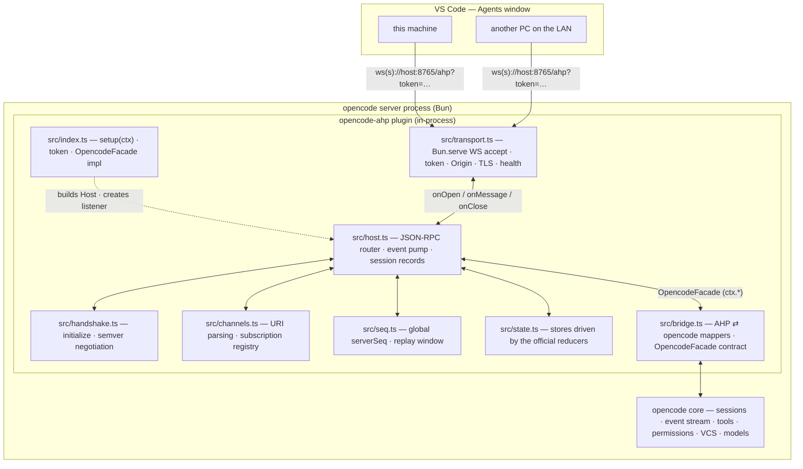
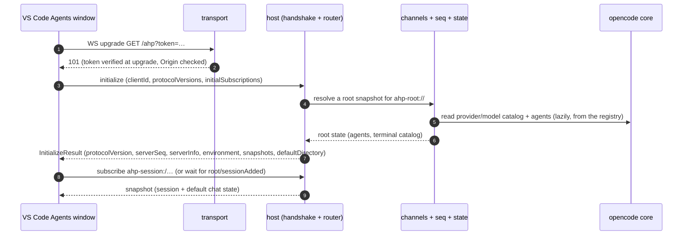
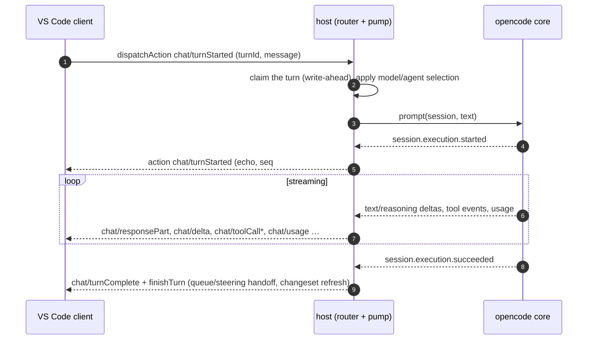
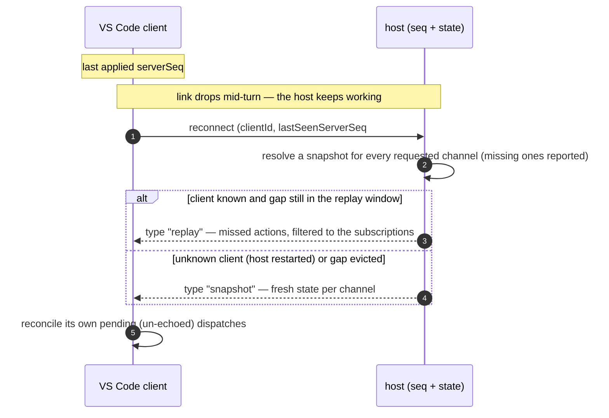

# Design

This document describes how `opencode-ahp` works **today**: its use cases,
architecture, lifecycle, protocol surface, and its error, recovery, and
persistence behavior. It reflects the current implementation in `src/`.

For how to run it, see the [README](../README.md); for testing (unit,
static, live verification, two-machine, and conformance), see
[`docs/testing.md`](testing.md).

## 1. Purpose

`opencode-ahp` is an **OpenCode v2 plugin** that hosts the
[Agent Host Protocol](https://github.com/microsoft/agent-host-protocol)
(**AHP 1.1.0**, strict-pinned to `@microsoft/agent-host-protocol@1.1.0`)
*in-process*, so that opencode appears as a **native agent** in the
**VS Code Agents window**.

AHP sits one layer above the Agent Client Protocol (ACP) — Microsoft's
summary: "a mutex over ACP". opencode speaks ACP natively
(`opencode acp`), which is why AHP⇄ACP gateway stopgaps work at all.
This plugin goes one level deeper: it hosts AHP directly in the opencode
server and skips the ACP subprocess hop entirely.

Use cases:

- **This machine** — point VS Code's Agents window at
  `ws://127.0.0.1:8765/ahp` and operate the local opencode server's
  sessions directly (create, list, chat, review diffs, run shell commands
  with rendered output).
- **Other machines on the LAN** — the same host, bound to a LAN
  address with a token, reachable from any PC on the network. VS Code
  ships the AHP client; **nothing is installed on the client machine**.
- **Off-LAN** — native `wss://` termination on the same listener (TLS
  key/cert in the options); the token and Origin policy are unchanged.

What the client gets in the Agents window:

- **Sessions** — `createSession`, a live session list (titles, statuses,
  chat catalogs), and state that survives reconnects via snapshots and
  replay.
- **Model picker** — the real opencode catalog (every provider/model the
  server exposes, including models from sync plugins).
- **Agent picker and session catalog** — opencode's user-invocable
  agents as AHP custom agents under a workspace directory node
  (subagent-mode agents are hidden, hidden agents are omitted), plus
  the session customization catalog ([§7.5](#75-session-customization-catalog)):
  a sibling skills directory node, top-level MCP server entries with
  their live status and a working enable toggle, and the session's
  `serverTools` (opencode's tool registry minus the client-contributed
  tools). In VS Code's
  Customizations panel — which merges host customizations with its own
  built-ins — the Agents / Skills / MCP Servers / Tools entries are
  opencode's live surface; any remaining built-in entries stay
  **display only** — they are never transmitted to the host, and the
  session's agent has no awareness of them (the sole client → agent
  capability channel is `activeClientSet`'s tools,
  [§10](#10-client-provided-tools)).
- **Chat** — streaming text + reasoning, the full tool-call lifecycle,
  permission prompts, steering/queueing, and usage totals.
- **Client tools** — a client can register tools per session; the model
  calls them directly and execution is delegated back to the owning
  client.
- **Multi-chat** — a session hosts additional chats; each chat runs
  against its own opencode backend session with fully isolated turns.
- **Changesets** — per-chat and per-session diff channels
  (uncommitted / session / per-turn) with a `discard-changes` operation.
- **Terminals** — read-only `ahp-terminal:` channels rendered from
  `shell`-tool command executions (not ptys).

The design constraints that shape everything below:

- The solution lives entirely inside the opencode **plugin `setup(ctx)`
  interface**: one package, one extra port, no sidecar process, no
  upstream opencode changes.
- The **opencode server must stay up no matter what** the plugin does
  ("R2"): every failure path logs and degrades, never throws out of
  `setup`, never takes the listener or the server down.
- **A token is always enforced** on the AHP listener, loopback or not; a
  non-loopback bind additionally refuses to start without one.

## 2. Architecture

### 2.1 Runtime model

A single npm package with **no build step**: `package.json` `exports`
point at `./src/index.ts` and opencode (a Bun runtime) loads the
TypeScript source directly. The package ships `src/` (minus `src/test/`).

Only **`src/index.ts` touches the plugin context `ctx`**. Everything else
is a pure module or a class with its dependencies (timers, sockets,
session access, logging) injected — so the whole protocol layer is
unit-tested with Vitest without an opencode runtime, network, or
filesystem. `src/index.ts` adapts `ctx` to a narrow
`OpencodeFacade` interface (defined in `bridge.ts`) and injects it into
the `Host`.



### 2.2 Module responsibilities

| Module | Role |
| --- | --- |
| `src/index.ts` | Plugin entry (`Plugin.define({ id: "opencode-ahp", setup })`). Resolves options, ensures the token, constructs the `Host` + transport, starts the event pump, registers client tools on the opencode tool registry (`ctx.tool.transform` + `ctx.tool.reload`), and returns the location-teardown cleanup. The only `ctx` call site; implements `OpencodeFacade` (including the git-backed changeset helpers, since the plugin surface has no HEAD-read or single-file-discard API). |
| `src/transport.ts` | Pure policy functions (loopback check, token extraction/comparison, Origin policy, path routing) plus a thin `Bun.serve` listener implementing the `Listener` interface. Auth happens at the WebSocket **upgrade**. |
| `src/handshake.ts` | The `initialize` command: validation and semver capability negotiation via the official package's `negotiateProtocolVersion`. |
| `src/host.ts` | The `Host` class — the JSON-RPC 2.0 router that ties transport, handshake, channels, sequencer, state stores, and the facade together: command handling, client-action dispatch, session/chat records, the opencode event pump, changesets, synthetic terminals, and client-tool routing. |
| `src/channels.ts` | Channel URI parsing/formatting (`ahp-root://`, `ahp-session:/`, `ahp-chat:/`, `ahp-terminal:/`, `…/changeset/…`, plus the non-standard legacy session form `<scheme>:/<suffix>` — `isSessionChannel`) and the `ChannelRegistry` (per-socket subscriptions, live session ids, live session-channel URIs, live terminal URIs). |
| `src/seq.ts` | The `Sequencer`: a single **host-wide** monotonic `serverSeq` (AHP numbers all channels on one sequence) with a bounded replay window. |
| `src/state.ts` | Channel state stores. Every store simply applies the **official reducers** from `@microsoft/agent-host-protocol` (`rootReducer`, `sessionReducer`, `chatReducer`, `changesetReducer`, `terminalReducer`) — the host never hand-rolls a state transition. |
| `src/bridge.ts` | The opencode-aware mapping layer: the `OpencodeFacade` contract, `mapV2Event` (raw v2 event → narrow `FacadeEvent` union), catalog/summary/changeset builders, the session customization catalog mappers ([§7.5](#75-session-customization-catalog): the skill-directory container, MCP server state, and `serverTools`), and the content-ref URI helpers (`file://`, `ahp-content://head/…`, `ahp-content://snap/…`). |
| `src/client-tools.ts` | Pure helpers for client-provided tools: wire validation of `ToolDefinition`s, the cross-session tool union, and per-session provider lookup. |
| `src/options.ts` | Option validation + resolution (ctx options ▸ `options.jsonc` sibling ▸ built-ins) and a dependency-free JSONC stripper. |
| `src/path-policy.ts` | The directory allowlist ([§3.3](#33-directory-allowlist-allowedworkingdirectories)): the pure `PathPolicy` decision (prefix/inside match over the symlink-resolved target) with the filesystem half injected, plus prefix lexical normalization. |
| `src/error.ts` | `errorMessage` normalizer. |
| `src/test/*` | Vitest suites for the pure modules (`state.ts` and `error.ts` covered indirectly through the host suites), including a captured-turn fixture replayed through the real AHP reducers. |

### 2.3 Location lifecycle

opencode v2 is **per-location**: a location (a project directory) boots on
first use and is idle-evicted after
`experimental.location_idle_timeout` (default 60 minutes). The plugin
lives and dies with its location:

```text
location boots → setup(ctx)
  1. resolve options; enabled: false → fully inert (no listener)
  2. token: explicit option, else persisted (generated once)
  2b. directory allowlist (optional): resolve the prefixes
      (a misconfigured list fails closed — AHP off)
  3. build Host (facade injected) + createListener (TLS material read)
  4. host.startEventPump()
  → logs the listening URL
location tears down → cleanup()
  → kill the pty terminals (final terminal/exited),
    stop the pump (aborts the event subscription),
    stop the listener (drops every client connection); logged
```

Steps 2–4 each have a failure path that logs and leaves the opencode
server running without AHP (see [§14](#14-error-handling--graceful-degradation)).
The idle sweep itself cannot be stopped from a plugin
([§15.3](#153-location-idle-timeout)) —
`experimental.location_idle_timeout: false` in the project config is
mandatory for an indefinitely-loaded AHP location.

## 3. Transport & security

`transport.ts` runs one `Bun.serve` HTTP+WS server on `host:port`.

### 3.1 The listener

- **`path`** (default `/ahp`) — the AHP WebSocket endpoint.
- **`healthPath`** (default `/healthz`) — plain HTTP `ok`, no auth.
- Any other path → 404.
- **TLS**: with `tls: { keyPath, certPath }`, the entry point reads the
  PEM files and hands their *contents* to `Bun.serve`, giving native
  `wss://` termination on the same port (the port becomes TLS-only; the
  health endpoint is then HTTPS). The transport itself stays
  filesystem-free.

The listener is behind a `Listener` interface (`port`, `sendTo`,
`closeConnection`, `stop`), so the protocol layer never sees Bun types;
a `ws`-package fallback could be dropped in if the plugin context ever
forbids raw listeners.

### 3.2 Authentication

**Authentication is at the WebSocket upgrade**, before any socket exists
(AHP transport spec): a missing or invalid token, or a disallowed Origin,
gets an HTTP 401/403 and never a connection. The presented token is taken
from the `?token=` query parameter first, then
`Authorization: Bearer <token>`, and compared in constant time.

- **Token always required.** There is no no-token mode. A non-loopback
  bind additionally **refuses to start** without a token (the listener
  throws, which takes the [§14](#14-error-handling--graceful-degradation) degrade path).
- **Origin allowlist** (`allowedOrigins`, default `"*"`): a null Origin
  (non-browser clients — VS Code's own connection, CLI probes) always
  passes; a present Origin must be in the list unless `"*"`. This is
  defense-in-depth only — the token is the credential.

### 3.3 Directory allowlist (`allowedWorkingDirectories`)

An opt-in hardening above token auth: an array of absolute path prefixes
that bounds which paths a client may name on the host. Absent or empty
(the default) is unrestricted — the default posture matches the VS Code
reference agent host, which exposes the whole host filesystem to a
connected (i.e. authenticated) client.

**What it bounds, and what it does not.** The AHP token is a full client
credential, so the allowlist is blast-radius scoping / defense-in-depth,
*not* a sandbox: the agent's `shell` tool is not directory-confined (its
`cwd` only defaults to the session directory; a command may name any
absolute path, and the permission confirmation goes back to the same
token-holder who approves it). What it stops concretely: whole-filesystem
enumeration and metadata via `resourceList`/`resourceResolve`, arbitrary
`resourceMkdir`, agent locations rooted outside the intended trees
(opencode confines the agent's file tools, changeset scope, and terminal
`cwd` to the location, so scoping the location scopes the agent's file
access), and a leaked token pointed at other homes or `/etc`. Genuine
sandboxing (a dedicated OS user, a container) remains an operational
concern — the [multi-tenant / sandboxing non-goal](futures.md#5-deferred-v1-non-goals)
stands.

**Semantics.** A client-named path is permitted when its
symlink-resolved form is a prefix of, or strictly inside, one of the
prefixes. The prefixes are lexically normalized at setup and, when they
exist, realpath'd (a symlink prefix covers its target); prefixes that do
not exist yet stay lexical (a `resourceMkdir` may create one). The target
is resolved the same way: the existing prefix portion is canonicalized
(walk up to the deepest existing ancestor, realpath, re-append the
missing tail), so a symlink planted under an allowed prefix
(`/tmp/link → /etc`) resolves outside the list and is denied.
When the resolved form cannot be determined (the resolution throws —
e.g. EACCES on an existing ancestor) the decision defers: the policy
allows, and the underlying operation's own errno error is what the client
sees — fail-closed only on a positive determination.

**Misconfiguration fails closed.** A non-absolute entry, or an
existing-but-undecidable prefix (realpath throws non-ENOENT), is a
configuration error: the entry point logs and takes the [§14](#14-error-handling--graceful-degradation)
degrade path (AHP off, opencode keeps serving) — never silent-unrestricted.

**Gated surfaces.** `createSession`'s `workingDirectories` first entry
(when present — a session without it runs in the plugin's own location,
which is not gated) and the three unconfined `resource*` commands
([§6](#6-command-surface)). Not gated: `resourceRead` (already
per-session-confined to the location directory and the live sessions' own
working directories), `createTerminal` (its `cwd` clamps into the
location directory or a live session's own working directory — itself
allowlist-gated at session creation — so it is transitively gated), and
the plugin's
own location. A denial answers `-32009` (AHP PermissionDenied) with a
flat message identical for every denied path — no existence oracle —
`path is not permitted by host policy` (resource commands) /
`working directory is not permitted by host policy` (`createSession`);
the full detail goes to the server log.

## 4. Connection model & handshake

The connection contract (AHP lifecycle):

- The **first request** on a socket is `initialize` (new client) or
  `reconnect` (known client). `ping` is answered even before
  initialize; any other pre-handshake request gets `-32600`
  (notifications are logged and dropped).
- `initialize` targets `ahp-root://`, carries `clientId` and
  `protocolVersions` (a non-empty semver array). The server picks the
  highest offered version inside its supported baselines and echoes that
  exact string back (the pinned 1.1.0 package supports the 1.0.0 and
  0.9.0 baselines, so any 1.x or 0.9.x offer is accepted). 1.x is
  additive-optional over the 1.0 wire, so an offer newer than the 1.1.0
  the host implements still negotiates — and its new surface is answered
  permissively (unknown params ignored, unsupported actions echoed).
  Anything outside the baselines is rejected with `-32005` and
  `data.supportedVersions`.
- The `initialize` result carries `protocolVersion`, the current global
  `serverSeq`, `serverInfo` (`name: "opencode-ahp"`, `version` read from
  `package.json` at runtime, `title: "OpenCode"`), `environment`
  (`pathStyle` — the host's native path grammar, platform-detected at
  setup; clients format and parse native paths with it instead of
  inferring from their own environment), snapshots for
  `initialSubscriptions` (unresolvable channels are simply omitted), and
  `defaultDirectory` (the location directory as a `file://` URI). VS Code
  uses its scheme to decide which workspace folders the host can address;
  a raw filesystem path can cause the editor to drop the selected folder.
- The host's `subscribe` and `reconnect` handlers read only the fields
  they use and ignore the rest — VS Code 1.148.0 adds optional
  `flowControl.receive` to non-root `subscribe` and `windows` to
  `reconnect`, and the host never returns a `flowControl` result, so
  such clients fall back to ordinary delivery.
- A 1.148.0 client with the non-default
  `chat.agentHost.multipleChatProviders.enabled` setting offers its
  vendored dev protocol version first (`1.2.0` in 1.148.0 — echoed, 1.x
  being caret-compatible with the 1.0.0 baseline) and signals the
  setting in `initialize`'s `_meta['vscode.multipleChatProviders']`.
  The host ignores unknown `_meta` keys and never advertises the
  `multipleChatProviders` capability; the client's re-initialize gate
  engages only when the host's own root config mirrors
  `multipleChatProviders.enabled: true` without the capability (the
  client never dispatches that key itself, and the host's root state
  never does), so nothing re-initializes and the connection stays up.
- The host keeps a **per-`clientId` registry across sockets**, so a
  dropped client can `reconnect` on a new socket.
- **Supersession**: a new `initialize` from a clientId whose old socket is
  still open closes the old socket (WebSocket code 4000,
  "superseded by a newer connection").
- **`serverSeq` is a single host-wide sequence** across all channels —
  snapshots carry `fromSeq` = the current global seq, and replay is a
  global range (see [§5.2](#52-sequencer--replay)).
- `dispatchAction` and `unsubscribe` are **notifications** (no `id`);
  their "response" is the `action` notification stream itself
  (write-ahead reconciliation, [§9](#9-client-dispatchable-actions)).



On **socket close** the host: drops the client's subscriptions, releases
the socket's slot in the clientId registry, and **evicts the client's
active-client role from every session it holds** (see [§10.4](#104-disconnection-eviction)) — the
official client re-dispatches `activeClientSet` on re-subscribe, so the
eviction is safe.

## 5. Channels & state

### 5.1 Channel kinds

| Kind | URI shape | Notes |
| --- | --- | --- |
| root | `ahp-root://` | One per host. Catalog of agents, active-session count, terminal list, session add/remove/summary notifications. |
| session | `ahp-session:/<suffix>`, or a non-standard `<scheme>:/<suffix>` (client legacy addressing — [§6](#6-command-surface)) | One per AHP session. The suffix is opaque and client-chosen; opencode session ids (`ses…`) double as suffixes for externally created sessions. Suffixes containing `/changeset/` are rejected (they would collide with changeset URIs). A legacy-form channel is echoed back verbatim and stays subscribable through the registry's live session-channel set. |
| chat | `ahp-chat:/<suffix>` | One per chat. The default chat reuses the session's opencode id as its suffix (zero wire change for single-chat clients); peer chats carry client-chosen suffixes. |
| changeset | `<owner>/changeset/uncommitted` · `<owner>/changeset/session` · `<owner>/changeset/turn/<turnId>` | Owner is a session channel (session kind) or a chat channel (uncommitted, turn kinds). See [§11](#11-changesets). |
| terminal | `ahp-terminal:/<toolCallId>` | Synthetic: one per foreground `shell`-tool call. Suffix is the opencode tool-call id (globally unique per invocation). See [§12](#12-terminals). |
| terminal (pty) | client-chosen URI (any scheme outside the `ahp-` namespace) | Interactive pty shells created via `createTerminal` — VS Code uses `agenthost-terminal://<uuid>`. The URI is opaque to the host; it classifies "terminal" only while the record is live. See [§12](#12-terminals). |

The `ChannelRegistry` tracks which sockets are subscribed to which
channel (broadcast targets), the set of live session ids (a session/chat
channel is subscribable only while its session is registered), the set
of live session-channel URIs (the non-standard legacy form classifies
"unknown" by prefix and resolves only through this set), and the set of
live terminal URIs — synthetic `ahp-terminal:` channels **and**
client-chosen pty channels. The host adds/removes the session-channel
and terminal sets in step with their record maps and keeps them
disjoint (a live session channel cannot become a pty terminal, and
vice versa — the two resource types share the `<scheme>:/` URI shape),
so a torn-down URI is unsubscribable again.

### 5.2 Sequencer & replay

`Sequencer` assigns the next global `serverSeq` to every published
action envelope (`{ channel, action, serverSeq, origin?, rejectionReason? }`)
and retains the last `replayWindow` envelopes (default 1000). Snapshots
carry `fromSeq` = the current global seq. On reconnect, the host replays
the global range `serverSeq > lastSeenServerSeq` **filtered to the
client's subscriptions** when the client is known and the gap is still in
the window; otherwise the client receives fresh per-channel snapshots
([§13.1](#131-reconnect-replay-or-snapshot)).

### 5.3 State stores & the publish path

Every channel's state is a store driven by the **official AHP reducers**
(`state.ts`). The host's single publish path (`Host.publish`) does:

1. stamp the action with the next global `serverSeq` and retain it;
2. for accepted actions, apply it to the right store (root / session /
   chat / changeset / terminal); rejected actions are retained and
   notified but not applied;
3. after a chat action, sync the chat's summary into the session store's
   chat catalog (`session/chatUpdated`), and if the denormalized session
   summary changed, announce it on the root channel
   (`root/sessionSummaryChanged` — an ephemeral **notification**, not
   replayed; only `root/activeSessionsChanged` is a sequenced action);
4. send the envelope as an `action` notification to every socket
   subscribed to the channel.

Root-level `root/sessionAdded` and `root/sessionRemoved` are
notifications too — the root snapshot (or a re-list via `listSessions`)
is the authoritative view.

**Snapshots** are computed on demand:

- session/chat channels — the official-reducer store state;
- changeset channels — the store state; a first subscribe (or a failed
  computation) triggers the computation, later subscribes return the
  last completed state;
- terminal channels — the store state (null once the record is torn down);
- root — re-derived from the facade on every call (the catalog read
  reflects every registration so far).

Catalog models with variants advertise `SessionModelInfo.configSchema` with
a `reasoningEffort` choice. Its values are the OpenCode variant IDs in
catalog order, plus an empty string labelled **Default**. Models without
variants omit the schema. This is model configuration, not session creation
configuration: VS Code sends the choice in `message.model.config` when it
starts a turn. The host passes the selected ID as `Model.Ref.variant` when
it switches the OpenCode session's model before sending the prompt. A
missing or empty choice selects the base model without a variant. The same
mapping applies to `createChat.initialMessage`.

## 6. Command surface

Requests (methods with an `id`) routed by the host:

| Command | Result / behavior |
| --- | --- |
| `ping` | `null`; answered even pre-handshake. |
| `initialize` | See [§4](#4-connection-model--handshake). |
| `reconnect` | `ReconnectResult`: `{ type: "replay", actions, missing }` or `{ type: "snapshot", snapshots }`. Must target `ahp-root://`. |
| `subscribe` | `{ snapshot }` when the channel is resolvable, else `{}`. Unknown URIs, dead sessions, or gone terminals get errors (`-32602`, `-32001`, `-32008`). |
| `unsubscribe` | Notification. Drops the socket's subscription. |
| `dispatchAction` | Notification. See [§9](#9-client-dispatchable-actions). |
| `listSessions` | All opencode sessions, most-recently-modified first, in-memory cursor pagination (`limit` default 100, `cursor` = offset). Unknown sessions are **lazily registered** (idempotent per opencode id) so their channels become subscribable. |
| `resolveSessionConfig` | An honest empty schema (`{ type: "object", properties: {} }`, `values: {}`) — opencode collects no session-creation configuration; agent/model choice rides session customizations and the per-turn message. `provider`/`workingDirectory`/`config` params are accepted and ignored. VS Code calls this strictly before the first send of a new session, so an unimplemented host makes every fresh session unstartable. |
| `createSession` | `null`. Creates a real opencode session (provider/model resolved from the catalog; `activeClient` eagerly claims an active-client role and must match the creating client). The client-chosen `channel` is accepted in the standard `ahp-session:/<suffix>` form or the non-standard `<scheme>:/<suffix>` form — client legacy addressing: VS Code mints `<provider>:/<uuid>` when its `initialize` result is not yet available at draft-creation time (its `isNativeAgentHost`/`vscode.ahpSessionUris` capability checks never fire without one, and we send no `_meta` to influence them), and the AHP reference client creates sessions the same way — and is echoed back verbatim; the channel stays subscribable through the registry's live session-channel set. A channel that is a live pty terminal channel is refused (the two resource sets must stay disjoint). The first `workingDirectories` entry (an absolute `file://` URI; a trailing slash is stripped) targets that directory's location — the session's working directory, see [§7.3](#73-workspace-workingdirectories); absent, the session runs in the plugin's own location. Extras are ignored (no `multipleWorkingDirectories` capability). Publishes the session-channel lifecycle (`session/ready`, `session/chatAdded`, `session/defaultChatChanged`, changeset catalogues), the root count action, and the `root/sessionAdded` notification. Errors: `-32602` (a channel that is not a session URI — rejected channels are logged with the offending value — or a live terminal channel; malformed `workingDirectories` or `activeClient`), `-32009` (`workingDirectories` target outside the [`allowedWorkingDirectories` allowlist](#33-directory-allowlist-allowedworkingdirectories), before any backend work), `-32002` (no enabled provider for the requested provider), `-32003` (channel exists), `-32603` (backend session creation failed, e.g. the target location cannot be booted). |
| `disposeSession` | `null`. Disposes an AHP session **and every opencode backend behind it** — the default backend and each peer chat's backend (the spec's cascade "to every chat in the session's catalog"). The channel is accepted in the same standard/legacy forms `createSession` echoes back. The AHP-side unbind runs **first** (the same race guard as `disposeChat`): the racing `session.deleted` events from each backend removal must find the bindings already dropped. `root/sessionRemoved` (with the `root/activeSessionsChanged` count update) is published **before** the response, and the default backend removal is awaited, so a `listSessions` after it does not resurface anything. Errors: `-32602` (a channel that is not a session URI), `-32001` (an unknown channel — already disposed, or deleted in the TUI first). A failed default-backend removal still drops the AHP session (R2 — the lingering opencode session shows up in the TUI, and lazily in `listSessions`, until deleted there). VS Code 1.148.0 drives this: the Agents window's **Delete…** session action (chat-fragment resources route to `disposeChat` instead) and the untitled-draft disposal (a disposed chat model, a replaced provisional generation, or workbench shutdown — the draft's own chosen channel URI, which this host echoes back verbatim); the client sends a bare `{ channel }`, ignores the `null` result, updates the session list from `root/sessionRemoved`, and surfaces a failed delete as an error dialog that leaves the chat widget on the still-existing session. |
| `createChat` | `null`. Mints a fresh opencode session (same provider/model resolution) and binds it to the client-chosen chat URI (the owner must be a session channel under the `createSession` rule — standard or legacy form); publishes `session/chatAdded` (+ changeset catalogue) **before** responding — the client waits for that action and rolls back with `disposeChat`. `title` (AHP 1.1.0) seeds the chat's display title when present and non-empty; absent or empty falls back to the host-minted `Chat N`. An `initialMessage` starts the chat's first turn; any failure in that path rolls the whole chat back. `source` and `workingDirectories` are rejected (`-32602`) — fork/side-chat and multiple-working-directories capabilities are deliberately not advertised. |
| `disposeChat` | `null`. Removes a peer chat (never the default chat) and its opencode backend session; publishes `session/chatRemoved`. AHP-side unbind happens *before* the backend removal so the racing `session.deleted` event doesn't double-publish. |
| `resourceRead` | File content for the URIs this host advertises in changesets: `file://` (live disk, confined to the location directory or one of the live sessions' own working directories), `ahp-content://head/…` (content at git HEAD), `ahp-content://snap/…` (a turn's captured before/after). `encoding` is `base64` (default) or `utf-8`. Errors: `-32008` not found, `-32009` outside every session's working directory. |
| `resourceResolve` | Metadata for one filesystem `file://` URI: canonical URI (directories end in `/`), `type` (`file` / `directory` / `symlink`), `size`, ISO `mtime`/`ctime`, and a weak etag `W/"<size>-<mtimeMs>"`. `followSymlinks` defaults to true (realpath + stat); `false` lstats the path itself (a link reports as `symlink`). This is the existence check VS Code's remote folder picker runs before accepting a path. Errors: `-32008` not found, `-32009` permission denied, `-32602` not a file URI, `-32603` other. |
| `resourceList` | Immediate entries of a directory `file://` URI as `{ name, type: file \| directory }` — directories first, then by name. Symlinks are followed for the type (a link to a directory lists as a directory; a dangling link as a file). The target must exist and be a directory: errors `-32008` (missing), `-32602` (not a directory), `-32009` (inaccessible). This is what the folder picker navigates with. |
| `resourceMkdir` | Creates a directory with `mkdir -p` semantics (parents as needed; an existing directory is a no-op success); result `{}`. Errors: `-32010` the path exists as a non-directory, `-32009` permission denied, `-32602` not a file URI, `-32603` other. |
| `invokeChangesetOperation` | The only operation the host offers is `discard-changes` (resource-scoped), on a live changeset; it targets the changeset's owning session's directory. See [§11.4](#114-discard-changes). |
| `createTerminal` | `null`. Spawns an interactive pty shell (`spawnPty` seam — Bun in production) in the resolved working directory and registers the client-chosen channel. Params: `channel` (client-chosen; the host namespace — including the reserved `ahp-terminal:` prefix — and live session channels are refused, keeping the session and terminal resource sets disjoint), `claim` (a client claim for the dispatching client, or a session claim), `name?`, `cwd?`, `cols?`/`rows?` (defaults 80×24). The `cwd` accepts plain `file://` (what VS Code sends), the client's `vscode-agent-host:`/`agent-host:` wrapper, or a bare absolute path; anything malformed, and anything outside the confinement boundary (the claimed session's working directory, else — for a client-claimed terminal — the location directory or a live session's own directory containing the cwd; [§12.2](#122-pty-terminals-interactive-shells)), clamps to it. Errors: `-32601` (capability off, or the runtime cannot spawn ptys), `-32600` (host-namespace or live session-channel URI), `-32010` (AHP AlreadyExists — duplicate channel), `-32602` (malformed params), `-32603` (the spawn threw — logged, R2: the host survives). |
| `disposeTerminal` | `null`. Kills the pty (a still-running process gets a final `terminal/exited`), drops the record, and refreshes the catalog. Idempotent: an unknown channel answers `null` (VS Code's shutdown path disposes terminals that may already be gone). Synthetic (session-owned) terminals are host-managed: `-32009` (AHP PermissionDenied). Capability off: `-32601`; missing channel: `-32602`. |
| `setClientManagedSettingsPermissions` | Accepted and logged as a no-op — a VS Code-specific post-init notification with no AHP counterpart; the connection must stay up. |
| anything else | `-32601` for requests; unknown notifications are logged and dropped. |

The filesystem `resource*` commands (`resourceRead`, `resourceResolve`,
`resourceList`, `resourceMkdir`) are **not** location-confined: the AHP
surface is token-authenticated, and by default the client may name any
path it can resolve — matching the VS Code reference agent host, which
exposes the whole host filesystem to a connected (i.e. authenticated)
client. The optional `allowedWorkingDirectories` option
([§3.3](#33-directory-allowlist-allowedworkingdirectories)) scopes these
commands (and `createSession.workingDirectories`) to an allowlist of
path prefixes. Confinement applies to *session-scoped* surfaces instead: `resourceRead`
`file://` targets, HEAD content refs, changeset diffs, turn-snapshot
paths, and terminal `cwd` all stay inside the location directory or the
owning session's own working directory ([§7.3](#73-workspace-workingdirectories)).
The facade surfaces Node `ErrnoException`s and the host maps the `code`
to the AHP error codes (ENOENT → `-32008`, EACCES/EPERM → `-32009`,
ENOTDIR → `-32602`, EEXIST → `-32010`, other → `-32603`).

JSON-RPC plumbing: malformed JSON → `-32700`; not a 2.0 request object →
`-32600`; an unhandled router error → `-32603` (logged) — a bad frame
never takes the host down.

## 7. Sessions & chats

### 7.1 The mapping

**One AHP session = one record holding a chat catalog; one AHP chat = one
opencode session.** Concretely, the host keeps:

- `SessionRecord` — the default chat's opencode id (`sessionID`, also the
  event-pump join key for the default chat), the session channel, the
  session-state store, the chat map, the `defaultChatURI`, and the
  session-kind changeset store.
- `ChatRuntime` — one per chat: its URI, its opencode session id, its
  chat-state store, and all the per-turn join state the event pump needs
  (current turn id, part/tool tracking, permission mapping, client-tool
  invocations, turn snapshots).
- `byOpencode` — opencode session id → `{ record, chat }`, the event
  pump's join key: every chat has its **own** backend session, so an
  opencode event must land on the owning chat, not just the record.

The default chat's channel suffix **is** the record's opencode id, so
single-chat clients see the plain `ahp-session:/<ses…>` /
`ahp-chat:/<ses…>` pair with zero indirection. Peer chats
(`createChat`) get client-chosen chat URIs backed by freshly minted
opencode sessions, which are marked (see [§15](#15-persistence--durability)) so they re-attach to their
owner after a restart instead of resurfacing as standalone sessions.
Peer-chat backends are real opencode sessions and therefore appear in
opencode's own UI (TUI) as ordinary sessions.

### 7.2 External sessions

Sessions the host did not create (TUI, another client, or sessions
resurfacing after a location reload) become AHP sessions in two ways:

1. **`session.created` event** — handled by the pump with a 250 ms grace
   (`EXTERNAL_REGISTER_GRACE_MS`): a concurrent `createSession` may still
   be resolving for the same opencode session under a client-chosen
   channel; if the slow path wins, `handleCreateSession` heals it by
   dropping the interim record and re-registering under the client's
   channel.
2. **`listSessions`** — every listed opencode session is lazily
   registered (idempotent), which is how sessions survive a restart.

A subagent child never becomes an AHP session, on either path. Opencode
core creates a subagent child with a `parentID` pointing at the caller's
session, and the host skips parented sessions: the pump drops a
`session.created` carrying a `parentID` before the grace deferral, and
`registerExternal` — the single seam behind both paths — returns without
registering, so a child gets no record, no channel, and no root
announcement. This mirrors opencode's own TUI, whose session list
filters on `parentID`. Forks are not children — a fork records its
origin in a `fork` field and carries no `parentID` — and register
normally.

Registration honors the durable **AHP markers** in opencode session
metadata ([§15.2](#152-session-metadata-markers)):

- peer-chat marker `{ chat, owner }` → re-attach to the owner's chat
  catalog at the original chat URI (no standalone session; the chat uses
  its backend's saved title);
- channel marker `{ channel }` → standalone session resurfacing under the
  original client-chosen session channel;
- no marker (or an unresolvable one) → standalone session whose channel
  reuses the opencode id.

A peer whose owner is not registered yet is queued; the queue drains when
the owner registers, or — if the owner has vanished from opencode after
the grace window — the peer falls back to standalone registration (the
data stays reachable). A standalone registration also picks up the
session customization catalog ([§7.5](#75-session-customization-catalog))
as a fire-and-forget pair of change actions after the root
announcement — this path is synchronous and cannot await the facade.

### 7.3 Workspace (`workingDirectories`)

Every session the host publishes carries
`workingDirectories: [directoryUri(directory)]` — on the
`SessionState` (session-channel snapshot, via `initialSessionState`) and
on every `SessionSummary` (root `sessionAdded` / `sessionSummaryChanged`
notifications and `listSessions`, via `sessionSummary`). The `directory`
is the session's own working directory: the directory its agent has tool
access to, and the same directory the agent-directory customization
points at. It is the `workingDirectories` first entry of a
`createSession`, the session's opencode location for externally
registered sessions, and the location directory for sessions without
either (records keep it as `SessionRecord.directory`; `undefined` = the
location).

`createSession` accepts the AHP `workingDirectories` param (AHP:
a client MUST NOT supply more than one entry unless the agent
advertises `multipleWorkingDirectories`, which this host does not): the
first entry must be a non-empty absolute `file://` URI — a trailing
slash, which RFC 8089 directory URIs may carry, is stripped, and a
non-array or empty list, an empty entry, a non-file URI, or a relative
path is `-32602`. Only the first entry is honored (extras are logged and
ignored). When the `allowedWorkingDirectories` allowlist is active
([§3.3](#33-directory-allowlist-allowedworkingdirectories)), a target
outside the prefixes answers `-32009` before any backend work. The
backend session is created with
`location: { directory }`, which makes opencode boot that directory's
location on first use — a directory that does not exist fails there, and
the createSession call answers `-32603` with the boot error. Sessions
without the param run in the plugin's own location (opencode fills the
location in). The host advertises no `multipleWorkingDirectories`
capability, so clients MUST NOT mutate the set (AHP working-directory
actions are unusable).

Externally registered sessions ([§7.2](#72-external-sessions)) take
their directory from opencode's `SessionInfo.location`, so a
cross-location session (created with `workingDirectories`, or created
elsewhere in another location) advertises the directory it was created
in and its session-scoped surfaces (changesets, snapshot paths, terminal
`cwd`) are confined to it. Peer-chat backends run in the owner's
location — a working-directories session's chats are not forked into the
plugin's own location. Cross-location sessions are fully live-verified
against the test server: opencode boots the target location
on the first `createSession`, the plugin's event pump sees its session
events, and `session.list`/`get` are app-level.

**Why the field is required for a usable session list (VS Code 1.148):**
the Sessions view groups sessions into workspace sections; a
session's workspace label comes from its AHP metadata —
`buildAgentHostSessionWorkspace` (vscode
`src/vs/workbench/contrib/sessions/common/agentHostSessionWorkspace.ts`)
labels the session with `SessionState.project.displayName` when a project
is present, else with the first `workingDirectories` entry (the remote
provider maps the host's `file://` URI to `agent-host://<host>/<path>` and
suffixes the label with the host name, e.g. `test-project [host.lan]`).
When **neither** field is present the workspace is undefined and the
session renders under the **"Unknown"** fallback
(`sessionsList.ts` → `sessionWorkspaceLabel`). Copilot quick chats are
unaffected: they carry a client-side quick-chat flag that routes them into
the dedicated **"Chats"** section regardless of workspace. The host
publishes `workingDirectories` rather than `project` because a location
directory is not necessarily a repository — `project` would mark the
workspace `isRepository: true` and hand it the repo icon, a false claim.

### 7.4 Session-summary status aggregation

`SessionSummary.status` — the status the session list renders ("Working…",
input-needed badge, error) — is **aggregated by the host** in
`sessionSummary()` via `sessionSummaryStatus` (bridge.ts), per the AHP
`SessionSummary` aggregation rule:

- the **activity bits** (0–4: `Idle`/`Error`/`InProgress`/`InputNeeded`)
  come from the **default chat**, else the most recently modified chat;
- they are **promoted** to `InputNeeded` whenever *any* chat is blocked on
  input, else to `Error` whenever any chat is in an error state
  (`InputNeeded` wins over `Error` — the user can unblock, the error
  cannot);
- the orthogonal flags (`IsRead`/`IsArchived`) stay **session-scoped** and
  are preserved from the session store's status.

The activity bits are deliberately **not** read from the session store:
the official session reducer reaches them only through the input-queue
path (`withInputNeededStatus` — promote: `(status & ~31) | InputNeeded`;
drain: clears only bit 16, leaving `InProgress`), and no reducer action
exists to lower the activity back to `Idle` when a turn ends. The reducer's
"an unblocked turn falls back to `InProgress`" assumes the session was
promoted to `InProgress` when the turn started — which it is not; only the
**chat** is (the chat reducer self-maintains its status correctly across
turn start/end). The session store's own `status` therefore keeps the
reducer's residue and is authoritative only for the flags. The chat
summaries (synced via `session/chatUpdated`) are the activity source of
truth.

Reading the store instead would mis-track in both directions: a plain
streaming turn never lifts the store's activity out of `Idle`, so the
list would stay idle while the chat is working, and any turn containing a
user-blocking input round trip would stick it in "Working…" forever —
`permission.asked` promotes the store to `InputNeeded|IsRead` (56), the
client's answer drains the queue to `InProgress|IsRead` (40), and the
turn's end (denied tool → `execution.interrupted` → `chat/turnCancelled`)
clears only the **chat**'s status. Aggregating from the chats instead
gives the list "Working…" for the duration of any turn (including plain
streaming turns, which are otherwise invisible at the session level) and
idle again when the turn ends, regardless of input round trips.

### 7.5 Session customization catalog

The session state publishes opencode's own customization surface beyond
the agent directory container: skills, MCP servers, and the session's
`serverTools`. This feeds the Skills / MCP Servers / Tools entries of
VS Code's Customizations panel, which merges the host's session
customizations with its own built-ins ([§1](#1-purpose)). The catalog is
a **snapshot per registration**, not a live view: the host reads the
plugin's own location at the moment the session registers.

**Snapshot points.** `createSession` awaits the facade lists before it
builds the session store, so the catalog is part of the initial state
and the first snapshot a subscriber receives. External registration
([§7.2](#72-external-sessions)) is a synchronous path that cannot await
the facade: the session registers and the root announcement go out
first, and the catalog lands after as a fire-and-forget pair of change
actions — `session/customizationsChanged` and `session/serverToolsChanged`
(both full replacements) — published against the live store. A client
that subscribes in the window holds a snapshot without the catalog and
receives the change actions; the store converges either way, and the
pair is skipped when the record is gone by the time the snapshot
resolves.

**The directory.** The catalog anchors on the session's working
directory — its own `workingDirectories` directory when it has one, else
the location directory — and every entry carries that directory's
`file://` URI. When no directory is available at all (the options
provide none and neither does the session), the catalog degrades to
absent — the legacy agents-only behavior.

**The containers.** A `DirectoryCustomization` holds one child type
(`contents` is singular), so the directory appears as two sibling
containers over the same URI:

- `opencode:directory:<dir>` — `contents: agent`, the existing
  agent-directory container ([§7.1](#71-the-mapping)), present only when
  at least one non-hidden agent exists;
- `opencode:directory:<dir>:skills` — `contents: skill`, the sibling
  carrying `SkillCustomization` children: `id` = `uri` = the skill's
  `path` (a filesystem path becomes a `file://` URI; the virtual
  `skill://…` paths the built-in skills use pass through unchanged),
  and `autoinvoke: false` maps to `disableModelInvocation: true` (the
  user can select the skill; the model must not invoke it).

MCP servers are **top-level** `McpServerCustomization` entries — the
protocol's slot for a "globally-configured MCP server that isn't
bundled in a plugin or directory": `id` = `opencode:mcp/<name>`, `uri`
= the session's directory URI (the closest provenance the status list
carries — the server is configured for that directory's location), and
`name` = the configured display title when there is one, else the
config name. A server whose status is `disabled` additionally carries
a single Workspace `enablement` entry with `enabled: false` (file- or
toggle-disabled — the status list does not distinguish them); an
enabled server omits the field, since the panel's effective-enabled
value is `enablement[0].enabled ?? true` and an absent field means
enabled by default.

**Provenance limit.** The directory URI says *where the server is in
effect*, not what defines it: opencode's plugin surface carries no
per-server configuration provenance — the MCP status list is name,
title, and status only — so the host has no defining file URI to
publish. The consequence lands on client actions that treat an entry's
`uri` as a file: VS Code's Customizations "Edit Configuration" opens
the URI through the client's own file service, so from a remote client
it reads a host-machine path that does not exist on the client (the
panel reports a file-read error for the test server's `/tmp/…`
directory URI), and even a same-machine read
would fail, since the URI names a directory, not a file. Per-server
configuration provenance (a file URI with a range into the defining
config) is an opencode upstream request (futures.md §4.1).

**MCP state mapping.** opencode's live `Mcp.Status` maps to the AHP
`McpServerState` as: `connected` → `ready`, `pending` → `starting`,
`disabled` → `stopped`, `failed` → `error` (`errorType: "mcp.failed"`,
the status's message). `needs_auth` also degrades to `error`
(`errorType: "mcp.auth-required"`): the AHP `auth-required` state
requires the RFC 9728 `ProtectedResourceMetadata` — an https `resource`
URI — which opencode's status does not carry (message only), so the
host reports an error rather than inventing a resource identifier.

**Toggling.** The panel's enable toggle
(`session/customizationToggled` on an `opencode:mcp/<name>` id) and
the dedicated `session/mcpServerStartRequested` /
`session/mcpServerStopRequested` control actions are honored for MCP
servers, and all three map to one mechanism: opencode's `disabled`
config flag. The plugin layers its decisions over the file config
through a single `ctx.mcp.transform` registration — the same
rebuild-then-reload pattern as the client tools
([§10.1](#101-registration-into-opencode)) — and then `ctx.mcp.reload()`,
which awaits the full MCP re-reconcile: a disable disposes the
connection and settles status `disabled`; a re-enable starts the
connection and resolves only once its new status has settled. The host
then echoes the action and re-snapshots the catalog, re-pushing it
(full replacements) to **every** live session — the toggled server's
tools leave the registry, so its `serverTools` entry goes too, and
each session's entry converges on the new `state` and `enablement`.
Decisions are **location-runtime only**: the config file is never
written and a restart or location reload drops them. The decisions are
a name → flag map rather than a set, so a file-`disabled` server can
be explicitly re-enabled at runtime (and a runtime disable overrides
a file enable). `session/mcpServerBackgroundRequested` stays rejected
— there is no blocking-start concept on the plugin side — and every
non-MCP customization (agents, skills, directories) is rejected with
a static-definition reason: they are file/config definitions opencode
cannot disable, so the write-ahead client rolls the toggle back.

**`serverTools`.** The session's `serverTools` is the opencode tool
registry (`ctx.tool.list()` — built-in, MCP-contributed, and
plugin-registered tools, keyed by effective name) mapped to AHP
`ToolDefinition`s, minus the client-contributed tool names. Client
tools register into the same location-global opencode tool registry
([§10](#10-client-provided-tools)), so they would otherwise echo back
as server tools; the exclusion set is the cross-session union of every
live session's active-client tools, and `createSession` additionally
seeds it with the creating session's own `activeClient` tools — its
record does not exist while the snapshot runs, so the union does not
carry them yet.

The `inputSchema` is shape-detected, with no schema-compiler dependency
(the bridge stays pure): a plain JSON-Schema object literal (`type:
"object"` with shape-valid `properties` / `required`) keeps those
fields, a Standard Schema v1 instance (branded symbol) or other opaque
object (an Effect codec) degrades to `{ type: "object" }` — the input
is always an object, but no JSON-Schema shape is extractable — and a
tool with no input omits the field.

**Not live (except the toggle).** The catalog is not re-pushed in
response to **opencode-side** changes during a session's lifetime.
opencode's MCP change events (`mcp.status.changed`,
`mcp.tools.changed`, `mcp.resources.changed`) carry only the server
name — no state payload — so a change event alone cannot update the
panel; acting on one would require re-snapshotting the list on every
event (and `mcp.tools.changed` is not on the public event stream a
plugin can observe, futures.md §1.6). The one live update is the MCP
toggle itself (**Toggling** above): the host re-pushes
deterministically after the re-reconcile it awaited in dispatch, not
from a change event. A mid-session change to the client-tool union is
likewise not re-pushed — v1 takes the per-registration snapshot for
both. The staleness is display-only — the session's behavior does not
depend on the snapshot — and the event-driven live re-push is the
residual (futures.md §1.6).

**Degradation.** Every list is an independent R2 seam: a facade failure
logs and degrades that one list to empty — the session is created or
registered either way — and the fire-and-forget pair is guarded the
same: an externally-registered session whose catalog snapshot fails
stays usable, just without its customization surface.

**Location scoping.** The facade lists read the host's own location, so
a cross-location session (created with `workingDirectories`, or created
elsewhere in another location) shows the host location's catalog — the
same provenance caveat as the agents. Live-verified against the test
server (`scripts/ahp-customizations.mjs`): the agent and
skill containers match the server's own `/api/agent` / `/api/skill`
(including the virtual-`skill://` built-ins), a connected MCP server
renders `ready` under its display title, `serverTools` is non-empty and
shaped (MCP-contributed tools included, no client-tool echo), and an
externally-created session converges on the catalog through the
change-action pair. The MCP toggle was live-verified with the same
script: disabling a connected server via
`session/customizationToggled` (accepted; the re-pushed entry is
`stopped` with the workspace disable `enablement`; `/api/mcp` reports
`disabled`), toggling the agent directory rejected with the
static-definition reason, and re-enabling via
`session/mcpServerStartRequested` (the entry `ready` again, `/api/mcp`
`connected`).

## 8. Turn lifecycle (event pump)

`Host.startEventPump()` runs a **single sequential async loop** over the
facade's mapped event stream (`ctx.event.subscribe` → `mapV2Event` →
`FacadeEvent`). Sequentiality is the core race-free design: event
handling and client-dispatch handling interleave on the same event loop
without locking on the per-turn join state. Every event is resolved
against the owning chat via `byOpencode`; events for sessions the host
doesn't know are ignored (only `session.created` registers).

A full turn driven by the client:



Event → action mapping (host side). The left column names the mapped
`FacadeEvent` types; on the raw opencode v2 wire the `execution.*`,
`step.*`, `text.*`, `reasoning.*`, `tool.*`, `usage.*`, and `inbox.*`
events additionally carry a `session.` prefix (e.g. wire
`session.execution.started`), while `session.created`/`session.deleted`/
`session.renamed` and `permission.asked`/`permission.replied` appear
exactly as written:

| opencode event | AHP effect |
| --- | --- |
| `session.created` | deferred external registration ([§7.2](#72-external-sessions)); a `parentID` in the event (a subagent child) skips it before the deferral. |
| `session.deleted` | default chat → the record is removed (the same teardown `disposeSession` runs, then the backend removals; peers' backends disposed, terminals torn down, client tools failed); peer chat → `session/chatRemoved` for that chat only. |
| `session.renamed` | Updates the affected chat through `session/chatUpdated`, and also the session title through `session/titleChanged` for the default chat. The session catalog supplies the title for list summaries and chat snapshots; turn-state updates do not overwrite it. |
| `execution.started` | if the turn is not already claimed (client write-ahead), start an **orphan turn** seeded with the last-seen inbox message (external TUI prompts); when that message is a subagent completion report, the seed carries the report text verbatim under a `systemNotification` origin instead of as user input. |
| `execution.succeeded` | `chat/turnComplete` (duration from the host clock) + `finishTurn`. |
| `execution.failed` | `chat/error` with the error part + `finishTurn`. |
| `execution.interrupted` | `chat/turnCancelled` + `finishTurn` — skipped when the client's own `chat/turnCancelled` echo already finalized the turn. |
| `step.started` | records the turn's model ref (`providerID/modelID`) for usage. |
| `text.delta` / `reasoning.delta` | first delta for a part lazily emits `chat/responsePart`; subsequent ones emit `chat/delta` / `chat/reasoning`. |
| `text.ended` / `reasoning.ended` | fallback for non-streaming providers: if no delta opened the part, emit it with the full text. |
| `tool.input.started` | `chat/toolCallStart` (with a `contributor` of kind *client* when one of the session's active clients provides the tool — [§10](#10-client-provided-tools)). |
| `tool.input.ended` | records the raw input; captures the **pre-edit file content** for changesets (the event fires before execution — the last safe point); opens the synthetic terminal for foreground shell calls ([§12.1](#121-synthetic-terminals-shell-tool-renderings)); for client-executed calls, clears the confirmation gate and raises a `toolClientExecution` input request on the session channel. |
| `tool.progress` | first sign the tool is running: `chat/toolCallReady` with `confirmed: "not-needed"` → status *running*. |
| `tool.success` / `tool.failed` | closes the synthetic terminal first (even after the turn was torn down); then `chat/toolCallComplete` with the result — suppressed when the call is already terminal (e.g. a client-executed call the client completed; the tracking, including the client-tool record, is still cleared). |
| `step.ended` | `chat/usage` for the latest model call, not the accumulated session total. Prompt tokens include cache reads/writes and completion tokens include reasoning. VS Code uses these fields for the current context window. |
| `permission.asked` (tool-sourced) | `chat/toolCallReady` *without* `confirmed` → status *pending-confirmation*, plus a `toolConfirmation` input request on the session channel (the in-window approval prompt). Non-tool permissions have no AHP counterpart and are logged. |
| `permission.replied` | safety net: removes the confirmation input request if the client's `chat/toolCallConfirmed` did not already. |
| `inbox.enqueued` / `inbox.delivered` | remembered on the chat; an enqueued synthetic item tagged `metadata.source: "subagent"` (a subagent completion report) is marked as such for the orphan-turn seeding; steering consumption happens at turn end. |

**Subagent completion reports drive orphan turns.** When a subagent
child goes idle, opencode admits its report to the parent's inbox as a
synthetic `steer` item (a `<subagent …>` text blob) tagged
`metadata.source: "subagent"` and wakes the parent. If the parent is
idle, the wake promotes the pending steer into a new execution — the
host sees `execution.started` with no write-ahead turn claimed and
starts the orphan turn above, seeding the turn message with the report
text verbatim under AHP's `systemNotification` message origin (the
kind for machine-generated input). The turn is not suppressed: the
parent model's response to the report must still reach the client, and
the terminal actions drop any turn whose id the host never claimed. If
the parent is mid-turn, the steer is consumed at a step boundary of the
running turn and no orphan turn starts.

`finishTurn` (after any turn terminal) clears the steering message the
turn consumed (`chat/pendingMessageRemoved`), auto-starts the next turn
from the queue (the queued prompt was already sent to opencode with
`delivery: "queue"` — opencode starts it itself; this only updates AHP
state), drops the ended turn's terminal rows from the root catalog, and
refreshes the chat's subscribed changesets (the "after" content is read
from disk here). The official reducer tracks both pending kinds in the
unified `queuedMessages` list (a steering entry is mirrored in the
deprecated `steeringMessage` slot), so the queue read happens after the
removal is applied — a snapshot taken mid-steering carries the steering
entry in both slots, and a 1.0.0-negotiating client that reads only the
mirror is unaffected.

If the pump itself fails (a bridge error), the error is logged and the
pump stops — the host keeps serving; streaming for new turns is gone
until the location is reloaded (R2, [§14](#14-error-handling--graceful-degradation)).

### 8.1 Event capture (`logEvents`)

With the `logEvents` option on, **every raw opencode V2 event the plugin
receives** is written to the server log as one timestamped line *before*
it is handled — so the log proves what the host saw and when. Purpose:
attributing turn latency to host, client, or model. A blank window in the
event stream means the host never received the events (e.g. the model
provider produced no output — "Considering…" on the client is then
correct, not a plugin stall).

Classification (`mapV2EventRaw` in bridge.ts — the only place that knows
the raw wire shape; `mapV2Event` is its thin `ok → event, else null`
wrapper, so the pump's behavior is unchanged):

| Outcome | Meaning | Line |
| --- | --- | --- |
| `ok` | mapped into the `FacadeEvent` union and pumped | `… event ok: session.tool.input.started {"…"}` |
| `dropped (missing: <fields>)` | a known type whose instance carries no usable fields — e.g. `session.tool.input.ended` with `text: ""` (opencode emits the accumulated raw input text, empty for a no-arg tool call, and the bridge treats empty as missing) — or a malformed envelope (not an object, missing `type`/`sessionID`) | `… event dropped (missing: text): session.tool.input.ended {"…"}` |
| `unimplemented` | an event type the host has no handler for (the switch `default`) | `… event unimplemented: shell.created {"…"}` |

Line format (`eventLogLine` + `timeStamp`, both pure and unit-tested):

```
[opencode-ahp] 19:04:41.520 event ok: session.tool.input.started {"sessionID":"ses_…","id":"tc_…",…}
```

- The timestamp is **local server time** when the event reached the
  plugin (`HH:MM:SS.mmm`) — compare against `opencode.db` message
  timestamps or the client wall clock for latency attribution.
- The type is the **raw** opencode type (what was received, not the
  mapped `FacadeEvent` type), and the payload is the raw `data` JSON,
  truncated to 300 characters with an ellipsis (malformed envelopes log
  the whole raw value).

Off by default — a busy turn emits dozens of lines (the captured fixture
turn is 38). The LAN test server
([scripts/ahp-server.mjs](../scripts/ahp-server.mjs),
[testing.md §3.1](testing.md#31-the-isolated-test-server)) enables it in
the scaffolded project config, so live verification gets the capture for
free: `grep "event " /tmp/ahp-server/server.log`.

## 9. Client-dispatchable actions

`dispatchAction` is a **notification** — there is no JSON-RPC response.
The response is the `action` notification stream itself: the host
validates, performs the opencode-side effect, and **echoes** the action
back (accepted, or with a `rejectionReason`). Clients apply dispatched
actions optimistically (write-ahead) and roll back on a rejection.
Rejections are additionally delivered **directly to the dispatching
socket** even when it isn't subscribed to the channel — a write-ahead
client that didn't subscribe yet must still get its rollback.

Shared pre-checks: the channel must be known; the action must be
client-dispatchable per the AHP catalog; the socket must be
initialized. Chat-channel actions run against the owning chat runtime; a
chat action on a session channel is rejected (a session no longer
identifies a single chat once multi-chat is on).

| Action | Host behavior |
| --- | --- |
| `chat/turnStarted` | Rejected when a turn is already active ("follow-ups go via `chat/pendingMessageSet`"). Otherwise: apply the message's model/agent selection to this chat's opencode session, **claim the turn before the prompt** (write-ahead, so a racing `execution.started` still joins it; reverted on prompt failure), prompt, then echo (with a host-normalized `startedAt` — see the reducer-trap note after this table). |
| `chat/pendingMessageSet` | `steering` mid-turn → prompt with `delivery: "steer"`; `queued` mid-turn → `delivery: "queue"`; with no active turn the message starts a turn right now (echo, then a host-minted `chat/turnStarted` carrying `queuedMessageId`). |
| `chat/pendingMessageRemoved` | Always rejected: opencode has no inbox cancel — a pending message cannot be withdrawn once sent. |
| `chat/toolCallConfirmed` | Replies to the pending opencode permission (`once` / `reject`), echoes (reducer → running/cancelled), and clears the session input request. The confirmation UI is the plain approve/deny card because the host publishes no `ConfirmationOption`s — that field on `ToolCallPendingConfirmationState` is optional, and when present the client renders them *instead of* the plain UI. VS Code therefore shows "Allow in this Session ⌄" plus **"Skip"**, where **Skip is the deny action**: it sends `approved:false`, which maps to `reject` (the reject → `tool.failed` → `execution.interrupted` chain then flows on the event stream). A richer card (e.g. an explicit "Deny" label) would require the host to publish `ConfirmationOption`s, but the options can only express what opencode's permission reply can answer with (`once` / `reject` today — the `always` gap is tracked in futures.md §1.4). |
| `chat/toolCallComplete` | Client-executed tool calls only ([§10](#10-client-provided-tools)): contributor-only, status must be running/pending-confirmation; echoes, then either settles the opencode-side waiter with the client's result or holds it for result confirmation. The reducer inlines the result fields (`success`, `pastTenseMessage`, `content`, `error`) onto the completed call — state has no `result` property — and applies the action only from Running/PendingConfirmation/AuthRequired (a success while auth-required is ignored). |
| `chat/toolCallContentChanged` | Contributor-only echo of streamed partial content (reducer replaces the running call's `content`); opencode needs no counterpart. |
| `chat/toolCallResultConfirmed` | Contributor-only; approves or denies a held client result (deny settles the waiter with a `Tool.Error` the model sees). |
| `chat/turnCancelled` | Must name the active turn; interrupts the opencode session, echoes with a host-normalized `duration` (required on the wire — see below), then runs the queued/steering handoff itself (the `execution.interrupted` event finds no active turn and is skipped). |
| `chat/truncated` | State-only: the official reducer trims the stored turns (to and including `turnId`, or to none when omitted) and drops the active turn (status → idle). opencode's message history has no counterpart and is untouched, and an in-flight execution is not interrupted — its late events no-op against the post-truncation store (the documented use case: truncate, then `turnStarted` with the edited message). An invalid `turnId` shape (non-string / empty) is rejected; an unknown `turnId` follows the official reducer's no-op (accepted, state unchanged). |
| `session/titleChanged` | On a session channel, renames its default OpenCode backend. On a chat channel (as used by VS Code's chat rename), renames that chat's backend. Titles above 256 characters are rejected (AHP sets no cap; opencode persists titles untruncated). The host echoes on the originating channel and updates the session's chat catalog. |
| `session/activeClientSet` | `activeClient.clientId` must be the dispatching client. Normalizes the tools, echoes, and re-syncs the location-global opencode tool union ([§10](#10-client-provided-tools)). |
| `session/activeClientRemoved` | Same clientId check; echo + tool-union re-sync. |
| `changeset/filesReviewChanged` | The only client-dispatchable changeset action: validates the channel resolves to a live changeset, echoes (the reducer toggles `reviewed` per file). |
| `chat/draftChanged`, `chat/isReadChanged`, `chat/isArchivedChanged`, `session/isReadChanged`, `session/isArchivedChanged` | Echo-only (the state is client-side UI bookkeeping). |
| `session/customizationToggled` | Honored for the host's `opencode:mcp/<name>` ids — the effective decision is `enablement[0].enabled ?? true`, and the toggle maps to opencode's `disabled` flag plus the awaited MCP re-reconcile ([§7.5](#75-session-customization-catalog)): accepted echo, then the catalog is re-snapshotted and re-pushed to every live session. A facade failure rejects with "mcp toggle failed: …". Every other customization is rejected: "cannot toggle: only MCP servers are togglable on this host — agents and skills are static file/config definitions". |
| `session/mcpServerStartRequested`, `session/mcpServerStopRequested` | The same path as the toggle (start = enable, stop = disable) for MCP ids; non-MCP ids rejected ("cannot start or stop: only MCP servers accept start/stop on this host"). `session/mcpServerBackgroundRequested` is not in the dispatch table and falls to the default "unsupported action" rejection (no blocking-start concept on the plugin side). |
| `terminal/input`, `terminal/resized`, `terminal/claimed`, `terminal/titleChanged`, `terminal/cleared` | On a **pty** terminal: input/resize drive the process, claim/title/clear apply through the official reducer (rejections for the invalid shapes and the non-holder claim — [§12.2](#122-pty-terminals-interactive-shells)). On a **synthetic** terminal: every one is rejected ("read-only terminal …"). |
| any other client-dispatchable action | Echoed with a `rejectionReason` ("unsupported action …"). This includes `chat/configChanged` (new in AHP 1.1.0): per-chat configuration is not supported — see [futures.md](futures.md). |

**Reducer traps (the official `chatReducer`).** Two echo fields are
*required on the wire*: `chat/turnStarted.startedAt` and
`chat/turnCancelled.duration`. The official reducer derives `modifiedAt`
from them and throws `RangeError: Invalid time value` on a missing or
unparseable value (observed live in the host) — hence the host-side
normalization.

## 10. Client-provided tools

Clients register tools per session via `createSession.activeClient` or
`session/activeClientSet` (an `activeClient` is `{ clientId, tools,
displayName? }`). AHP's `SessionActiveClient` also carries a
`customizations` field (client-published plugins — the protocol's door
for client-side MCP servers / skills to reach a session), but the host
**drops it** in normalization: only `tools` cross the wire, so a
client's customization surface never appears in the session state. The
client's built-in display section (the panel's Built-in list) is part
of no AHP message at all — it belongs to the client's own agent
harness. Active clients are **session-level** state; tool
*invocations* are **chat-level** (each chat has its own backend session).

### 10.1 Registration into opencode

opencode's tool registry is per-location, not per-session, so the host
registers the **cross-session union** of every live session's
active-client tools into the location registry
(`syncClientToolsToOpencode`): first-registered wins per normalized
name; a single `ctx.tool.transform` registration (applied on every
registry rebuild) plus `ctx.tool.reload` replaces the set. Each tool is
registered as a **direct tool** (`options: { codemode: false }`) — under
Code Mode a catalog tool is invoked as nested JavaScript that emits no
tool events of its own, so the host could never see the call to track
and relay. A sync failure is logged and the AHP side stays authoritative
(R2).

### 10.2 Execution

When the model calls a client tool, the pump sees
`tool.input.started`, records the invocation (`clientId`, `turnId`), and
emits `chat/toolCallStart` with `contributor: { kind: "client",
clientId }`. At `tool.input.ended` the call clears its confirmation gate
(no opencode permission can fire for it) and the host raises a
`toolClientExecution` input request on the session channel — the session
stays in progress while the client runs.

Meanwhile opencode invokes the tool's `execute` bridge
(`host.executeClientTool`), which **re-checks per-session ownership** —
the tool is visible location-globally, but execution only resolves when
*this* session is an AHP session with an active client providing the
tool (a TUI session sees the tool but cannot execute it). The bridge
then waits for the client's `chat/toolCallComplete`. The client's
dispatched `toolCallComplete` (contributor-only) either settles the
waiter directly — unblocking `execute`, which drives the pump's
`tool.success`/`tool.failed` terminal that clears the tracking — or,
with `requiresResultConfirmation`, holds the result until
`chat/toolCallResultConfirmed` (a `toolConfirmation` request replaces the
execution request under the same id and raises the session's
`InputNeeded` status; deny settles the waiter with an error). An
aborted turn settles the invocation with a cancellation error.

### 10.3 Permission bypass

Client tools skip opencode's permission prompt entirely: the client that
provides the tool is the approver. Only the contributing client may
execute or confirm a given call (other clients' dispatches get
rejection echoes).

### 10.4 Disconnection eviction

When the contributing client's socket closes, the host publishes
`session/activeClientRemoved` on every affected session, fails that
client's in-flight client-tool executions (the opencode tool then fails
and the pump's normal `tool.failed` path completes the AHP tool call),
clears the session input request each execution had raised, and re-syncs
the shrunken tool union. The session's AHP state stays consistent; the
client re-dispatches `activeClientSet` when it re-subscribes.

## 11. Changesets

Gated by `capabilities.changesets` (default **on**); requires the
location directory to be a git repository (otherwise the working-tree
changesets are empty). Discovery is by state optionality: with the
capability off, snapshots carry no changeset catalogues and changeset
URIs resolve to nothing.

### 11.1 Catalogues

- **Session channel** advertises one changeset: the session-wide one
  (`<session>/changeset/session`).
- **Each chat channel** advertises its own `uncommitted`
  (`<chat>/changeset/uncommitted`), the session-wide one, and a per-turn
  template (`<chat>/changeset/turn/<turnId>` for any turn of that chat).

### 11.2 Turn snapshots (before/after capture)

At `tool.input.ended` (fires before execution — the last safe point),
file-mutating tools (`write`, `edit`, `apply`, `patch`) whose input
carries a path (`path` / `file_path` / `filePath` / `file`) have the
target file's **pre-edit content** read from disk, confined to the
owning session's working directory (the location directory for sessions
without one — a relative tool path resolves against it); the first
capture per file per turn wins, so the pre-turn content survives later
edits in the same turn. At the turn terminal, each captured file's
**after** content is read from disk (absent = deleted). These in-memory
snapshots back the turn changeset and the `ahp-content://snap/…` content
refs — kept until the chat is removed (discard-restore reads them).

### 11.3 Computation & content

`refreshChangeset` recomputes a store and publishes the delta:
`changeset/contentChanged` when the file list changed (the
`discard-changes` operation is (re)attached while files exist and cleared
when they vanish), then `changeset/statusChanged` to `ready`. A failed
computation publishes `statusChanged` with an error. The uncommitted and
session kinds compute from the working-tree diff — in the session's own
working directory (the location directory for sessions without one),
untracked included, joined to the git root — and the turn kind computes
from the chat's snapshots. `ctx.vcs.diff` is location-fixed (the core
Vcs service is a location node, and the plugin host exposes no location
input), so a session whose directory is not the plugin's location falls
back to a direct git diff in the facade (`gitWorkingDiff`): the same
semantics as the core git adapter — `git diff --name-status/-z HEAD` +
`git status --porcelain=v1 -z` (untracked), `--numstat` for line counts,
run with the session directory as cwd and a `-- .` pathspec (the output
paths are repo-root-relative regardless of cwd — verified against git
2.47.3). Any git failure yields an empty diff (R2).

File content is served via `resourceRead` from three URI forms:

- `file://` — live disk, confined to the location directory or one of
  the live sessions' own working directories;
- `ahp-content://head/<b64url(absPath)>` — the file's content at git HEAD
  (`git show HEAD:`);
- `ahp-content://snap/<b64url(sessionID)>/<b64url(turnId)>/<b64url(absPath)>/before|after` —
  the in-memory turn snapshot of a live chat's backend session (exactly
  four segments, the last one literal).

The `ahp-content://` segments are base64url-encoded and opaque by design:
unguessable, so a client cannot point the host at an arbitrary snapshot or
path — malformed segments fail to parse (`-32008`).

`encoding` selects `base64` (default) or `utf-8` in the result.

### 11.4 `discard-changes`

`invokeChangesetOperation` accepts exactly one operation:
`discard-changes`, resource-scoped, on a live changeset; the target path
must lie inside the changeset's owning session's working directory (the
location directory for sessions without one — otherwise `-32009`). It
publishes `changeset/operationStatusChanged` (running), restores the
file — for a turn changeset from the before-snapshot (a file the turn
added is deleted), otherwise via `git checkout HEAD -- <file>` (untracked
files are deleted instead) — in the session's directory, refreshes the
changeset, publishes the status `idle`, and returns a human-readable
message. Errors publish status `error` and the RPC error.

### 11.5 Teardown

When a chat is removed or a record is deleted, every live changeset
store gets `changeset/cleared` (the protocol's "channel going away"
case) so subscribers release their references, and the stores are
dropped (their URIs become un-subscribable).

## 12. Terminals

Two kinds of terminal channels share the root catalog
(`root/terminalsChanged`) and the AHP `TerminalState` shape: **synthetic**
(read-only renderings of `shell`-tool executions, host-managed) and
**pty** (interactive shells a client spawns via `createTerminal`). Both
are gated by `capabilities.terminals` (default **on**); the capability
off means synthetic channels never open and the terminal commands answer
`-32601`.

### 12.1 Synthetic terminals (shell-tool renderings)

These are **read-only renderings of `shell`-tool executions** — not
ptys.

- A foreground `shell`-tool call (opencode tool names `shell` / `bash`)
  opens `ahp-terminal:/<toolCallId>` at `tool.input.ended` — the only
  point where the command line is known. The initial state has
  `isPty: false`, a session claim scoped to the chat/turn/toolCall,
  `supportsCommandDetection: true`, the command as title (truncated to
  64 chars), and the location directory as `cwd`. Background calls and
  malformed inputs are excluded (no synchronous completion to render).
- The lifecycle actions: `terminal/commandExecuted` (commandId =
  toolCallId) at open; at the tool's terminal event, `terminal/data`
  (the output text — the tool's text content on success, the error
  message on failure), `terminal/commandFinished` (exit code parsed from
  opencode's trailing `Exit code: N` notice when non-zero; zero exits
  carry no notice; spawn failures arrive as `tool.failed` with no code),
  and `terminal/exited`. Finishing is idempotent and runs *before* the
  turn guard, so a command that outlives its turn still exits its
  terminal.
- **Root catalog**: membership is **turn-scoped** — a synthetic row is
  listed while its turn is still the owning chat's active turn, so
  finished commands keep their final lifecycle row until the turn ends,
  then the row drops. The channel *state* is retained: it stays
  subscribable until the owning chat/record is removed (existing socket
  subscriptions linger — the session-removal precedent — but no further
  actions reach them).
- When a chat is removed, a still-running command gets a final
  `terminal/exited`, then the records and registry entries are dropped.
- Every client-dispatchable terminal action on a synthetic channel
  (`input`, `resized`, `claimed`, `titleChanged`, `cleared`) gets an
  explicit rejection echo ("read-only terminal …") so write-ahead clients
  roll back cleanly. `disposeTerminal` on a synthetic channel gets
  `-32009` (AHP PermissionDenied — the client is not permitted to dispose
  host-managed terminals).
- **Client visibility: the reference client (VS Code 1.148) renders none
  of these.** The Agents window discovers an output terminal only via the
  tool result's terminal content block — which this host never emits; it
  publishes standalone `ahp-terminal:` channels instead — and the remote
  agent-host contribution consumes terminal channels only for
  reconnection and recovery (`reconnectTerminals`, recovery telemetry).
  The feature is therefore wire-only against the current client: the wire
  surface (catalog row, snapshot, full action stream, read-only
  rejections) is exercised by the host's unit suite (testing.md §1),
  while the window renders nothing. Rendering `isPty: false` / standalone
  terminal channels is a candidate VS Code request (futures.md §4.2).

### 12.2 PTY terminals (interactive shells)

A `createTerminal` request spawns a real shell in a pty — the mechanism
VS Code's Agents window needs to make a session usable (clicking a
session opens an interactive terminal; a host that refuses
`createTerminal` surfaces a launch-error toast).

- **Spawn seam.** The host never calls the runtime directly: it calls
  `HostOptions.spawnPty` (a `SpawnPty` injected by the plugin entry).
  In production the entry provides a `Bun.spawn`-backed factory — opencode
  ships as a Bun-compiled binary, so `Bun.spawn(…, { terminal: {…} })`
  gives a real pty with no external dependency (shell = `$SHELL`,
  fallback `/bin/bash`; login shells `-l`; `TERM=xterm-256color`). Unit
  tests inject a fake. When the runtime cannot spawn ptys the seam is
  `undefined` and both terminal commands answer `-32601` (R2: no
  crash, no dev-mode bypass).
- **Channel.** The URI is **client-chosen** and opaque — VS Code uses
  `agenthost-terminal://<uuid>`. It classifies "terminal" only while the
  host's record map holds it (`kindOf`), so the registry's live-terminal
  set (not a URI prefix) gates subscribability. The host refuses any
  channel in the `ahp-` namespace — including the reserved
  `ahp-terminal:` synthetic prefix (`-32600`). A duplicate channel gets
  `-32010` (AHP AlreadyExists).
- **Working directory.** `cwd` accepts a plain `file://` URI (what VS
  Code sends — it unwraps its own wrapper before the wire), the client's
  `vscode-agent-host:`/`agent-host:` wrapper (URI path, with the `_ah`
  urlsafe-base64 meta path winning when present), or a bare absolute
  path. The confinement boundary is the claimed session's own working
  directory when the claim names a session that has one (a cross-location
  session's terminal opens there, not in the plugin's location). A
  client-claimed terminal — VS Code client-claims its pty terminals while
  opening them in the session's folder — may open in the location
  directory or in any live session's own working directory (the same
  confinement set as `resourceRead` file targets), and the boundary is
  the innermost of those directories that contains the requested cwd.
  Anything malformed, and anything outside the boundary, clamps to it:
  the shell is a tool of the session's agent and must not spawn outside
  its working roots.
- **State & lifecycle.** The seed has `isPty: true`, the (resolved)
  directory `cwd`, the requested `cols`/`rows` (default 80×24), the
  requested `name` (default "Shell"), the creating client's claim, and a
  running lifecycle. `supportsCommandDetection` is **omitted** (no OSC-633
  in v1 — clients check `=== true`, so omission is "no"). `terminal/data`
  streams the pty output to subscribers (the official reducer appends to
  the content tail — one growing unclassified part while no command is
  executing); `terminal/exited` carries the process exit code when the
  runtime reported one.
- **Client-dispatchable actions** (see [§9](#9-client-dispatchable-actions)):
  `terminal/input` and `terminal/resized` drive the live process (rejected
  once it has exited — a dead pty has no stdin to write to);
  `terminal/claimed` applies only when the dispatching client currently
  holds the client claim (a claim is not a credential — naming someone
  else is rejected; session claims are host-mediated, never
  client-dispatchable); `terminal/titleChanged` (non-empty) and
  `terminal/cleared` apply through the official reducer and stay allowed
  after exit (the state still exists). Accepted title/claim changes
  refresh the root catalog (VS Code reference parity:
  `_setTitle`/`_setClaim` → `_broadcastTerminalList`).
- **Content trim.** The official terminal reducer is append-only and never
  trims; the host mirrors the VS Code reference client's rolling buffer
  after each `terminal/data` apply: once the stored content exceeds
  100 000 chars it trims back to 80 000 (drop whole parts from the front,
  then slice the head part) via a `store.replace` transition — the one
  non-reducer state change the host makes. The replay window still
  carries the raw `terminal/data` actions (inherent — the window is
  shared with every other channel).
- **Catalog & teardown.** A pty row is listed while its record is alive
  (running **or** exited) until the client disposes it or the location
  tears down. `disposeTerminal` publishes a final `terminal/exited` for a
  still-running process (no exit code — a host kill), kills the process,
  and drops the record + registry entry. The pty's own
  `onOutput`/`onExit` callbacks re-look-up the record, so a dispose that
  races them no-ops cleanly. `stopTerminals()` (location teardown, run
  before the listener stops so the final `terminal/exited` actions still
  reach subscribers) kills every live pty.

## 13. Reconnection & recovery

### 13.1 Reconnect: replay or snapshot



Details:

- `reconnect` must target `ahp-root://`; snapshots for unresolvable
  channels are reported in `missing` and the client drops them.
- Replay is the global range `> lastSeenServerSeq` **filtered to the
  client's subscriptions** — a client only re-receives what it had
  subscribed.
- Replay requires the client to be **known** (clientId registry) — a host
  restart clears the registry and the replay buffer, so a post-restart
  client always gets snapshots (its sessions have been re-registered by
  then via `listSessions`/markers, [§15](#15-persistence--durability)).
- The client reconciles its own un-acknowledged write-ahead dispatches:
  the host has no dispatch acks — the `action` stream is the ground
  truth, and rejections carry the reason.

### 13.2 Client disconnect

A disconnect never affects the opencode sessions or other clients. The
host drops the socket's subscriptions, releases its clientId slot, and
evicts its active-client roles + in-flight client-tool calls ([§10.4](#104-disconnection-eviction)).
Turns in flight continue; their actions accumulate in the replay buffer
until the client reconnects (or the window evicts them → snapshot).

### 13.3 Restart / location reload

There is no boot-time event replay — opencode sessions outlive the
plugin.

**In-flight work does not survive a reload.** A reload interrupts
active executions (the location-scoped finalizers abort the execution
fibers): the in-flight turn's `activeTurn` and streaming parts are lost
and cannot be resumed — a client that wants to continue starts a new
turn. Pending permission requests do not dangle: opencode's `Permission`
finalizer auto-declines every pending request during the old location's
teardown, so waiting turns settle cleanly. The decline fires *inside*
the teardown, though, so no AHP client ever receives a "declined by the
reload" notice — it just sees the session go idle.

After a reload, sessions resurface when a client calls
`listSessions` (or the pump sees them), and the **durable markers**
([§15.2](#152-session-metadata-markers)) determine the shape: peer chats re-attach to their owner's
catalog at their original URIs; client-chosen session channels
resurface under their original names; unmarked sessions become
standalone under their opencode ids. Session titles, messages, and
model/agent state persist in opencode. The default and re-attached chat
titles are recovered from their respective OpenCode backends.

### 13.4 Location teardown

The plugin's cleanup kills every live pty
terminal (`stopTerminals` — a still-running process gets a final
`terminal/exited` so subscribers see the row exit rather than the socket
drop), aborts the event pump (ending the `ctx.event.subscribe`
iteration), and force-stops the listener (`stop(true)`, dropping every
connection): a graceful stop lets open WebSockets outlive the stop,
and the port stays bound while they drain — a location reload racing
that window fails to rebind the AHP port, degrading the fresh location
while the stale socket keeps serving (observed on the test server; a
unit test pins the force flag). The teardown logs a
single line — a torn-down listener with no log line is otherwise
undiagnosable.

The cleanup runs as a finalizer in the location's activation scope —
opencode closes it on unload and on a plugin swap — so it must not
throw: on the 2.2.6 peer floor a failing finalizer aborts the whole
plugin swap, leaving the config-derived agents and commands
unregistered until the next reload (opencode 2.3.x isolates a failing
finalizer to a log line). The cleanup is therefore per-step guarded: a
failing step is logged and the remaining steps still run, with the
listener stop — the step that releases the port — unconditional and
last. The same guard covers the `Bun.serve` failure path, whose
half-started listener must stop without throwing out of `setup` (R2).

## 14. Error handling & graceful degradation

The governing rule (R2): **the opencode server must stay up**. The
plugin never throws out of `setup`; every failure mode degrades AHP,
never opencode.

| Failure | Behavior |
| --- | --- |
| `enabled: false` | The plugin is fully inert — no listener. |
| Malformed `options.jsonc` sibling | One error log; options re-resolved without the file. |
| Token cannot be resolved | Error log; the plugin returns — opencode serves without AHP. |
| TLS key/cert unreadable | The listener never binds; error log; opencode serves without AHP. |
| `Bun.serve` bind failure (port in use, etc.) | Same degrade path as above. |
| Non-loopback bind without a token | The listener refuses to start (before binding) — the same degrade path. |
| Malformed JSON frame | `-32700` parse error; the connection stays up. |
| Invalid request shape | `-32600`; unknown methods → `-32601`. |
| Unhandled router/bridge error | Logged with stack; the request gets `-32603`; the host continues. |
| Client action rejection | Echo with `rejectionReason` (plus direct delivery to the dispatching socket when unsubscribed) — the client rolls back. |
| Prompt failure in `turnStarted` | The turn claim is reverted and the echo carries the rejection; no dangling turn. |
| `createChat` backend/initial-message failure | The whole chat is rolled back (the client never sees a chat whose promised first turn never happened). |
| VCS git helper failure | Degrades to `null`/`[]` — a VCS hiccup never throws into the host (the changeset shows empty or an error status). |
| Client-tool sync failure | Logged; the AHP active-client state stays authoritative. |
| Event pump failure | Logged; the pump stops and the host keeps serving. |
| `disposeChat` backend-removal failure | The AHP chat is dropped anyway; the lingering opencode session shows in the TUI until deleted there. |
| `disposeSession` backend-removal failure | The AHP session is dropped anyway; the lingering opencode session shows in the TUI (and lazily in `listSessions`) until deleted there. |
| pty spawn failure (`createTerminal`) | Logged; the command answers `-32603`; the host keeps serving (R2). |
| pty kill failure (dispose / teardown) | Logged; the record and registry entry are dropped anyway. |
| Teardown step failure | Logged; the remaining steps still run — the listener stop (the port release) is unconditional and last. |

The JSON-RPC error code table used by the host:

| Code | Meaning (in this host) |
| --- | --- |
| `-32700` | Parse error (malformed JSON). |
| `-32600` | Invalid request (not a 2.0 request object; pre/post-handshake misuse). |
| `-32601` | Method not found — including the terminal commands when the `terminals` capability is off or the runtime cannot spawn ptys (no `spawnPty`). |
| `-32602` | Invalid params (all command/action validation; subscribe to an unresolvable channel, incl. a disposed pty URI). |
| `-32603` | Internal error (logged; unexpected router/bridge failure — incl. a pty spawn that threw). |
| `-32001` | Session (or chat) not found. |
| `-32002` | No agent for the requested provider. |
| `-32003` | Session (or chat) already exists. |
| `-32005` | Unsupported protocol version (with `data.supportedVersions`). |
| `-32008` | Not found (channel/terminal/content ref; a synthetic terminal whose record is gone). |
| `-32009` | Permission denied (path outside the location directory, a `file://` read failure, or `disposeTerminal` on a host-managed synthetic terminal). |
| `-32010` | Already exists (`createTerminal` for a channel that is already open). AHP defines no "not supported" code — the standard `-32600…-32603` range covers those shapes. |

## 15. Persistence & durability

opencode's session store is the only durable surface a plugin has. The
host deliberately persists *just enough* to survive location reloads,
and nothing more.

### 15.1 The token

When no `token` option is given, the plugin generates one (32 random
bytes, base64url) on first start and persists it in **plugin storage
under the key `ahp.token`**, printing it once to the server log.
Restarts reuse the persisted token, so a printed token never goes stale
on `opencode service restart`.

**Plugin storage is shared across the locations of one server**, so the
generated token is per-server, not per-location: a second AHP-enabled
project on the same server silently reuses the persisted token (no
re-print).

### 15.2 Session-metadata markers

Under the opencode session-metadata key **`opencode-ahp`**, the host
stamps small markers **atomically at session create** (the plugin host
projects metadata updates as a full column replacement, so there is no
read-merge):

| Marker | Where | Purpose |
| --- | --- | --- |
| `{ chat: <chat URI>, owner: <opencode session id> }` | peer-chat backends | re-attach the backend to the owning session's chat catalog at its original URI after a restart. `owner` is the opencode id, not the channel suffix (client-chosen suffixes differ from minted ids). |
| `{ channel: <session channel URI> }` | the default backend of a minted-id session | resurface the standalone session under the **original client-chosen channel** after a restart (a `ses…` suffix *is* the opencode id and needs no marker). |

Markers are defensive on read: a malformed shape means "no marker"
(standalone registration under the opencode id). The `channel` marker is
read with the same `isSessionChannel` rule as `createSession` — both
the standard and the legacy `<scheme>:/<suffix>` form resurface the
session under its original channel (a prefix-only check would fall back
to the opencode id). Forked sessions inherit
metadata from their parent — when an inherited marker's target is
already bound, the marker is ignored and the session registers
standalone (logged).

### 15.3 Location idle timeout

The plugin cannot stop the location idle sweep, so an AHP-enabled
location requires `experimental.location_idle_timeout: false` in the
project's `opencode.jsonc` (documented as mandatory in the README).

Why a plugin cannot do it: opencode's `LocationActivity` touches a
location's activity counter only for durable session events whose
**envelope** carries a `location`. Events a plugin publishes do not —
the plugin host runs plugin effects in a minimal fiber context (Scope
and loggers only, `packages/core/src/plugin.ts`), so when
`Session.setMetadata` publishes `session.metadata.updated`, the envelope's
optional `location` is unset and the touch is ignored. Verified live:
the anchor-session touches arrived on the raw event stream
(`GET /api/event`) every minute **without** a `location` field, while
the location was still idle-evicted exactly 60 minutes after the last
real activity. A plugin-side keep-alive based on periodic durable
touches (an anchor session `ses_ahp_keepalive`, filtered from every AHP
surface) was therefore removed — it could never reset the TTL.

A one-time boot is still required after a fresh server start (plugins
cannot run before their location boots; the README documents the
headless one-liner); with `location_idle_timeout: false` the location —
and the AHP listener — then stays loaded indefinitely. If upstream makes
plugin-published events count as location activity (or exposes
retention to plugins), the config entry becomes unnecessary again —
tracked in [`futures.md`](futures.md).

### 15.4 What is intentionally not durable

All host-internal state is in memory and is rebuilt on reload: the
session/chat record maps, the replay buffer, the clientId registry,
terminal records, turn snapshots, changeset stores, pending chat
bindings, and client-tool invocations. Active-client membership in
particular is **deliberately** ephemeral: the AHP spec makes it
host-managed and self-healing — clients add (or refresh) themselves
with `session/activeClientSet`, and the host evicts them on
unsubscribe/disconnect ([§10.4](#104-disconnection-eviction)) — so
persisting it would fight the protocol. Anything a client needs across
a reload must already be expressible from (a) opencode's session data and
(b) the metadata markers above — snapshots and `listSessions` converge
to that view.

## 16. Configuration

Options resolve **per top-level key**: the plugin entry's `options`
object (in `opencode.jsonc`) ▸ an `options.jsonc` sibling of
`src/index.ts` (checkouts only — npm installs ship none; copy
[`options.example.jsonc`](../options.example.jsonc)) ▸ built-in
defaults. Invalid values fall back to the next source (no throw), except
a malformed JSONC file, which is logged and skipped. `capabilities`
merges per leaf, so a partial entry doesn't clobber the other flags.

The full option set — every key, its default, and what it does — is
documented in [`options.example.jsonc`](../options.example.jsonc).

## 17. References

**Protocol**

- AHP docs (guide, spec, implementations, "AHP and ACP"):
  [microsoft.github.io/agent-host-protocol](https://microsoft.github.io/agent-host-protocol/)
- Spec 1.1.0 (the site's default; 1.0.0 lives under `/v1.0.0`):
  [specification overview](https://microsoft.github.io/agent-host-protocol/specification/overview)
- Official repo (types, official clients, conformance fixtures incl.
  `types/test-cases`):
  [microsoft/agent-host-protocol](https://github.com/microsoft/agent-host-protocol)

**opencode**

- v2 plugin API (the `ctx` surface):
  [opencode.ai/docs/build/plugins/server](https://opencode.ai/docs/build/plugins/server)
- Repo: [anomalyco/opencode](https://github.com/anomalyco/opencode) ·
  SDK: `@opencode-ai/sdk`

**VS Code**

- Remote agent sessions (SSH / Dev Tunnels / GitHub Environments;
  `chat.remoteAgentHosts`):
  [code.visualstudio.com/docs/agents/run/remote-agent-sessions](https://code.visualstudio.com/docs/agents/run/remote-agent-sessions)
- 1.144 release notes (AHP v1.0; `Agents: Add Remote Agent Host…`):
  [code.visualstudio.com/updates/v1_144](https://code.visualstudio.com/updates/v1_144)
- 1.145 release notes:
  [code.visualstudio.com/updates/v1_145](https://code.visualstudio.com/updates/v1_145)
- 1.148 release notes (AHP 1.1.0 in the client; sandbox profiles,
  worktree cleanup, Agent chat performance):
  [code.visualstudio.com/updates/v1_148](https://code.visualstudio.com/updates/v1_148)
