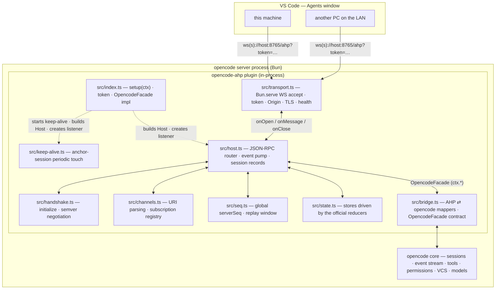
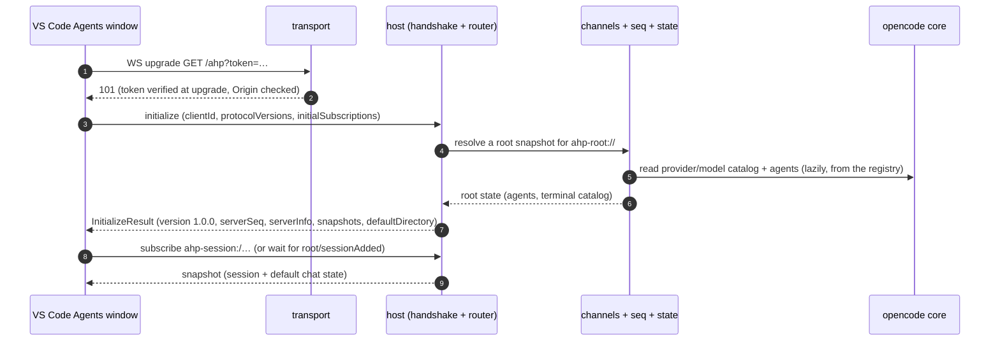
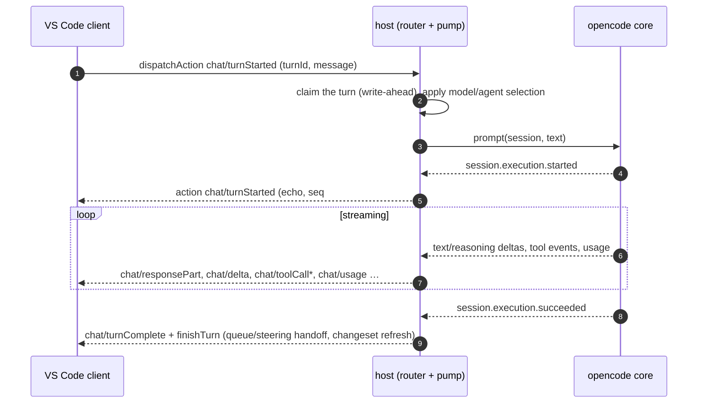
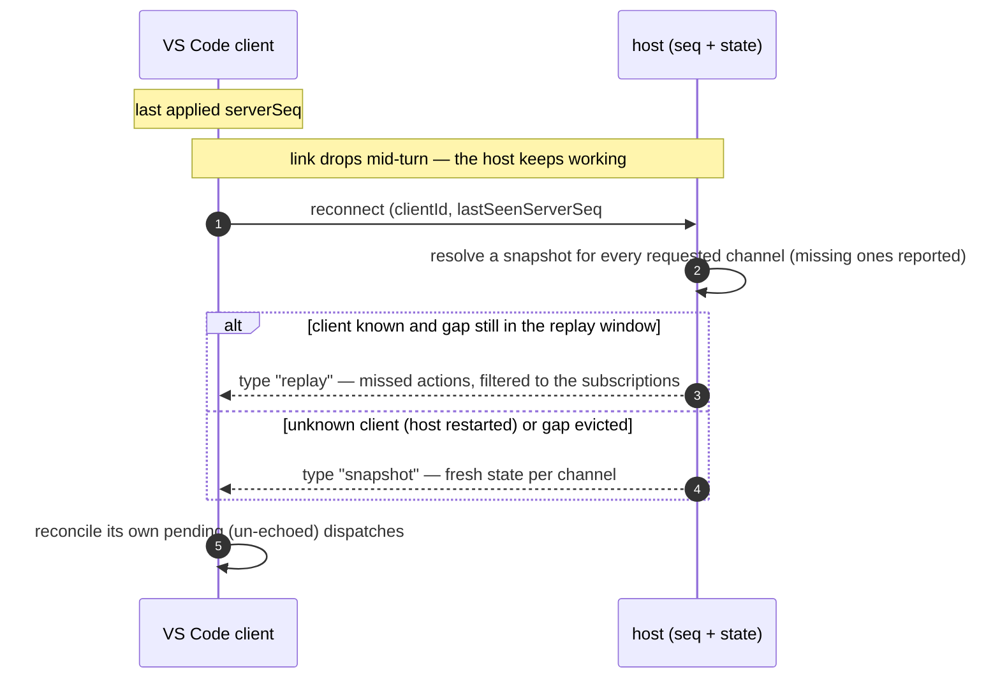

# Design

This document describes how `opencode-ahp` works **today**: its use cases,
architecture, lifecycle, protocol surface, and its error, recovery, and
persistence behavior. It reflects the current implementation in `src/`.

For how to run it, see the [README](../README.md); for testing (unit,
static, live verification, two-machine, and conformance), see
[`docs/testing.md`](testing.md).

## 1. Purpose

`opencode-ahp` is an **OpenCode v2 plugin** that hosts the
[Agent Host Protocol](https://github.com/microsoft/agent-host-protocol)
(**AHP 1.0.0**, strict-pinned to `@microsoft/agent-host-protocol@1.0.0`)
*in-process*, so that opencode appears as a **native agent** in the
**VS Code Agents window**.

AHP sits one layer above the Agent Client Protocol (ACP) — Microsoft's
summary: "a mutex over ACP". opencode speaks ACP natively
(`opencode acp`), which is why AHP⇄ACP gateway stopgaps work at all.
This plugin goes one level deeper: it hosts AHP directly in the opencode
server and skips the ACP subprocess hop entirely.

Use cases:

- **This machine** — point VS Code's Agents window at
  `ws://127.0.0.1:8765/ahp` and operate the local opencode server's
  sessions directly (create, list, chat, review diffs, run shell commands
  with rendered output).
- **Other machines on the LAN** — the same host, bound to a LAN
  address with a token, reachable from any PC on the network. VS Code
  ships the AHP client; **nothing is installed on the client machine**.
- **Off-LAN** — native `wss://` termination on the same listener (TLS
  key/cert in the options); the token and Origin policy are unchanged.

What the client gets in the Agents window:

- **Sessions** — `createSession`, a live session list (titles, statuses,
  chat catalogs), and state that survives reconnects via snapshots and
  replay.
- **Model picker** — the real opencode catalog (every provider/model the
  server exposes, including models from sync plugins).
- **Agent picker** — opencode's user-invocable agents as AHP custom
  agents under a workspace directory node; subagent-mode agents are
  hidden, hidden agents are omitted.
- **Chat** — streaming text + reasoning, the full tool-call lifecycle,
  permission prompts, steering/queueing, and usage totals.
- **Client tools** — a client can register tools per session; the model
  calls them directly and execution is delegated back to the owning
  client.
- **Multi-chat** — a session hosts additional chats; each chat runs
  against its own opencode backend session with fully isolated turns.
- **Changesets** — per-chat and per-session diff channels
  (uncommitted / session / per-turn) with a `discard-changes` operation.
- **Terminals** — read-only `ahp-terminal:` channels rendered from
  `shell`-tool command executions (not ptys).

The design constraints that shape everything below:

- The solution lives entirely inside the opencode **plugin `setup(ctx)`
  interface**: one package, one extra port, no sidecar process, no
  upstream opencode changes.
- The **opencode server must stay up no matter what** the plugin does
  ("R2"): every failure path logs and degrades, never throws out of
  `setup`, never takes the listener or the server down.
- **A token is always enforced** on the AHP listener, loopback or not; a
  non-loopback bind additionally refuses to start without one.

## 2. Architecture

### 2.1 Runtime model

A single npm package with **no build step**: `package.json` `exports`
point at `./src/index.ts` and opencode (a Bun runtime) loads the
TypeScript source directly. The package ships `src/` (minus `src/test/`).

Only **`src/index.ts` touches the plugin context `ctx`**. Everything else
is a pure module or a class with its dependencies (timers, sockets,
session access, logging) injected — so the whole protocol layer is
unit-tested with Vitest without an opencode runtime, network, or
filesystem. `src/index.ts` adapts `ctx` to a narrow
`OpencodeFacade` interface (defined in `bridge.ts`) and injects it into
the `Host`.



### 2.2 Module responsibilities

| Module | Role |
| --- | --- |
| `src/index.ts` | Plugin entry (`Plugin.define({ id: "opencode-ahp", setup })`). Resolves options, ensures the token, starts keep-alive, constructs the `Host` + transport, starts the event pump, registers client tools on the opencode tool registry (`ctx.tool.transform` + `ctx.tool.reload`), and returns the location-teardown cleanup. The only `ctx` call site; implements `OpencodeFacade` (including the git-backed changeset helpers, since the plugin surface has no HEAD-read or single-file-discard API). |
| `src/transport.ts` | Pure policy functions (loopback check, token extraction/comparison, Origin policy, path routing) plus a thin `Bun.serve` listener implementing the `Listener` interface. Auth happens at the WebSocket **upgrade**. |
| `src/handshake.ts` | The `initialize` command: validation and semver capability negotiation via the official package's `negotiateProtocolVersion`. |
| `src/host.ts` | The `Host` class — the JSON-RPC 2.0 router that ties transport, handshake, channels, sequencer, state stores, and the facade together: command handling, client-action dispatch, session/chat records, the opencode event pump, changesets, synthetic terminals, and client-tool routing. |
| `src/channels.ts` | Channel URI parsing/formatting (`ahp-root://`, `ahp-session:/`, `ahp-chat:/`, `ahp-terminal:/`, `…/changeset/…`) and the `ChannelRegistry` (per-socket subscriptions, live session ids, live terminal URIs). |
| `src/seq.ts` | The `Sequencer`: a single **host-wide** monotonic `serverSeq` (AHP 1.0.0 numbers all channels on one sequence) with a bounded replay window. |
| `src/state.ts` | Channel state stores. Every store simply applies the **official reducers** from `@microsoft/agent-host-protocol` (`rootReducer`, `sessionReducer`, `chatReducer`, `changesetReducer`, `terminalReducer`) — the host never hand-rolls a state transition. |
| `src/bridge.ts` | The opencode-aware mapping layer: the `OpencodeFacade` contract, `mapV2Event` (raw v2 event → narrow `FacadeEvent` union), catalog/summary/changeset builders, and the content-ref URI helpers (`file://`, `ahp-content://head/…`, `ahp-content://snap/…`). |
| `src/client-tools.ts` | Pure helpers for client-provided tools: wire validation of `ToolDefinition`s, the cross-session tool union, and per-session provider lookup. |
| `src/keep-alive.ts` | Periodic durable touch of an anchor session that keeps the opencode location loaded against its idle timeout. |
| `src/options.ts` | Option validation + resolution (ctx options ▸ `options.jsonc` sibling ▸ built-ins) and a dependency-free JSONC stripper. |
| `src/error.ts` | `errorMessage` normalizer. |
| `src/test/*` | Vitest suites for the pure modules (`state.ts` and `error.ts` covered indirectly through the host suites), including a captured-turn fixture replayed through the real AHP reducers. |

### 2.3 Location lifecycle

opencode v2 is **per-location**: a location (a project directory) boots on
first use and is idle-evicted after
`experimental.location_idle_timeout` (default 60 minutes). The plugin
lives and dies with its location:

```text
location boots → setup(ctx)
  1. resolve options; enabled: false → fully inert (no listener)
  2. token: explicit option, else persisted (generated once)
  3. keep-alive: get-or-create the anchor session, start touching it
  4. build Host (facade injected) + createListener (TLS material read)
  5. host.startEventPump()
  → logs the listening URL
location tears down → cleanup()
  → stop keep-alive, kill the pty terminals (final terminal/exited),
    stop the pump (aborts the event subscription),
    stop the listener (drops every client connection); logged
```

Steps 2–5 each have a failure path that logs and leaves the opencode
server running without AHP (see [§14](#14-error-handling--graceful-degradation)). Keep-alive starts **before** the
host so the anchor session's `session.created` event fires before the
event pump subscribes (the facade also filters the anchor from every
client-facing surface, so this is belt-and-braces).

## 3. Transport & security

`transport.ts` runs one `Bun.serve` HTTP+WS server on `host:port`:

- **`path`** (default `/ahp`) — the AHP WebSocket endpoint.
- **`healthPath`** (default `/healthz`) — plain HTTP `ok`, no auth.
- Any other path → 404.

**Authentication is at the WebSocket upgrade**, before any socket exists
(AHP transport spec): a missing or invalid token, or a disallowed Origin,
gets an HTTP 401/403 and never a connection. The presented token is taken
from the `?token=` query parameter first, then
`Authorization: Bearer <token>`, and compared in constant time.

Additional policies:

- **Token always required.** There is no no-token mode. A non-loopback
  bind additionally **refuses to start** without a token (the listener
  throws, which takes the [§14](#14-error-handling--graceful-degradation) degrade path).
- **Origin allowlist** (`allowedOrigins`, default `"*"`): a null Origin
  (non-browser clients — VS Code's own connection, CLI probes) always
  passes; a present Origin must be in the list unless `"*"`. This is
  defense-in-depth only — the token is the credential.
- **TLS**: with `tls: { keyPath, certPath }`, the entry point reads the
  PEM files and hands their *contents* to `Bun.serve`, giving native
  `wss://` termination on the same port (the port becomes TLS-only; the
  health endpoint is then HTTPS). The transport itself stays
  filesystem-free.

The listener is behind a `Listener` interface (`port`, `sendTo`,
`closeConnection`, `stop`), so the protocol layer never sees Bun types;
a `ws`-package fallback could be dropped in if the plugin context ever
forbids raw listeners.

## 4. Connection model & handshake

The connection contract (AHP 1.0.0 lifecycle):

- The **first request** on a socket is `initialize` (new client) or
  `reconnect` (known client). `ping` is answered even before
  initialize; any other pre-handshake request gets `-32600`
  (notifications are logged and dropped).
- `initialize` targets `ahp-root://`, carries `clientId` and
  `protocolVersions` (a non-empty semver array). The server picks the
  highest offered version inside its supported baselines (the pinned
  1.0.0 package supports the 1.0.0 and 0.9.0 baselines, so any 1.x or
  0.9.x offer negotiates the 1.0 wire protocol). Anything else is
  rejected with `-32005` and `data.supportedVersions`.
- The `initialize` result carries `protocolVersion`, the current global
  `serverSeq`, `serverInfo` (`name: "opencode-ahp"`, `version` read from
  `package.json` at runtime, `title: "OpenCode"`), snapshots for
  `initialSubscriptions` (unresolvable channels are simply omitted), and
  `defaultDirectory` (the location directory).
- The host keeps a **per-`clientId` registry across sockets**, so a
  dropped client can `reconnect` on a new socket.
- **Supersession**: a new `initialize` from a clientId whose old socket is
  still open closes the old socket (WebSocket code 4000,
  "superseded by a newer connection").
- **`serverSeq` is a single host-wide sequence** across all channels —
  snapshots carry `fromSeq` = the current global seq, and replay is a
  global range (see [§5.2](#52-sequencer--replay)).
- `dispatchAction` and `unsubscribe` are **notifications** (no `id`);
  their "response" is the `action` notification stream itself
  (write-ahead reconciliation, [§9](#9-client-dispatchable-actions)).



On **socket close** the host: drops the client's subscriptions, releases
the socket's slot in the clientId registry, and **evicts the client's
active-client role from every session it holds** (see [§10.4](#104-disconnection-eviction)) — the
official client re-dispatches `activeClientSet` on re-subscribe, so the
eviction is safe.

## 5. Channels & state

### 5.1 Channel kinds

| Kind | URI shape | Notes |
| --- | --- | --- |
| root | `ahp-root://` | One per host. Catalog of agents, active-session count, terminal list, session add/remove/summary notifications. |
| session | `ahp-session:/<suffix>` | One per AHP session. The suffix is opaque and client-chosen; opencode session ids (`ses…`) double as suffixes for externally created sessions. Suffixes containing `/changeset/` are rejected (they would collide with changeset URIs). |
| chat | `ahp-chat:/<suffix>` | One per chat. The default chat reuses the session's opencode id as its suffix (zero wire change for single-chat clients); peer chats carry client-chosen suffixes. |
| changeset | `<owner>/changeset/uncommitted` · `<owner>/changeset/session` · `<owner>/changeset/turn/<turnId>` | Owner is a session channel (session kind) or a chat channel (uncommitted, turn kinds). See [§11](#11-changesets). |
| terminal | `ahp-terminal:/<toolCallId>` | Synthetic: one per foreground `shell`-tool call. Suffix is the opencode tool-call id (globally unique per invocation). See [§12](#12-terminals). |
| terminal (pty) | client-chosen URI (any scheme outside the `ahp-` namespace) | Interactive pty shells created via `createTerminal` — VS Code uses `agenthost-terminal://<uuid>`. The URI is opaque to the host; it classifies "terminal" only while the record is live. See [§12](#12-terminals). |

The `ChannelRegistry` tracks which sockets are subscribed to which
channel (broadcast targets), the set of live session ids (a session/chat
channel is subscribable only while its session is registered), and the
set of live terminal URIs — synthetic `ahp-terminal:` channels **and**
client-chosen pty channels (the host adds/removes them in step with the
record map, so a disposed pty URI is unsubscribable again).

### 5.2 Sequencer & replay

`Sequencer` assigns the next global `serverSeq` to every published
action envelope (`{ channel, action, serverSeq, origin?, rejectionReason? }`)
and retains the last `replayWindow` envelopes (default 1000). Snapshots
carry `fromSeq` = the current global seq. On reconnect, the host replays
the global range `serverSeq > lastSeenServerSeq` **filtered to the
client's subscriptions** when the client is known and the gap is still in
the window; otherwise the client receives fresh per-channel snapshots
([§13.1](#131-reconnect-replay-or-snapshot)).

### 5.3 State stores & the publish path

Every channel's state is a store driven by the **official AHP reducers**
(`state.ts`). The host's single publish path (`Host.publish`) does:

1. stamp the action with the next global `serverSeq` and retain it;
2. for accepted actions, apply it to the right store (root / session /
   chat / changeset / terminal); rejected actions are retained and
   notified but not applied;
3. after a chat action, sync the chat's summary into the session store's
   chat catalog (`session/chatUpdated`), and if the denormalized session
   summary changed, announce it on the root channel
   (`root/sessionSummaryChanged` — an ephemeral **notification**, not
   replayed; only `root/activeSessionsChanged` is a sequenced action);
4. send the envelope as an `action` notification to every socket
   subscribed to the channel.

Root-level `root/sessionAdded` and `root/sessionRemoved` are
notifications too — the root snapshot (or a re-list via `listSessions`)
is the authoritative view.

**Snapshots** are computed on demand:

- session/chat channels — the official-reducer store state;
- changeset channels — the store state; a first subscribe (or a failed
  computation) triggers the computation, later subscribes return the
  last completed state;
- terminal channels — the store state (null once the record is torn down);
- root — re-derived from the facade on every call (the catalog read
  reflects every registration so far).

## 6. Command surface

Requests (methods with an `id`) routed by the host:

| Command | Result / behavior |
| --- | --- |
| `ping` | `null`; answered even pre-handshake. |
| `initialize` | See [§4](#4-connection-model--handshake). |
| `reconnect` | `ReconnectResult`: `{ type: "replay", actions, missing }` or `{ type: "snapshot", snapshots }`. Must target `ahp-root://`. |
| `subscribe` | `{ snapshot }` when the channel is resolvable, else `{}`. Unknown URIs, dead sessions, or gone terminals get errors (`-32602`, `-32001`, `-32008`). |
| `unsubscribe` | Notification. Drops the socket's subscription. |
| `dispatchAction` | Notification. See [§9](#9-client-dispatchable-actions). |
| `listSessions` | All opencode sessions, most-recently-modified first, in-memory cursor pagination (`limit` default 100, `cursor` = offset). Unknown sessions are **lazily registered** (idempotent per opencode id) so their channels become subscribable. |
| `resolveSessionConfig` | An honest empty schema (`{ type: "object", properties: {} }`, `values: {}`) — opencode collects no session-creation configuration; agent/model choice rides session customizations and the per-turn message. `provider`/`workingDirectory`/`config` params are accepted and ignored. VS Code calls this strictly before the first send of a new session, so an unimplemented host makes every fresh session unstartable. |
| `createSession` | `null`. Creates a real opencode session (provider/model resolved from the catalog; `activeClient` eagerly claims an active-client role and must match the creating client). Publishes the session-channel lifecycle (`session/ready`, `session/chatAdded`, `session/defaultChatChanged`, changeset catalogues), the root count action, and the `root/sessionAdded` notification. Errors: `-32002` (no enabled provider for the requested provider), `-32003` (channel exists). |
| `createChat` | `null`. Mints a fresh opencode session (same provider/model resolution) and binds it to the client-chosen chat URI; publishes `session/chatAdded` (+ changeset catalogue) **before** responding — the client waits for that action and rolls back with `disposeChat`. An `initialMessage` starts the chat's first turn; any failure in that path rolls the whole chat back. `source` and `workingDirectories` are rejected (`-32602`) — fork/side-chat and multiple-working-directories capabilities are deliberately not advertised. |
| `disposeChat` | `null`. Removes a peer chat (never the default chat) and its opencode backend session; publishes `session/chatRemoved`. AHP-side unbind happens *before* the backend removal so the racing `session.deleted` event doesn't double-publish. |
| `resourceRead` | File content for the URIs this host advertises in changesets: `file://` (live disk, confined to the location directory), `ahp-content://head/…` (content at git HEAD), `ahp-content://snap/…` (a turn's captured before/after). `encoding` is `base64` (default) or `utf-8`. Errors: `-32008` not found, `-32009` outside the location. |
| `invokeChangesetOperation` | The only operation the host offers is `discard-changes` (resource-scoped). See [§11.4](#114-discard-changes). |
| `createTerminal` | `null`. Spawns an interactive pty shell (`spawnPty` seam — Bun in production) in the resolved working directory and registers the client-chosen channel. Params: `channel` (client-chosen; the host namespace, including the reserved `ahp-terminal:` prefix, is refused), `claim` (a client claim for the dispatching client, or a session claim), `name?`, `cwd?`, `cols?`/`rows?` (defaults 80×24). The `cwd` accepts plain `file://` (what VS Code sends), the client's `vscode-agent-host:`/`agent-host:` wrapper, or a bare absolute path; anything malformed or outside the location directory clamps to the location directory. Errors: `-32601` (capability off, or the runtime cannot spawn ptys), `-32600` (host-namespace channel), `-32010` (AHP AlreadyExists — duplicate channel), `-32602` (malformed params), `-32603` (the spawn threw — logged, R2: the host survives). |
| `disposeTerminal` | `null`. Kills the pty (a still-running process gets a final `terminal/exited`), drops the record, and refreshes the catalog. Idempotent: an unknown channel answers `null` (VS Code's shutdown path disposes terminals that may already be gone). Synthetic (session-owned) terminals are host-managed: `-32009` (AHP PermissionDenied). Capability off: `-32601`; missing channel: `-32602`. |
| `setClientManagedSettingsPermissions` | Accepted and logged as a no-op — a VS Code-specific post-init notification with no AHP 1.0.0 counterpart; the connection must stay up. |
| anything else | `-32601` for requests; unknown notifications are logged and dropped. |

JSON-RPC plumbing: malformed JSON → `-32700`; not a 2.0 request object →
`-32600`; an unhandled router error → `-32603` (logged) — a bad frame
never takes the host down.

## 7. Sessions & chats

### 7.1 The mapping

**One AHP session = one record holding a chat catalog; one AHP chat = one
opencode session.** Concretely, the host keeps:

- `SessionRecord` — the default chat's opencode id (`sessionID`, also the
  event-pump join key for the default chat), the session channel, the
  session-state store, the chat map, the `defaultChatURI`, and the
  session-kind changeset store.
- `ChatRuntime` — one per chat: its URI, its opencode session id, its
  chat-state store, and all the per-turn join state the event pump needs
  (current turn id, part/tool tracking, permission mapping, client-tool
  invocations, turn snapshots).
- `byOpencode` — opencode session id → `{ record, chat }`, the event
  pump's join key: every chat has its **own** backend session, so an
  opencode event must land on the owning chat, not just the record.

The default chat's channel suffix **is** the record's opencode id, so
single-chat clients see the plain `ahp-session:/<ses…>` /
`ahp-chat:/<ses…>` pair with zero indirection. Peer chats
(`createChat`) get client-chosen chat URIs backed by freshly minted
opencode sessions, which are marked (see [§15](#15-persistence--durability)) so they re-attach to their
owner after a restart instead of resurfacing as standalone sessions.
Peer-chat backends are real opencode sessions and therefore appear in
opencode's own UI (TUI) as ordinary sessions.

### 7.2 External sessions

Sessions the host did not create (TUI, another client, or sessions
resurfacing after a location reload) become AHP sessions in two ways:

1. **`session.created` event** — handled by the pump with a 250 ms grace
   (`EXTERNAL_REGISTER_GRACE_MS`): a concurrent `createSession` may still
   be resolving for the same opencode session under a client-chosen
   channel; if the slow path wins, `handleCreateSession` heals it by
   dropping the interim record and re-registering under the client's
   channel.
2. **`listSessions`** — every listed opencode session is lazily
   registered (idempotent), which is how sessions survive a restart.

Registration honors the durable **AHP markers** in opencode session
metadata ([§15.2](#152-session-metadata-markers)):

- peer-chat marker `{ chat, owner }` → re-attach to the owner's chat
  catalog at the original chat URI (no standalone session; chat title is
  re-derived as `Chat <n>`);
- channel marker `{ channel }` → standalone session resurfacing under the
  original client-chosen session channel;
- no marker (or an unresolvable one) → standalone session whose channel
  reuses the opencode id.

A peer whose owner is not registered yet is queued; the queue drains when
the owner registers, or — if the owner has vanished from opencode after
the grace window — the peer falls back to standalone registration (the
data stays reachable).

### 7.3 Workspace (`workingDirectories`)

Every session the host publishes carries
`workingDirectories: [directoryUri(location directory)]` — on the
`SessionState` (session-channel snapshot, via `initialSessionState`) and
on every `SessionSummary` (root `sessionAdded` / `sessionSummaryChanged`
notifications and `listSessions`, via `sessionSummary`). The location
directory is the single directory the session's agent has tool access to;
it is the same directory the agent-directory customization points at.
One entry only: the host advertises no `multipleWorkingDirectories`
capability, so clients MUST NOT mutate the set (AHP working-directory
actions are unusable).

**Why the field is required for a usable session list (VS Code 1.145
finding):** the Sessions view groups sessions into workspace sections; a
session's workspace label comes from its AHP metadata —
`buildAgentHostSessionWorkspace` (vscode
`src/vs/workbench/contrib/sessions/common/agentHostSessionWorkspace.ts`)
labels the session with `SessionState.project.displayName` when a project
is present, else with the first `workingDirectories` entry (the remote
provider maps the host's `file://` URI to `agent-host://<host>/<path>` and
suffixes the label with the host name, e.g. `test-project [dev.zinky.lan]`).
When **neither** field is present the workspace is undefined and the
session renders under the **"Unknown"** fallback
(`sessionsList.ts` → `sessionWorkspaceLabel`). Copilot quick chats are
unaffected: they carry a client-side quick-chat flag that routes them into
the dedicated **"Chats"** section regardless of workspace. The host
publishes `workingDirectories` rather than `project` because a location
directory is not necessarily a repository — `project` would mark the
workspace `isRepository: true` and hand it the repo icon, a false claim.

## 8. Turn lifecycle (event pump)

`Host.startEventPump()` runs a **single sequential async loop** over the
facade's mapped event stream (`ctx.event.subscribe` → `mapV2Event` →
`FacadeEvent`). Sequentiality is the core race-free design: event
handling and client-dispatch handling interleave on the same event loop
without locking on the per-turn join state. Every event is resolved
against the owning chat via `byOpencode`; events for sessions the host
doesn't know are ignored (only `session.created` registers).

A full turn driven by the client:



Event → action mapping (host side). The left column names the mapped
`FacadeEvent` types; on the raw opencode v2 wire the `execution.*`,
`step.*`, `text.*`, `reasoning.*`, `tool.*`, `usage.*`, and `inbox.*`
events additionally carry a `session.` prefix (e.g. wire
`session.execution.started`), while `session.created`/`session.deleted`/
`session.renamed` and `permission.asked`/`permission.replied` appear
exactly as written:

| opencode event | AHP effect |
| --- | --- |
| `session.created` | deferred external registration ([§7.2](#72-external-sessions)). |
| `session.deleted` | default chat → the record is removed (peers' backends disposed, terminals torn down, client tools failed); peer chat → `session/chatRemoved` for that chat only. |
| `session.renamed` | default chat → `session/titleChanged`; peer chat → `session/chatUpdated` (chat summaries carry the title). |
| `execution.started` | if the turn is not already claimed (client write-ahead), start an **orphan turn** seeded with the last-seen inbox message (external TUI prompts). |
| `execution.succeeded` | `chat/turnComplete` (duration from the host clock) + `finishTurn`. |
| `execution.failed` | `chat/error` with the error part + `finishTurn`. |
| `execution.interrupted` | `chat/turnCancelled` + `finishTurn` — skipped when the client's own `chat/turnCancelled` echo already finalized the turn. |
| `step.started` | records the turn's model ref (`providerID/modelID`) for usage. |
| `text.delta` / `reasoning.delta` | first delta for a part lazily emits `chat/responsePart`; subsequent ones emit `chat/delta` / `chat/reasoning`. |
| `text.ended` / `reasoning.ended` | fallback for non-streaming providers: if no delta opened the part, emit it with the full text. |
| `tool.input.started` | `chat/toolCallStart` (with a `contributor` of kind *client* when one of the session's active clients provides the tool — [§10](#10-client-provided-tools)). |
| `tool.input.ended` | records the raw input; captures the **pre-edit file content** for changesets (the event fires before execution — the last safe point); opens the synthetic terminal for foreground shell calls ([§12.1](#121-synthetic-terminals-shell-tool-renderings)); for client-executed calls, clears the confirmation gate and raises a `toolClientExecution` input request on the session channel. |
| `tool.progress` | first sign the tool is running: `chat/toolCallReady` with `confirmed: "not-needed"` → status *running*. |
| `tool.success` / `tool.failed` | closes the synthetic terminal first (even after the turn was torn down); then `chat/toolCallComplete` with the result — suppressed when the call is already terminal (e.g. a client-executed call the client completed; the tracking, including the client-tool record, is still cleared). |
| `usage.updated` | `chat/usage` (session-cumulative tokens; the chat reducer replaces the turn's usage, so the latest is the turn's view). |
| `permission.asked` (tool-sourced) | `chat/toolCallReady` *without* `confirmed` → status *pending-confirmation*, plus a `toolConfirmation` input request on the session channel (the in-window approval prompt). Non-tool permissions have no AHP counterpart and are logged. |
| `permission.replied` | safety net: removes the confirmation input request if the client's `chat/toolCallConfirmed` did not already. |
| `inbox.enqueued` / `inbox.delivered` | remembered on the chat; steering consumption happens at turn end. |

`finishTurn` (after any turn terminal) clears the steering message the
turn consumed (`chat/pendingMessageRemoved`), auto-starts the next turn
from the queue (the queued prompt was already sent to opencode with
`delivery: "queue"` — opencode starts it itself; this only updates AHP
state), drops the ended turn's terminal rows from the root catalog, and
refreshes the chat's subscribed changesets (the "after" content is read
from disk here).

If the pump itself fails (a bridge error), the error is logged and the
pump stops — the host keeps serving; streaming for new turns is gone
until the location is reloaded (R2, [§14](#14-error-handling--graceful-degradation)).

### 8.1 Event capture (`logEvents`)

With the `logEvents` option on, **every raw opencode V2 event the plugin
receives** is written to the server log as one timestamped line *before*
it is handled — so the log proves what the host saw and when. Purpose:
attributing turn latency to host, client, or model. A blank window in the
event stream means the host never received the events (e.g. the model
provider produced no output — "Considering…" on the client is then
correct, not a plugin stall). The keep-alive anchor's events are filtered
before classification, as from every AHP surface.

Classification (`mapV2EventRaw` in bridge.ts — the only place that knows
the raw wire shape; `mapV2Event` is its thin `ok → event, else null`
wrapper, so the pump's behavior is unchanged):

| Outcome | Meaning | Line |
| --- | --- | --- |
| `ok` | mapped into the `FacadeEvent` union and pumped | `… event ok: session.tool.input.started {"…"}` |
| `dropped (missing: <fields>)` | a known type whose instance carries no usable fields — e.g. `session.tool.input.ended` with `text: ""` (opencode emits the accumulated raw input text, empty for a no-arg tool call, and the bridge treats empty as missing) — or a malformed envelope (not an object, missing `type`/`sessionID`) | `… event dropped (missing: text): session.tool.input.ended {"…"}` |
| `unimplemented` | an event type the host has no handler for (the switch `default`) | `… event unimplemented: shell.created {"…"}` |

Line format (`eventLogLine` + `timeStamp`, both pure and unit-tested):

```
[opencode-ahp] 19:04:41.520 event ok: session.tool.input.started {"sessionID":"ses_…","id":"tc_…",…}
```

- The timestamp is **local server time** when the event reached the
  plugin (`HH:MM:SS.mmm`) — compare against `opencode.db` message
  timestamps or the client wall clock for latency attribution.
- The type is the **raw** opencode type (what was received, not the
  mapped `FacadeEvent` type), and the payload is the raw `data` JSON,
  truncated to 300 characters with an ellipsis (malformed envelopes log
  the whole raw value).

Off by default — a busy turn emits dozens of lines (the captured fixture
turn is 38). The LAN test server
([scripts/ahp-server.mjs](../scripts/ahp-server.mjs),
[testing.md §3.1](testing.md#31-the-isolated-test-server)) enables it in
the scaffolded project config, so live verification gets the capture for
free: `grep "event " /tmp/ahp-server/server.log`.

## 9. Client-dispatchable actions

`dispatchAction` is a **notification** — there is no JSON-RPC response.
The response is the `action` notification stream itself: the host
validates, performs the opencode-side effect, and **echoes** the action
back (accepted, or with a `rejectionReason`). Clients apply dispatched
actions optimistically (write-ahead) and roll back on a rejection.
Rejections are additionally delivered **directly to the dispatching
socket** even when it isn't subscribed to the channel — a write-ahead
client that didn't subscribe yet must still get its rollback.

Shared pre-checks: the channel must be known; the action must be
client-dispatchable per the AHP 1.0.0 catalog; the socket must be
initialized. Chat-channel actions run against the owning chat runtime; a
chat action on a session channel is rejected (a session no longer
identifies a single chat once multi-chat is on).

| Action | Host behavior |
| --- | --- |
| `chat/turnStarted` | Rejected when a turn is already active ("follow-ups go via `chat/pendingMessageSet`"). Otherwise: apply the message's model/agent selection to this chat's opencode session, **claim the turn before the prompt** (write-ahead, so a racing `execution.started` still joins it; reverted on prompt failure), prompt, then echo (with a host-normalized `startedAt` — see the reducer-trap note after this table). |
| `chat/pendingMessageSet` | `steering` mid-turn → prompt with `delivery: "steer"`; `queued` mid-turn → `delivery: "queue"`; with no active turn the message starts a turn right now (echo, then a host-minted `chat/turnStarted` carrying `queuedMessageId`). |
| `chat/pendingMessageRemoved` | Always rejected: opencode has no inbox cancel — a pending message cannot be withdrawn once sent. |
| `chat/toolCallConfirmed` | Replies to the pending opencode permission (`once` / `reject`), echoes (reducer → running/cancelled), and clears the session input request. |
| `chat/toolCallComplete` | Client-executed tool calls only ([§10](#10-client-provided-tools)): contributor-only, status must be running/pending-confirmation; echoes, then either settles the opencode-side waiter with the client's result or holds it for result confirmation. The reducer inlines the result fields (`success`, `pastTenseMessage`, `content`, `error`) onto the completed call — state has no `result` property — and applies the action only from Running/PendingConfirmation/AuthRequired (a success while auth-required is ignored). |
| `chat/toolCallContentChanged` | Contributor-only echo of streamed partial content (reducer replaces the running call's `content`); opencode needs no counterpart. |
| `chat/toolCallResultConfirmed` | Contributor-only; approves or denies a held client result (deny settles the waiter with a `Tool.Error` the model sees). |
| `chat/turnCancelled` | Must name the active turn; interrupts the opencode session, echoes with a host-normalized `duration` (required on the wire — see below), then runs the queued/steering handoff itself (the `execution.interrupted` event finds no active turn and is skipped). |
| `session/titleChanged` | Renames the opencode session, then echoes. |
| `session/activeClientSet` | `activeClient.clientId` must be the dispatching client. Normalizes the tools, echoes, and re-syncs the location-global opencode tool union ([§10](#10-client-provided-tools)). |
| `session/activeClientRemoved` | Same clientId check; echo + tool-union re-sync. |
| `changeset/filesReviewChanged` | The only client-dispatchable changeset action: validates the channel resolves to a live changeset, echoes (the reducer toggles `reviewed` per file). |
| `chat/draftChanged`, `chat/isReadChanged`, `chat/isArchivedChanged`, `session/isReadChanged`, `session/isArchivedChanged` | Echo-only (the state is client-side UI bookkeeping). |
| `terminal/input`, `terminal/resized`, `terminal/claimed`, `terminal/titleChanged`, `terminal/cleared` | On a **pty** terminal: input/resize drive the process, claim/title/clear apply through the official reducer (rejections for the invalid shapes and the non-holder claim — [§12.2](#122-pty-terminals-interactive-shells)). On a **synthetic** terminal: every one is rejected ("read-only terminal …"). |
| any other client-dispatchable action | Echoed with a `rejectionReason` ("unsupported action …"). |

**Reducer traps (AHP 1.0.0 `chatReducer`).** Two echo fields are
*required on the wire*: `chat/turnStarted.startedAt` and
`chat/turnCancelled.duration`. The official reducer derives `modifiedAt`
from them and throws `RangeError: Invalid time value` on a missing or
unparseable value (observed live in the host) — hence the host-side
normalization.

## 10. Client-provided tools

Clients register tools per session via `createSession.activeClient` or
`session/activeClientSet` (an `activeClient` is `{ clientId, tools,
displayName? }`). Active clients are **session-level** state; tool
*invocations* are **chat-level** (each chat has its own backend session).

### 10.1 Registration into opencode

opencode's tool registry is per-location, not per-session, so the host
registers the **cross-session union** of every live session's
active-client tools into the location registry
(`syncClientToolsToOpencode`): first-registered wins per normalized
name; a single `ctx.tool.transform` registration (applied on every
registry rebuild) plus `ctx.tool.reload` replaces the set. Each tool is
registered as a **direct tool** (`options: { codemode: false }`) — under
Code Mode a catalog tool is invoked as nested JavaScript that emits no
tool events of its own, so the host could never see the call to track
and relay. A sync failure is logged and the AHP side stays authoritative
(R2).

### 10.2 Execution

When the model calls a client tool, the pump sees
`tool.input.started`, records the invocation (`clientId`, `turnId`), and
emits `chat/toolCallStart` with `contributor: { kind: "client",
clientId }`. At `tool.input.ended` the call clears its confirmation gate
(no opencode permission can fire for it) and the host raises a
`toolClientExecution` input request on the session channel — the session
stays in progress while the client runs.

Meanwhile opencode invokes the tool's `execute` bridge
(`host.executeClientTool`), which **re-checks per-session ownership** —
the tool is visible location-globally, but execution only resolves when
*this* session is an AHP session with an active client providing the
tool (a TUI session sees the tool but cannot execute it). The bridge
then waits for the client's `chat/toolCallComplete`. The client's
dispatched `toolCallComplete` (contributor-only) either settles the
waiter directly — unblocking `execute`, which drives the pump's
`tool.success`/`tool.failed` terminal that clears the tracking — or,
with `requiresResultConfirmation`, holds the result until
`chat/toolCallResultConfirmed` (a `toolConfirmation` request replaces the
execution request under the same id and raises the session's
`InputNeeded` status; deny settles the waiter with an error). An
aborted turn settles the invocation with a cancellation error.

### 10.3 Permission bypass

Client tools skip opencode's permission prompt entirely: the client that
provides the tool is the approver. Only the contributing client may
execute or confirm a given call (other clients' dispatches get
rejection echoes).

### 10.4 Disconnection eviction

When the contributing client's socket closes, the host publishes
`session/activeClientRemoved` on every affected session, fails that
client's in-flight client-tool executions (the opencode tool then fails
and the pump's normal `tool.failed` path completes the AHP tool call),
clears the session input request each execution had raised, and re-syncs
the shrunken tool union. The session's AHP state stays consistent; the
client re-dispatches `activeClientSet` when it re-subscribes.

## 11. Changesets

Gated by `capabilities.changesets` (default **on**); requires the
location directory to be a git repository (otherwise the working-tree
changesets are empty). Discovery is by state optionality: with the
capability off, snapshots carry no changeset catalogues and changeset
URIs resolve to nothing.

### 11.1 Catalogues

- **Session channel** advertises one changeset: the session-wide one
  (`<session>/changeset/session`).
- **Each chat channel** advertises its own `uncommitted`
  (`<chat>/changeset/uncommitted`), the session-wide one, and a per-turn
  template (`<chat>/changeset/turn/<turnId>` for any turn of that chat).

### 11.2 Turn snapshots (before/after capture)

At `tool.input.ended` (fires before execution — the last safe point),
file-mutating tools (`write`, `edit`, `apply`, `patch`) whose input
carries a path (`path` / `file_path` / `filePath` / `file`) have the
target file's **pre-edit content** read from disk, confined to the
location directory; the first capture per file per turn wins, so the
pre-turn content survives later edits in the same turn. At the turn
terminal, each captured file's **after** content is read from disk
(absent = deleted). These in-memory snapshots back the turn changeset
and the `ahp-content://snap/…` content refs — kept until the chat is
removed (discard-restore reads them).

### 11.3 Computation & content

`refreshChangeset` recomputes a store and publishes the delta:
`changeset/contentChanged` when the file list changed (the
`discard-changes` operation is (re)attached while files exist and cleared
when they vanish), then `changeset/statusChanged` to `ready`. A failed
computation publishes `statusChanged` with an error. The uncommitted and
session kinds compute from the working-tree diff (`ctx.vcs.diff` mode
working, untracked included, joined to the git root); the turn kind
computes from the chat's snapshots.

File content is served via `resourceRead` from three URI forms:

- `file://` — live disk, confined to the location directory;
- `ahp-content://head/<b64url(absPath)>` — the file's content at git HEAD
  (`git show HEAD:`);
- `ahp-content://snap/<b64url(sessionID)>/<b64url(turnId)>/<b64url(absPath)>/before|after` —
  the in-memory turn snapshot of a live chat's backend session (exactly
  four segments, the last one literal).

The `ahp-content://` segments are base64url-encoded and opaque by design:
unguessable, so a client cannot point the host at an arbitrary snapshot or
path — malformed segments fail to parse (`-32008`).

`encoding` selects `base64` (default) or `utf-8` in the result.

### 11.4 `discard-changes`

`invokeChangesetOperation` accepts exactly one operation:
`discard-changes`, resource-scoped, on a live changeset. It publishes
`changeset/operationStatusChanged` (running), restores the file — for a
turn changeset from the before-snapshot (a file the turn added is
deleted), otherwise via `git checkout HEAD -- <file>` (untracked files
are deleted instead) — refreshes the changeset, publishes the status
`idle`, and returns a human-readable message. Errors publish status
`error` and the RPC error.

### 11.5 Teardown

When a chat is removed or a record is deleted, every live changeset
store gets `changeset/cleared` (the protocol's "channel going away"
case) so subscribers release their references, and the stores are
dropped (their URIs become un-subscribable).

## 12. Terminals

Two kinds of terminal channels share the root catalog
(`root/terminalsChanged`) and the AHP `TerminalState` shape: **synthetic**
(read-only renderings of `shell`-tool executions, host-managed) and
**pty** (interactive shells a client spawns via `createTerminal`). Both
are gated by `capabilities.terminals` (default **on**); the capability
off means synthetic channels never open and the terminal commands answer
`-32601`.

### 12.1 Synthetic terminals (shell-tool renderings)

These are **read-only renderings of `shell`-tool executions** — not
ptys.

- A foreground `shell`-tool call (opencode tool names `shell` / `bash`)
  opens `ahp-terminal:/<toolCallId>` at `tool.input.ended` — the only
  point where the command line is known. The initial state has
  `isPty: false`, a session claim scoped to the chat/turn/toolCall,
  `supportsCommandDetection: true`, the command as title (truncated to
  64 chars), and the location directory as `cwd`. Background calls and
  malformed inputs are excluded (no synchronous completion to render).
- The lifecycle actions: `terminal/commandExecuted` (commandId =
  toolCallId) at open; at the tool's terminal event, `terminal/data`
  (the output text — the tool's text content on success, the error
  message on failure), `terminal/commandFinished` (exit code parsed from
  opencode's trailing `Exit code: N` notice when non-zero; zero exits
  carry no notice; spawn failures arrive as `tool.failed` with no code),
  and `terminal/exited`. Finishing is idempotent and runs *before* the
  turn guard, so a command that outlives its turn still exits its
  terminal.
- **Root catalog**: membership is **turn-scoped** — a synthetic row is
  listed while its turn is still the owning chat's active turn, so
  finished commands keep their final lifecycle row until the turn ends,
  then the row drops. The channel *state* is retained: it stays
  subscribable until the owning chat/record is removed (existing socket
  subscriptions linger — the session-removal precedent — but no further
  actions reach them).
- When a chat is removed, a still-running command gets a final
  `terminal/exited`, then the records and registry entries are dropped.
- Every client-dispatchable terminal action on a synthetic channel
  (`input`, `resized`, `claimed`, `titleChanged`, `cleared`) gets an
  explicit rejection echo ("read-only terminal …") so write-ahead clients
  roll back cleanly. `disposeTerminal` on a synthetic channel gets
  `-32009` (AHP PermissionDenied — the client is not permitted to dispose
  host-managed terminals).

### 12.2 PTY terminals (interactive shells)

A `createTerminal` request spawns a real shell in a pty — the mechanism
VS Code's Agents window needs to make a session usable (clicking a
session opens an interactive terminal; a host that refuses
`createTerminal` surfaces a launch-error toast).

- **Spawn seam.** The host never calls the runtime directly: it calls
  `HostOptions.spawnPty` (a `SpawnPty` injected by the plugin entry).
  In production the entry provides a `Bun.spawn`-backed factory — opencode
  ships as a Bun-compiled binary, so `Bun.spawn(…, { terminal: {…} })`
  gives a real pty with no external dependency (shell = `$SHELL`,
  fallback `/bin/bash`; login shells `-l`; `TERM=xterm-256color`). Unit
  tests inject a fake. When the runtime cannot spawn ptys the seam is
  `undefined` and both terminal commands answer `-32601` (R2: no
  crash, no dev-mode bypass).
- **Channel.** The URI is **client-chosen** and opaque — VS Code uses
  `agenthost-terminal://<uuid>`. It classifies "terminal" only while the
  host's record map holds it (`kindOf`), so the registry's live-terminal
  set (not a URI prefix) gates subscribability. The host refuses any
  channel in the `ahp-` namespace — including the reserved
  `ahp-terminal:` synthetic prefix (`-32600`). A duplicate channel gets
  `-32010` (AHP AlreadyExists).
- **Working directory.** `cwd` accepts a plain `file://` URI (what VS
  Code sends — it unwraps its own wrapper before the wire), the client's
  `vscode-agent-host:`/`agent-host:` wrapper (URI path, with the `_ah`
  urlsafe-base64 meta path winning when present), or a bare absolute
  path. Anything malformed, and anything outside the location directory,
  clamps to the location directory: the shell is a tool of the session's
  agent and must not spawn outside its working root.
- **State & lifecycle.** The seed has `isPty: true`, the (resolved)
  directory `cwd`, the requested `cols`/`rows` (default 80×24), the
  requested `name` (default "Shell"), the creating client's claim, and a
  running lifecycle. `supportsCommandDetection` is **omitted** (no OSC-633
  in v1 — clients check `=== true`, so omission is "no"). `terminal/data`
  streams the pty output to subscribers (the official reducer appends to
  the content tail — one growing unclassified part while no command is
  executing); `terminal/exited` carries the process exit code when the
  runtime reported one.
- **Client-dispatchable actions** (see [§9](#9-client-dispatchable-actions)):
  `terminal/input` and `terminal/resized` drive the live process (rejected
  once it has exited — a dead pty has no stdin to write to);
  `terminal/claimed` applies only when the dispatching client currently
  holds the client claim (a claim is not a credential — naming someone
  else is rejected; session claims are host-mediated, never
  client-dispatchable); `terminal/titleChanged` (non-empty) and
  `terminal/cleared` apply through the official reducer and stay allowed
  after exit (the state still exists). Accepted title/claim changes
  refresh the root catalog (VS Code reference parity:
  `_setTitle`/`_setClaim` → `_broadcastTerminalList`).
- **Content trim.** The official terminal reducer is append-only and never
  trims; the host mirrors the VS Code reference client's rolling buffer
  after each `terminal/data` apply: once the stored content exceeds
  100 000 chars it trims back to 80 000 (drop whole parts from the front,
  then slice the head part) via a `store.replace` transition — the one
  non-reducer state change the host makes. The replay window still
  carries the raw `terminal/data` actions (inherent — the window is
  shared with every other channel).
- **Catalog & teardown.** A pty row is listed while its record is alive
  (running **or** exited) until the client disposes it or the location
  tears down. `disposeTerminal` publishes a final `terminal/exited` for a
  still-running process (no exit code — a host kill), kills the process,
  and drops the record + registry entry. The pty's own
  `onOutput`/`onExit` callbacks re-look-up the record, so a dispose that
  races them no-ops cleanly. `stopTerminals()` (location teardown, run
  before the listener stops so the final `terminal/exited` actions still
  reach subscribers) kills every live pty.

## 13. Reconnection & recovery

### 13.1 Reconnect: replay or snapshot



Details:

- `reconnect` must target `ahp-root://`; snapshots for unresolvable
  channels are reported in `missing` and the client drops them.
- Replay is the global range `> lastSeenServerSeq` **filtered to the
  client's subscriptions** — a client only re-receives what it had
  subscribed.
- Replay requires the client to be **known** (clientId registry) — a host
  restart clears the registry and the replay buffer, so a post-restart
  client always gets snapshots (its sessions have been re-registered by
  then via `listSessions`/markers, [§15](#15-persistence--durability)).
- The client reconciles its own un-acknowledged write-ahead dispatches:
  the host has no dispatch acks — the `action` stream is the ground
  truth, and rejections carry the reason.

### 13.2 Client disconnect

A disconnect never affects the opencode sessions or other clients. The
host drops the socket's subscriptions, releases its clientId slot, and
evicts its active-client roles + in-flight client-tool calls ([§10.4](#104-disconnection-eviction)).
Turns in flight continue; their actions accumulate in the replay buffer
until the client reconnects (or the window evicts them → snapshot).

### 13.3 Restart / location reload

There is no boot-time event replay — opencode sessions outlive the
plugin.

**In-flight work does not survive a reload.** A reload interrupts
active executions (the location-scoped finalizers abort the execution
fibers): the in-flight turn's `activeTurn` and streaming parts are lost
and cannot be resumed — a client that wants to continue starts a new
turn. Pending permission requests do not dangle: opencode's `Permission`
finalizer auto-declines every pending request during the old location's
teardown, so waiting turns settle cleanly. The decline fires *inside*
the teardown, though, so no AHP client ever receives a "declined by the
reload" notice — it just sees the session go idle.

After a reload, sessions resurface when a client calls
`listSessions` (or the pump sees them), and the **durable markers**
([§15.2](#152-session-metadata-markers)) determine the shape: peer chats re-attach to their owner's
catalog at their original URIs; client-chosen session channels
resurface under their original names; unmarked sessions become
standalone under their opencode ids. Session titles, messages, and
model/agent state persist (they live in opencode); re-attached chat
titles are re-derived (`Chat 2`, …) — a documented divergence.

### 13.4 Location teardown

The plugin's cleanup stops the keep-alive timer, kills every live pty
terminal (`stopTerminals` — a still-running process gets a final
`terminal/exited` so subscribers see the row exit rather than the socket
drop), aborts the event pump (ending the `ctx.event.subscribe`
iteration), and stops the listener (dropping every connection). The
teardown logs a single line — a torn-down listener with no log line is
otherwise undiagnosable.

## 14. Error handling & graceful degradation

The governing rule (R2): **the opencode server must stay up**. The
plugin never throws out of `setup`; every failure mode degrades AHP,
never opencode.

| Failure | Behavior |
| --- | --- |
| `enabled: false` | The plugin is fully inert — no listener, no keep-alive. |
| Malformed `options.jsonc` sibling | One error log; options re-resolved without the file. |
| Token cannot be resolved | Error log; the plugin returns — opencode serves without AHP. |
| Keep-alive anchor fails | Keep-alive stays off (logged); opencode's idle timeout applies as if the plugin weren't there. |
| Keep-alive touch fails | Logged; retried on the next tick. |
| TLS key/cert unreadable | The listener never binds; error log; keep-alive stopped; opencode serves without AHP. |
| `Bun.serve` bind failure (port in use, etc.) | Same degrade path as above. |
| Non-loopback bind without a token | The listener refuses to start (before binding) — the same degrade path. |
| Malformed JSON frame | `-32700` parse error; the connection stays up. |
| Invalid request shape | `-32600`; unknown methods → `-32601`. |
| Unhandled router/bridge error | Logged with stack; the request gets `-32603`; the host continues. |
| Client action rejection | Echo with `rejectionReason` (plus direct delivery to the dispatching socket when unsubscribed) — the client rolls back. |
| Prompt failure in `turnStarted` | The turn claim is reverted and the echo carries the rejection; no dangling turn. |
| `createChat` backend/initial-message failure | The whole chat is rolled back (the client never sees a chat whose promised first turn never happened). |
| VCS git helper failure | Degrades to `null`/`[]` — a VCS hiccup never throws into the host (the changeset shows empty or an error status). |
| Client-tool sync failure | Logged; the AHP active-client state stays authoritative. |
| Event pump failure | Logged; the pump stops and the host keeps serving. |
| `disposeChat` backend-removal failure | The AHP chat is dropped anyway; the lingering opencode session shows in the TUI until deleted there. |
| pty spawn failure (`createTerminal`) | Logged; the command answers `-32603`; the host keeps serving (R2). |
| pty kill failure (dispose / teardown) | Logged; the record and registry entry are dropped anyway. |

The JSON-RPC error code table used by the host:

| Code | Meaning (in this host) |
| --- | --- |
| `-32700` | Parse error (malformed JSON). |
| `-32600` | Invalid request (not a 2.0 request object; pre/post-handshake misuse). |
| `-32601` | Method not found — including the terminal commands when the `terminals` capability is off or the runtime cannot spawn ptys (no `spawnPty`). |
| `-32602` | Invalid params (all command/action validation; subscribe to an unresolvable channel, incl. a disposed pty URI). |
| `-32603` | Internal error (logged; unexpected router/bridge failure — incl. a pty spawn that threw). |
| `-32001` | Session (or chat) not found. |
| `-32002` | No agent for the requested provider. |
| `-32003` | Session (or chat) already exists. |
| `-32005` | Unsupported protocol version (with `data.supportedVersions`). |
| `-32008` | Not found (channel/terminal/content ref; a synthetic terminal whose record is gone). |
| `-32009` | Permission denied (path outside the location directory, a `file://` read failure, or `disposeTerminal` on a host-managed synthetic terminal). |
| `-32010` | Already exists (`createTerminal` for a channel that is already open). AHP 1.0.0 defines no "not supported" code — the standard `-32600…-32603` range covers those shapes. |

## 15. Persistence & durability

opencode's session store is the only durable surface a plugin has. The
host deliberately persists *just enough* to survive location reloads,
and nothing more.

### 15.1 The token

When no `token` option is given, the plugin generates one (32 random
bytes, base64url) on first start and persists it in **plugin storage
under the key `ahp.token`**, printing it once to the server log.
Restarts reuse the persisted token, so a printed token never goes stale
on `opencode service restart`.

**Plugin storage is shared across the locations of one server**, so the
generated token is per-server, not per-location: a second AHP-enabled
project on the same server silently reuses the persisted token (no
re-print).

### 15.2 Session-metadata markers

Under the opencode session-metadata key **`opencode-ahp`**, the host
stamps small markers **atomically at session create** (the plugin host
projects metadata updates as a full column replacement, so there is no
read-merge):

| Marker | Where | Purpose |
| --- | --- | --- |
| `{ chat: <chat URI>, owner: <opencode session id> }` | peer-chat backends | re-attach the backend to the owning session's chat catalog at its original URI after a restart. `owner` is the opencode id, not the channel suffix (client-chosen suffixes differ from minted ids). |
| `{ channel: <session channel URI> }` | the default backend of a minted-id session | resurface the standalone session under the **original client-chosen channel** after a restart (a `ses…` suffix *is* the opencode id and needs no marker). |
| the string `"keep-alive"` (+ `keepAliveAt`) | the anchor session | identifies the keep-alive anchor (also its touch record). |

Markers are defensive on read: a malformed shape means "no marker"
(standalone registration under the opencode id). Forked sessions inherit
metadata from their parent — when an inherited marker's target is
already bound, the marker is ignored and the session registers
standalone (logged).

### 15.3 Keep-alive anchor

To survive the location idle timeout without any user config,
`keep-alive.ts` keeps a dedicated anchor session — deterministic id
`ses_ahp_keepalive`, titled **"opencode-ahp (keep-alive)"** — and
periodically updates its metadata (default every 10 minutes, well under
the 60-minute default timeout). The metadata update publishes a durable
`session.metadata.updated` event, which is exactly what touches the
location's activity counter. Consequences:

- No `experimental.location_idle_timeout: false` config is needed.
- The anchor is a **real** opencode session and therefore shows in the
  TUI session list; the plugin surface cannot archive it. Instead the
  facade filters it **by id** from every AHP surface: session list,
  `getSession`, and the event stream (no `session.created` leak).
- Deterministic id ⇒ reloads reuse the same session (no accumulation).
- A cold boot is an architectural limit: plugins cannot run before their
  location boots, so a one-time boot step (open the project once, or a
  headless `POST /api/location`) is still required after a fresh server
  start; the keep-alive then holds the location indefinitely.

### 15.4 What is intentionally not durable

All host-internal state is in memory and is rebuilt on reload: the
session/chat record maps, the replay buffer, the clientId registry,
terminal records, turn snapshots, changeset stores, pending chat
bindings, and client-tool invocations. Active-client membership in
particular is **deliberately** ephemeral: the AHP spec makes it
host-managed and self-healing — clients add (or refresh) themselves
with `session/activeClientSet`, and the host evicts them on
unsubscribe/disconnect ([§10.4](#104-disconnection-eviction)) — so
persisting it would fight the protocol. Anything a client needs across
a reload must already be expressible from (a) opencode's session data and
(b) the metadata markers above — snapshots and `listSessions` converge
to that view.

## 16. Configuration

Options resolve **per top-level key**: the plugin entry's `options`
object (in `opencode.jsonc`) ▸ an `options.jsonc` sibling of
`src/index.ts` (checkouts only — npm installs ship none; copy
[`options.example.jsonc`](../options.example.jsonc)) ▸ built-in
defaults. Invalid values fall back to the next source (no throw), except
a malformed JSONC file, which is logged and skipped. `capabilities`
merges per leaf, so a partial entry doesn't clobber the other flags.

The full option set — every key, its default, and what it does — is
documented in [`options.example.jsonc`](../options.example.jsonc).

## 17. References

**Protocol**

- AHP docs (guide, spec, implementations, "AHP and ACP"):
  [microsoft.github.io/agent-host-protocol](https://microsoft.github.io/agent-host-protocol/)
- Spec 1.0.0:
  [specification overview](https://microsoft.github.io/agent-host-protocol/specification/overview)
- Official repo (types, official clients, conformance fixtures incl.
  `types/test-cases`):
  [microsoft/agent-host-protocol](https://github.com/microsoft/agent-host-protocol)

**opencode**

- v2 plugin API (the `ctx` surface):
  [opencode.ai/docs/build/plugins/server](https://opencode.ai/docs/build/plugins/server)
- Repo: [anomalyco/opencode](https://github.com/anomalyco/opencode) ·
  SDK: `@opencode-ai/sdk`

**VS Code**

- Remote agent sessions (SSH / Dev Tunnels / GitHub Environments;
  `chat.remoteAgentHosts`):
  [code.visualstudio.com/docs/agents/run/remote-agent-sessions](https://code.visualstudio.com/docs/agents/run/remote-agent-sessions)
- 1.144 release notes (AHP v1.0; `Agents: Add Remote Agent Host…`):
  [code.visualstudio.com/updates/v1_144](https://code.visualstudio.com/updates/v1_144)
- 1.145 release notes:
  [code.visualstudio.com/updates/v1_145](https://code.visualstudio.com/updates/v1_145)
