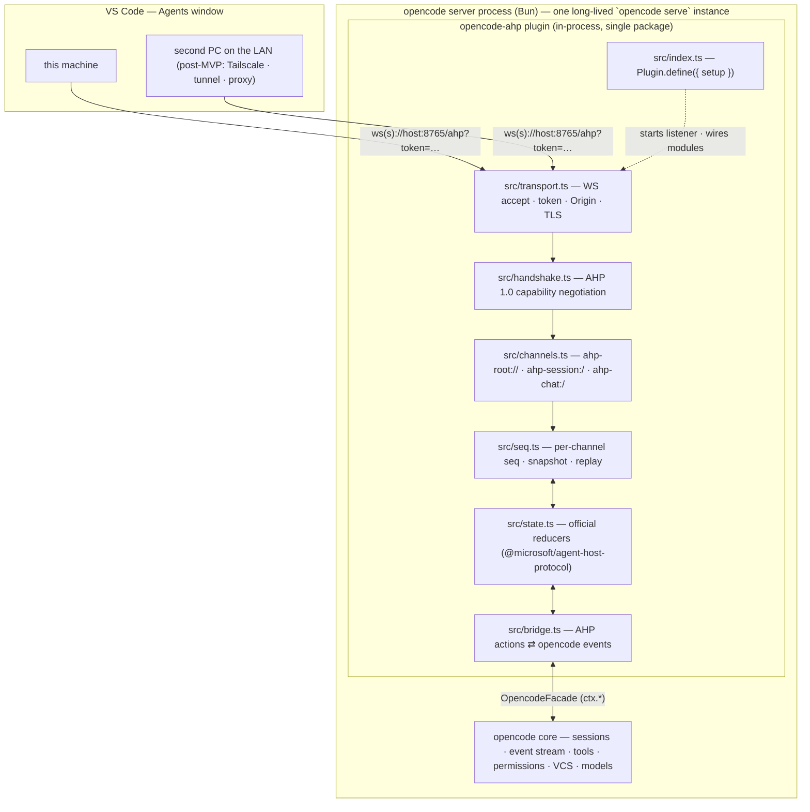
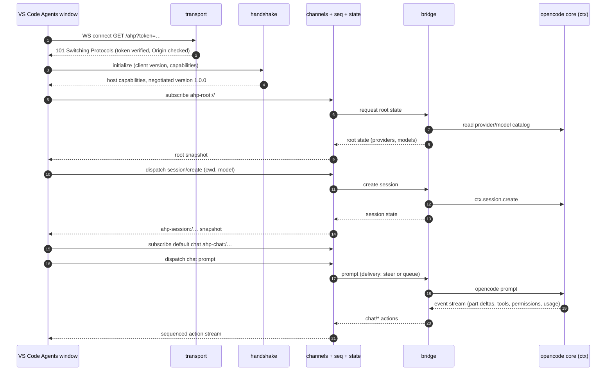
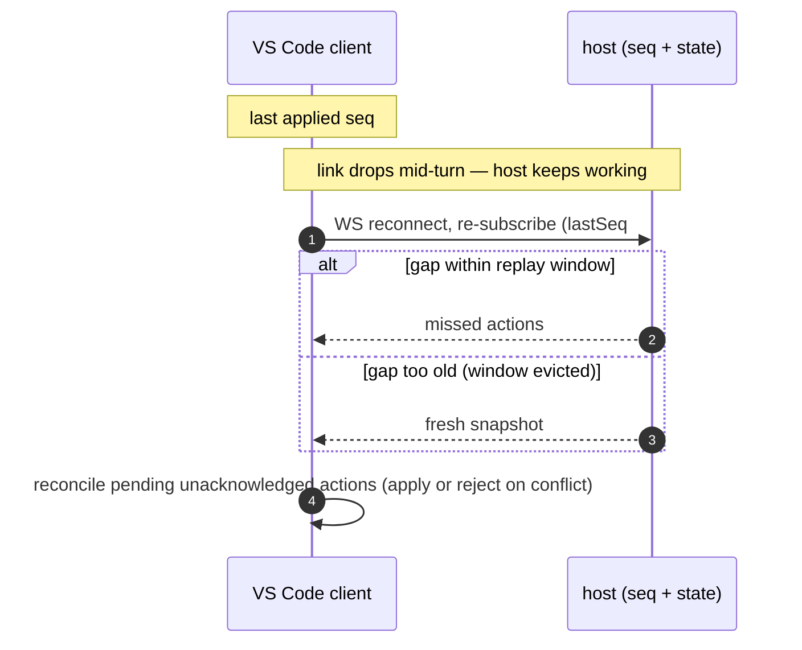

# Plan: `opencode-ahp`

An OpenCode V2 plugin (global, publishable) that hosts the **Agent Host
Protocol (AHP) 1.0.0 in-process** — opencode becomes a native agent in the
VS Code Agents window, on this machine and on remote ones.

**Repo pattern:** follows `llama-sync` (`/home/mattzink/llama-sync`) —
mise-managed toolchain, pnpm, single npm package shipping TypeScript source
(no build step), GitHub CI + npm trusted publishing, local-directory plugin
support, pure modules + vitest, `plan.md` kept current with a
deviations/findings section.

**Verification targets:** VS Code **1.145.2** Agents window (this machine +
one other PC on the local LAN — MVP scope per D3); AHP **1.0.0**
(published 2026-10-03 — 1.1 is a draft, unpublished, out of scope);
opencode **v2** (v2.2.6 at writing; npm `@opencode/cli`, repo
`anomalyco/opencode`).

**Registry facts verified 2026-11-07:** npm `opencode-ahp` is available
(registry 404); `@opencode/plugin` latest is **2.2.6**;
`@microsoft/agent-host-protocol` latest *published* is **1.0.0** (1.1.x
exists only as a doc draft).

---

## 1. Verdict

**Feasible.** Recommended path: an **opencode v2 plugin that hosts AHP
in-process** inside the opencode server. The plugin's `setup(ctx)` starts a
WebSocket listener; a bridge translates between AHP's channel/action model
and opencode's plugin `ctx` APIs (sessions, events, permissions, VCS,
tools, models).

A plugin beats a standalone service for our case:

- no second process to deploy, keep alive, or version-drift;
- direct in-process access to events, permissions, and VCS — no REST/SSE
  indirection;
- ships and updates with the opencode install (`opencode plugin update`).

**Key enabler:** the official `@microsoft/agent-host-protocol` TypeScript
package exports not just wire types but **all state reducers**
(`rootReducer`, `sessionReducer`, `chatReducer`, `changesetReducer`,
`terminalReducer`, …) plus `isClientDispatchable`, and client helpers
(`AhpClient`, `MultiHostClient`, `WebSocketTransport`; subpaths `/client`,
`/ws`, `/hosts`). A host therefore **reuses Microsoft's official state
machine** and only needs to build:

1. transport (WS accept, auth, origins, TLS),
2. channel registry (`ahp-root://`, `ahp-session:/`, `ahp-chat:/`, …),
3. sequencer/replay (per-channel sequences, snapshots, reconnect catch-up),
4. the opencode ↔ AHP bridge.

All four live as **pure modules inside one npm package** (the
`llama-sync` pattern). A standalone bin is out of scope (D4, 2026-11-07);
the pure-module layout would keep a future extraction cheap if it is ever
needed.

AHP is a coordination layer over ACP ("a mutex over ACP"), and opencode
already speaks ACP natively (`opencode acp`) — which is why ACP-bridge
stopgaps work at all. Our plugin goes one level deeper and skips the ACP
subprocess hop entirely.

---

## 2. Goals / Non-goals

### Goals

- **G1 — Native agent in the Agents window.** opencode appears as a
  provider in VS Code's Agents window: provider picker → model picker →
  session, with streaming, tool-call confirmations, and session list.
- **G2 — Remote access.** The host is reachable from other machines: one
  long-lived `opencode serve` instance, token auth, and a documented
  transport story (§5). MVP scope: **local LAN only** (D3, 2026-11-07);
  broader transports (Tailscale, dev tunnels, TLS proxies) are post-MVP.
- **G3 — AHP 1.0.0 conformance.** Passes the official conformance test
  suite for every capability we advertise.
- **G4 — Publishable.** GitHub `mattzink/opencode-ahp` + npm
  `opencode-ahp`, installable via `opencode plugin add`, CI-gated
  publishing per the house pattern (§10).

### Non-goals (v1)

- Replacing the opencode TUI or its own UI.
- Standalone (non-plugin) host binary (D4, 2026-11-07).
- AHP 1.1-draft features (automations, and other in-flux items).
- Multi-user / multi-tenant policy, sandboxing.
- Windows-first deployment polish (build for Linux first, verify
  cross-platform later).
- **Turn/message history hydration** — reconstructing past turns after a
  location reload from `ctx.session.context` via AHP's `fetchTurns` /
  `chat/turnsLoaded`. **Future work, not a v1/MVP extension** (it is
  extension-scale, and the current VS Code client never requests it). The
  gap, the durable-data source, and the AHP wire path are documented in
  §14.14; it is the only previous-feature durability item worth scheduling
  once the MVP extensions are done.
- **Terminals beyond the synthetic command terminals** — the
  persistent-pty read-only mirror (§14.16 option b) and
  client-interactive terminals (option d, which needs an opencode pty
  plugin surface). **Post-MVP** (decision 2026-11-09, §14.16); the MVP
  terminal scope is option (c) only — synthetic `isPty: false`
  terminals from `shell`-tool executions, read-only.

---

## 3. Feasibility

### 3.1 AHP 1.0.0 mechanics (what a host must implement)

- **JSON-RPC 2.0 over WebSocket.**
- **Connection handshake / capability negotiation** with semver versioning
  (1.0 changed this from the draft's integer `1`).
- **Channels**: `ahp-root://` (provider/model catalog),
  `ahp-session:/<id>`, `ahp-chat:/<id>`, plus optional changeset and
  terminal channels. (Draft-era URIs `agenthost:/root`,
  `opencode:/<uuid>` are gone.)
- **Snapshot + sequenced actions**: each channel has a snapshot and a
  monotonic action sequence; any client can join at any sequence number and
  replay.
- **Write-ahead reconciliation**: clients dispatch actions optimistically;
  the host is the state arbiter (can reject/reconcile conflicts); on
  reconnect the host sends missed actions or a fresh snapshot, and the
  client reconciles its pending actions.
- **Optional, negotiated capabilities**: terminals, automations,
  elicitation, client-provided tools, etc. — a host may start with "just
  chat" and add more (VS Code handles absence gracefully).
- **Conformance**: language-independent test fixtures in
  [`microsoft/agent-host-protocol` → `types/test-cases`](https://github.com/microsoft/agent-host-protocol/tree/main/types/test-cases).
  This is our parity exit criterion.

### 3.2 opencode v2 capability mapping

opencode v2: Bun-based server (default port 4096, `opencode serve`),
plugins run **in the server process** with a `ctx` surface covering
session / event / permission / vcs / model / provider / tool / storage plus
hooks.

| AHP 1.0 feature | opencode v2 surface | Status |
| --- | --- | --- |
| Provider & model catalog | `ctx.model` / provider + model listings | ✅ direct |
| Session create / list / load | `ctx.session` (v2 session API) | ✅ direct |
| Chat prompts | v2 prompt API with `delivery: "steer" \| "queue"` | ✅ direct → maps to AHP steering + queued pending messages |
| Streaming parts (text / reasoning) | event stream (`V2EventEncoded` part deltas) | ⚠️ event catalog audit needed (Phase 0) |
| Tool lifecycle events | tool events / `ctx.tool` | ⚠️ audit needed (Phase 0) |
| Tool-call confirmation / permissions | `ctx.permission` (list / reply + `evaluate` hook) | ✅ direct |
| Changesets (uncommitted / session / per-turn diffs) | `ctx.vcs.status()` / `ctx.vcs.diff()` | ✅ direct |
| Model picker / session options | model + mode configuration | ✅ direct |
| Custom-agent picker (Build/Plan/…) | `ctx.agent` (`list` / `get`) + `agent.updated` event | ✅ direct → `AgentCustomization` children + `Message.agent` (§14.7); catalog side **implemented** (Phase 0 increment, 2026-11-07) — `AgentInfo.customizations` carries the workspace agent container; `Message.agent` → prompt agent lands with Phase 1 sessions |
| Client-provided tools | `ctx.tool.transform` | ✅ direct (Phase 4) |
| Terminals | `ctx.experimental.terminal.read` only (read-only screen snapshot of the session's selected terminal; no create / write / attach / list on the plugin ctx) | ⚠️ read-only surface (AHP-optional — not capability-negotiated in 1.0.0); **MVP scope = option (c)** synthetic `isPty: false` shell-command terminals, read-only; mirror (b) + interactive (d) deferred post-MVP — §14.16 |
| Automations | — | ❌ gap (1.1-draft territory) |
| Multiple chats per session | one chat per session | ❌ gap (matches pi-ahp / ahp-acp-gateway) |
| Elicitation | partial | ⚠️ partial |

### 3.3 Risks

| # | Risk | Mitigation |
| --- | --- | --- |
| R1 | **Young plugin API** — opencode v2 is ~2 months old (2.0 → 2.2.6 in that span); surfaces may move | Pin `@opencode/plugin` to a tested version (llama-sync precedent); keep the bridge thin so it's cheap to adapt; test across patch releases |
| R2 | **A plugin crash takes down the server process** (plugins run in-process) | Defensive bridge code — never throw across the transport boundary; keep the listener failure-isolated; consider a Bun Worker if instability appears |
| R3 | **Plugin is per-server-instance** (TUI vs `opencode serve`) | Document + README runbook: run **one long-lived `opencode serve` instance** as the AHP host |
| R4 | **Token in `?token=` query param is cleartext on plain `ws://`** | Non-loopback bind *requires* a token (refuse to start otherwise); LAN/Tailscale for plain ws; `wss://` off-LAN (Bun.serve terminates TLS natively) |
| R5 | **Origin handling** — VS Code desktop sends `Origin` headers; naive hosts reject or over-allow | `allowedOrigins` policy **while always enforcing the token** (token is the only credential); matrix-tested (Phase 0/1) |
| R6 | **`Bun.serve` is a Bun-only API** — availability inside the plugin context is unverified (the opencode v2 server is Bun, but the plugin sandbox could differ) | Phase 0 verifies it; fallback is the `ws` package (works on Node and Bun) behind the same `transport.ts` interface |

---

## 4. Existing implementations

### 4.1 Comparison

| Implementation | What it is | Verdict for us |
| --- | --- | --- |
| **[maxious/opencode-plugin-agent-host-protocol](https://github.com/maxious/opencode-plugin-agent-host-protocol)** | opencode plugin hosting an AHP WS server | **Closest prior art, but stale** — detailed below |
| **[formulahendry/ahp-acp-gateway](https://github.com/formulahendry/ahp-acp-gateway)** | Standalone AHP ⇄ ACP gateway (Node 24+), stateful, protocol-compliant | **Behavioral reference** (stopgap declined, D3); opencode is its default built-in ACP provider |
| **[Qusic/pi-ahp](https://github.com/Qusic/pi-ahp)** | AHP host for the pi coding agent (WS) — official AHP registry | **Best pattern reference** for "embed agent → AHP host" + VS Code integration steps |
| **[softov/ahpd](https://github.com/softov/ahpd)** | AHP host over WS that runs plugins (agent, ports, server tools installed, not built-in); `@ahpd/sdk` for building hosts; opencode preset via `@ahpd/agent-acp` — official registry | Alternative stopgap; confirms the plugin/daemon shape |
| **VS Code's bundled Agent Host** (`src/vs/platform/agentHost/node/`) | Microsoft's **reference AHP server** (Copilot/Claude/Codex adapters) | Reference for protocol behavior and edge cases |
| hydra-ahp, AgentConnect (found in GitHub search) | Other community AHP projects; not in the official registry | Found during investigation, not evaluated in depth — revisit only if they resurface |

Notable AHP *clients* (useful for testing our host beyond VS Code):
**AHPX** (CLI/Node client), **ahpc** (terminal client + tool server). VS
Code itself is the primary client for us.

### 4.2 maxious plugin — detailed notes

- **3,844 LOC, 9 commits, last commit 2026-04-02** — effectively
  unmaintained.
- Targets the **opencode v1 plugin API** and the **pre-1.0 protocol
  draft**: integer protocol version `1`, `agenthost:/root` /
  `opencode:/<uuid>` channel URIs, 25 `session/*` actions. AHP 1.0 changed
  all three axes (semver negotiation; `ahp-root://` / `ahp-session:/` /
  `ahp-chat:/`; `chat/*` action namespace).
- Layout worth salvaging: `src/ws-server.ts`, `src/session-manager.ts`,
  `src/permission-bridge.ts`, `src/protocol/*`, plus its test and
  client-state code.
- **Verdict (D1, 2026-11-07): no code reuse** — a fresh build against AHP
  1.0; nothing is copied from this repo. Its only value is as a source of
  good test cases and scenarios (permission round trips, reconnect edge
  cases, client-state bookkeeping questions) to inform §9. (Clone at
  `/tmp/opencode/ahp-investigation/opencode-plugin-agent-host-protocol`.)

### 4.3 ahp-acp-gateway — notes

- `npx --yes ahp-acp-gateway` → AHP WS at `ws://127.0.0.1:8765/ahp`, health
  at `/healthz`, SQLite persistence at `~/.ahp-acp-gateway/`.
- **opencode is the default built-in ACP provider**
  (`npx --yes @opencode/cli acp`); E2E-tested against the VS Code Agents
  window.
- Features: replay with snapshot fallback, restart repair, changeset
  channels (uncommitted/session/per-turn, incl. `discard-changes`), token
  auth, strict Origin allowlist option, Docker image + one-click Azure
  Container Apps deploy (yields `wss://<fqdn>/ahp?token=...`).
- Limitations: ACP v1 only, one chat per session, read-only resources,
  pipe-backed terminals, no MCP forwarding, bundled provider catalog.
- **Use:** no stopgap — D3 declines it (we build our own host, and the MVP
  only needs LAN reachability). Remaining value: behavioral reference —
  its deployment config is exactly the surface a host should expose
  (`/ahp` path, `/healthz`, token, Origin policy).
- Its README documents the `chat.remoteAgentHosts` JSON setting against the
  current Agents window — evidence that path still works in 1.145.

---

## 5. Remote access (VS Code 1.145.2 — MVP scope: local LAN per D3)

### 5.1 Registering a third-party AHP host in VS Code

- **Agents window** (`Chat: Open Agents Window`, or `code --agents`):
  **`Agents: Add Remote Agent Host...`** (added in 1.144) → paste the
  `ws(s)://` URL. No sign-in needed; the token is the only credential.
- **`settings.json` — JSON-only in 1.145, *not* surfaced in the settings
  UI:**

  ```jsonc
  "chat.remoteAgentHosts": [
    { "name": "opencode", "address": "wss://host.example:8765/ahp?token=..." }
  ]
  ```

  `address` accepts a bare `host:port/path` (ws://) or a full `wss://`
  URL. Reopen the Agents window after saving. **With Settings Sync on,
  this one line propagates to all of the user's PCs automatically** — the
  simplest multi-PC story.
- Related UI-visible settings: `chat.remoteAgentHostsEnabled` (on by
  default), `chat.remoteAgentHostsAutoConnect`.

### 5.2 Important: the built-in remote flows are NOT a path for third-party hosts

The Agents window's **SSH** and **Dev tunnels** connection methods
auto-install the VS Code CLI on the remote machine and run **VS Code's own
bundled Agent Host**. GitHub Environments (Preview) registers a machine for
the bundled host + supported Copilot clients. **None of these run our
opencode plugin.** For a third-party host, what matters is purely network
reachability of the raw `ws(s)://` URL — everything else is client-side
registration (trivial: one line per PC or the command above).

### 5.3 Transport options

**MVP (D3): local LAN only** — plain `ws://` + token on the LAN. No
Tailscale, tunnels, or TLS needed for the MVP; the rest are post-MVP
options:

| Transport | When | Notes |
| --- | --- | --- |
| LAN `ws://` (**MVP**) | same network | the MVP transport (D3); token in query string is cleartext — LAN only, by design |
| **Tailscale** (post-MVP) | user's own PCs across networks | `ws://100.x.y.z:8765/ahp?token=` — or `wss://` via Tailscale Serve. Encrypted, zero firewall changes |
| **Dev tunnels as a port forward** | any internet-reachable PC | `code tunnel --forward 8765:8765` exposes the port as a `wss://` endpoint through the Azure relay (outbound-only on the host, auth by account). This is a generic TLS port forward — *not* the auto-discovery flow |
| Cloudflare Tunnel / any TLS proxy | same idea | any `wss://` endpoint under our control |

### 5.4 Host-side requirements (inform Phase 0/1)

- Accept the token via `?token=` query param (and `Authorization: Bearer`
  too).
- Handle VS Code desktop `Origin` headers — allow them while still
  enforcing the token.
- Accept whatever path the URL carries (e.g. `/ahp`).
- Support `wss://` via native TLS in `Bun.serve` — **post-MVP**; only
  needed for off-LAN transports, which are out of MVP scope (D3).

---

## 6. Proposed architecture

Single npm package, in-process plugin. The protocol machinery is a set of
**pure modules** (no `ctx` imports, unit-testable without an OpenCode
runtime — the llama-sync principle); only `src/index.ts` touches `ctx`, and
it does so through a narrow `OpencodeFacade` interface that `bridge.ts`
defines and `index.ts` implements (dependency inversion: bridge tests
inject a fake facade).

### 6.1 Components



Component responsibilities:

- **`transport.ts`** — WS accept (`Bun.serve`, fallback `ws` package —
  R6), token auth (query + Bearer), Origin policy, optional TLS,
  `/healthz`, non-loopback guard (R4).
- **`handshake.ts`** — AHP 1.0.0 `initialize`: semver capability
  negotiation; accept 1.0.x, reject anything else with the supported list;
  advertise only the capabilities we implement.
- **`channels.ts` + `seq.ts` + `state.ts`** — channel registry; per-channel
  monotonic sequences, snapshots, replay window; state computed by the
  **official reducers** (we never hand-roll state transitions).
- **`bridge.ts`** — the only opencode-aware module: maps AHP actions to
  `OpencodeFacade` calls (session create, prompt with `delivery:
  steer|queue`, permission reply, VCS status/diff) and opencode events to
  AHP chat actions (part deltas, tool lifecycle, permission events, usage).

### 6.2 Connection + session (happy path)



### 6.3 Reconnect + replay (write-ahead reconciliation)



---

## 7. Repository layout & dev toolchain

House pattern per `llama-sync` (verified against that repo 2026-11-07):

```
opencode-ahp/
├── plan.md                     # this file
├── mise.toml                   # node 26; pnpm adopted from package.json
│                               #   packageManager; node_modules/.bin on PATH;
│                               #   `setup` task (pnpm install, source/output tracking)
├── package.json                # name opencode-ahp, type: module,
│                               #   exports { ".": "./src/index.ts" },
│                               #   packageManager pnpm@12.x, engines node >=20,
│                               #   scripts: typecheck / test / prepublishOnly
├── pnpm-workspace.yaml         # pnpm 10+ knobs (allowBuilds / minimumReleaseAgeExclude as needed)
├── pnpm-lock.yaml
├── tsconfig.json               # strict, NodeNext, ES2022, noEmit — no build step;
│                               #   ships TS source, opencode (Bun) runs it directly
├── vitest.config.ts            # include src/test/**/*.test.ts
├── .gitignore                  # node_modules/, dist/, *.tsbuildinfo
├── README.md                   # what/why, install, options, remote access, dev, publishing
├── LICENSE                     # MIT
├── options.example.jsonc       # documented option set (copied to options.jsonc when
│                               #   running from a checkout; npm installs ship none)
├── index.ts                    # one-line re-export of ./src/index.js — see below
├── .github/workflows/ci.yml    # jdx/mise-action@v5 → install, typecheck, test
├── .github/workflows/publish.yml # trusted publishing (OIDC) → npm publish on push to main
└── src/
    ├── index.ts                # Plugin.define entry: options, listener lifecycle,
    │                           #   OpencodeFacade impl (the only ctx call sites), cleanup
    ├── options.ts              # resolution: ctx.options ▸ options.jsonc sibling ▸ built-ins (pure)
    ├── transport.ts            # WS accept, token auth, Origin policy, TLS, /healthz (R6 interface)
    ├── handshake.ts            # AHP 1.0 initialize / semver capability negotiation (pure)
    ├── channels.ts             # channel registry: ahp-root://, ahp-session:/, ahp-chat:/ (pure)
    ├── seq.ts                  # per-channel sequencer: sequences, snapshots, replay window (pure)
    ├── state.ts                # official reducer wiring (@microsoft/agent-host-protocol) (pure)
    ├── bridge.ts               # AHP action ⇄ opencode event mappers + OpencodeFacade interface (pure w/ injected facade)
    └── test/
        ├── options.test.ts
        ├── transport.test.ts   # token/Origin matrix, path routing, non-loopback guard
        ├── handshake.test.ts   # version negotiation matrix (1.0.x accept, 1.1-draft/older reject)
        ├── channels.test.ts
        ├── seq.test.ts         # seq, snapshot, replay window, multi-client ordering
        ├── bridge.test.ts      # event→action + action→facade-call mapping (fake facade)
        └── fixtures/
            ├── ahp-*.json      # captured AHP 1.0.0 frames (official conformance suite + live)
            └── opencode-*.json # captured V2EventEncoded fixtures (Phase 0 audit)
```

**Dependencies:** `@opencode/plugin` pinned to a tested v2 line (latest at
writing: 2.2.6 — llama-sync precedent: pin the version actually
implemented, not `latest`); `@microsoft/agent-host-protocol` **strict-pinned
to `1.0.0`** (1.1.x is draft/unpublished). Dev: `typescript` ^7.x,
`vitest` ^5.x, `@types/node` ^26 (llama-sync toolchain versions).

**Dev tooling via mise** (identical pattern to llama-sync): `mise.toml`
pins `node = "26"`, adopts the pnpm version from `package.json`
`packageManager` (`idiomatic_version_file_enable_tools = ["pnpm"]`), puts
`node_modules/.bin` on PATH, and defines a `setup` task (`pnpm install`
with source/output tracking). Locally, `mise install` provisions
everything; all scripts run via pnpm. CI installs the toolchain with
`jdx/mise-action@v5` before `pnpm install --frozen-lockfile` (§10).

**Root `index.ts` (local-directory plugin support):** OpenCode resolves
*local-directory* plugin entries to `<dir>/index.*` (`Host.resolve`) and
does **not** read `package.json` `exports` for that case (llama-sync
implementation finding §10.1.3). The one-line re-export
`export { default } from "./src/index.js"` exists solely for that path; npm
and git installs resolve through `exports["."]` and are unaffected.

**Pure-module principle:** `options`, `handshake`, `channels`, `seq`,
`state`, and the `bridge` mappers take plain data in and return plain data
out — fully unit-testable without an OpenCode runtime. Only `src/index.ts`
touches `ctx` (as the `OpencodeFacade` implementation). All green before
wiring the live `ctx`.

---

## 8. Plugin design

### 8.1 Lifecycle (`src/index.ts`)

```ts
export default Plugin.define({
  id: "opencode-ahp",
  async setup(ctx) {
    const opts = resolveOptions(ctx.options, readOptionsFile())
    //   options.ts; malformed sibling file → one error log + ctx.options + built-ins
    if (!opts.enabled) return
    const facade = implementFacade(ctx)          // bridge.ts interface; the only ctx call sites
    const host = createHost({
      state: createState(),                      // state.ts — official reducers
      channels: createChannels(),                // channels.ts
      seq: createSeq({ replayWindow: opts.replayWindow }),
      bridge: createBridge(facade),              // bridge.ts — pure w/ injected facade
    })
    const token = opts.token ?? (await ensureToken(ctx.storage))
    //   generate + persist via ctx.storage + print once to the server log
    const server = await startServer(opts, token, host)
    //   transport.ts: Bun.serve (websocket + optional TLS) — fallback: ws package (R6)
    log(`${TAG} AHP 1.0.0 host listening on ws${opts.tls ? "s" : ""}://${opts.host}:${opts.port}${opts.path}`)
    return () => { server.stop() }               // cleanup: close all client connections
  },
})
```

Ordering notes:

- Options resolve **before** anything else; the plugin is fully inert
  (`enabled: false` or missing options) rather than partially up.
- The token is persisted in `ctx.storage` so restarts reuse it — a printed
  token must not go stale on `opencode service restart`.
- The listener is the *only* thing `setup` starts; all protocol behavior
  hangs off it. `console` output uses the `[opencode-ahp]` TAG prefix
  (house pattern: untimestamped stdout lines in the service log — grep
  `\[opencode-ahp\]`).
- Every failure path logs and stays up: a bad client connection or a
  bridge error must never take down the opencode server (R2).

### 8.2 Options (draft — finalize in Phase 1)

Resolution order per key (house pattern): `ctx.options` (object-form
config entry) ▸ `options.jsonc` sibling of `src/index.ts` (npm installs
ship none — copy `options.example.jsonc` if using a checkout) ▸ built-in
defaults.

| Key | Type | Default | Description |
| --- | --- | --- | --- |
| `enabled` | boolean | `true` | Master switch; `false` → no listener, plugin inert |
| `port` | number | `8765` | WS listen port |
| `host` | string | `"127.0.0.1"` | Bind address; **non-loopback requires a token** (refuse to start otherwise, R4) |
| `path` | string | `"/ahp"` | WS path — VS Code's URL carries it verbatim (§5.4) |
| `token` | string \| null | auto | Generated on first start, persisted in `ctx.storage`, printed once; explicit value supported. Accepted via `?token=` query param and `Authorization: Bearer` |
| `allowedOrigins` | string[] \| `"*"` | `"*"` | Origin allowlist; the token is always required regardless (R5) |
| `tls` | `{ keyPath, certPath }` \| null | `null` | Native TLS via `Bun.serve` → `wss://` for off-LAN transports (§5.3) |
| `healthPath` | string | `"/healthz"` | Plain-HTTP health endpoint (no auth) |
| `replayWindow` | number | `1000` | Per-channel actions kept for reconnect replay; older gaps → fresh snapshot (§6.3) |
| `capabilities` | object | `{ changesets: true, terminals: true, automations: false }` | Host-side switches — never advertise what we don't implement (in AHP 1.0.0 none is a wire field — §14.16). `changesets` flipped to `true` in Phase 2 (D2); `terminals` flipped to `true` with the Phase 4 extension 3 build (§14.17) |

### 8.3 Installation mechanics (avoids double-load)

The repo lives at `~/opencode-ahp` — **not** inside any
`.opencode/plugins/` or `~/.config/opencode/plugins/` discovery path — and
is loaded exclusively through an explicit `plugins` entry (house pattern,
llama-sync R5).

- **Dev (this machine):** global `~/.config/opencode/opencode.jsonc`

  ```jsonc
  "plugins": [{
    "package": "/home/mattzink/opencode-ahp",
    "options": { /* per §8.2 */ }
  }]
  ```

  (This is the local-directory path served by the root `index.ts`, §7.)
- **Published:** `opencode plugin add opencode-ahp` (npm) or
  `opencode plugin add github:mattzink/opencode-ahp` (git); remove the dev
  entry.
- **Updating:** `latest` tracks the newest `main` build but installed
  copies don't auto-update — `opencode plugin update opencode-ahp` +
  `opencode service restart`. Pinned entries
  (e.g. `opencode-ahp@0.1.42`) are skipped by updates by design.

---

## 9. Testing plan

### 9.1 Unit tests (vitest)

Pure modules, no OpenCode runtime — all green before wiring the live
`ctx` (house pattern):

- `options.test.ts` — resolution precedence matrix (ctx.options ▸
  sibling file ▸ defaults), JSONC stripping (comments, trailing commas),
  missing/malformed file.
- `handshake.test.ts` — param validation (channel, clientId,
  protocolVersions shape); version negotiation (1.0.x accepted, newer 1.x
  offers echoed, 0.9.x baseline accepted, 0.8.x/2.x rejected with the
  supported list); result shape (serverSeq, serverInfo, defaultDirectory,
  initialSubscriptions resolution). AHP 1.0.0 has no capability fields —
  the capability switches are host-side options (§14.16).
- `transport.test.ts` — token matrix (missing / wrong / correct, via query
  and via Bearer); Origin matrix (allow-all-with-token, allowlist, VS Code
  desktop Origin values); path routing (`/ahp` vs `/healthz` vs 404);
  non-loopback without token → refuse to start.
- `channels.test.ts` + `seq.test.ts` — snapshot on subscribe; monotonic
  seq; multi-client broadcast ordering; replay window (within → replay,
  evicted → snapshot); client-dispatchable gating via
  `isClientDispatchable`.
- `bridge.test.ts` — with a fake `OpencodeFacade`: opencode event → AHP
  chat action mapping (part deltas, tool lifecycle, permission events,
  usage) per the Phase 0 audit; AHP action → facade call mapping (session
  create, prompt with `delivery: steer|queue`, permission reply, VCS
  status/diff for changesets).
- **Fixtures:** captured AHP 1.0.0 frames from the official conformance
  suite (`types/test-cases`) plus live captures; `V2EventEncoded` fixtures
  captured during the Phase 0 audit.

### 9.2 Static checks

`pnpm typecheck` = `tsc --noEmit` (strict, NodeNext) over `src/` incl.
tests; `pnpm test` = `vitest run`. Toolchain (node 26 + pnpm) from
`mise.toml` (§7); CI runs `jdx/mise-action@v5`,
`pnpm install --frozen-lockfile`, then typecheck + vitest on push/PR
(§10).

### 9.3 Conformance (Phase 5 — last phase)

The official AHP conformance fixtures
(`microsoft/agent-host-protocol` → `types/test-cases`) run against our
host over WebSocket. Exit criterion: green for every capability in
`options.capabilities`.

### 9.4 Manual E2E checklist (this machine + one LAN PC)

1. Dev local-directory entry added; `opencode service restart` (or config
   hot-reload); plugin active; `curl 127.0.0.1:8765/healthz` → 200;
   listener line in the service log.
2. Same-machine VS Code: `Agents: Add Remote Agent Host...` →
   `ws://127.0.0.1:8765/ahp?token=…` → host appears in the Agents window
   picker.
3. New session: opencode appears in the agent picker; the model picker
   shows the **real** opencode catalog (spot-check 2–3 models).
4. Prompt round trip: text streams in as `chat/*` actions; reasoning parts
   when the model produces them.
5. Permission round trip: prompt that triggers a tool needing approval →
   approval prompt in the Agents window; approve → tool runs; deny → tool
   blocked.
6. Token enforcement: no token → rejected; wrong token → rejected;
   correct token from a VS Code desktop Origin → accepted (Origin policy,
   R5).
7. Reconnect: drop the link mid-turn (airplane mode / `ss -K`), reconnect
   → replay or snapshot (§6.3); no duplicate turns; pending actions
   reconcile.
8. Multi-client: two Agents windows (or the AHPX CLI) observe the same
   session; action streams match.
9. Restart stability: `opencode service restart` → listener returns,
   clients reconnect, sessions persist (opencode owns session state).
10. **Second PC on the LAN**: `ws://<lan-ip>:8765/ahp?token=…` → full
    round trip (Phase 1 exit criterion — MVP is LAN-only per D3).
11. (Phase 1) **Steering** (D2): a mid-turn steer reaches the active
    turn; a queued message waits until the turn completes
    (`delivery: steer|queue`).
12. (Phase 2) Changesets: prompt that edits files → uncommitted/session
    diffs appear; `discard-changes` works.

**Exit criteria:** MVP = items 1–11 (Phase 1); parity = item 12
(Phase 2); §9.3 conformance green = Phase 5 (last phase).

---

## 10. CI & publishing (house pattern)

### 10.1 CI — `.github/workflows/ci.yml`

Push to `main` + pull requests: checkout → **`jdx/mise-action@v5`** (Node
26 + pnpm per `mise.toml`/`packageManager`; no `version` input — the
action defaults to the newest stable mise ≥24 h old; `"latest"` is *not* a
magic value) → `pnpm install --frozen-lockfile` → `pnpm typecheck` →
`pnpm test`.

### 10.2 Publish — `.github/workflows/publish.yml`

Push to `main`; publishes must land in commit order, so
`concurrency: { group: publish, cancel-in-progress: false }` (never cancel
a running publish — a stale build finishing after a newer one must not win
the `latest` tag).

- `permissions: { id-token: write, contents: write }` — **npm trusted
  publishing (OIDC)**: the npm CLI exchanges the OIDC token GitHub mints
  for this specific run of this specific workflow file for a short-lived
  publish credential — no npm token or repo secret stored anywhere.
  `contents: write` backs the per-build GitHub release.
- Steps: **full-clone** checkout (`fetch-depth: 0` — the release-notes step
  resolves the push's `event.before` commit) → `jdx/mise-action@v5` →
  install → typecheck → test → **compute version** (base `major.minor`
  from `package.json` + `GITHUB_RUN_NUMBER`, e.g. base `0.1.0` + run 7 →
  `0.1.7`; failed runs consume a number, so the sequence may have gaps —
  each published version is unique either way) →
  `pnpm version <v> --no-git-tag-version` → **`npm publish`** (the *npm*
  CLI — not pnpm — detects the OIDC environment and performs the token
  exchange; unscoped name is public by default; `prepublishOnly` re-runs
  typecheck + tests as a final gate) → **write release notes** (short
  pointer to the README install instructions + `opencode plugin add
  opencode-ahp@<v>` pin + the commits in `event.before..GITHUB_SHA` —
  GitHub's `generate_release_notes` only lists merged PRs, which is useless
  for a project that commits directly to main) → **create release**
  (`softprops/action-gh-release@v3`, tag `v<v>`; creates the tag when
  missing, updates the release when the tag exists).

**One-time trusted-publisher setup** (house pattern):

1. Publish the base once from a checkout (`npm login`, `npm publish`) —
   creates the package, required before a trusted publisher can be
   configured.
2. npmjs.com → `opencode-ahp` → **Package settings → Trusted publishers
   → Add**: GitHub Actions, user `mattzink`, repository `opencode-ahp`,
   workflow filename `publish.yml` — and tick **Allow `npm publish`**
   (configurations created after 2026-09-03 default to *staged* publishing
   only, which would leave every build awaiting manual approval).
3. Push to `main`; the first automated release lands as `0.1.<n>`. Because
   the repo is public, npm attaches a provenance attestation to each build.

Note: `repository.url` in `package.json` must keep matching the GitHub
repository exactly — npm validates it against the publisher configuration.

**Versioning:** base starts at `0.1.0` (→ publishes `0.1.<n>`); bump the
base in `package.json` to move builds to a new era (e.g. `1.0.0` once the
MVP is stable → `1.0.<n>`).

### 10.3 Install / update (end user)

- `opencode plugin add opencode-ahp` (npm) or
  `opencode plugin add github:mattzink/opencode-ahp` (git).
- Update: `opencode plugin update opencode-ahp` + `opencode service
  restart`. Pin a build: `opencode plugin add opencode-ahp@0.1.42`.
- Manual publish from a checkout: `npm publish` (gates run via
  `prepublishOnly`).

---

## 11. Phased plan

### Phase 0 — Spike (de-risk the load-bearing assumptions)

- [x] Scaffold the repo per §7 (mise.toml, package.json + lock, tsconfig,
      vitest config, .gitignore, root `index.ts`, options.example.jsonc,
      CI skeleton) — `mise install` green. (Deltas vs the §7 tree:
      `src/host.ts`, `scripts/`, `docs/` — see §14.)
- [x] `Bun.serve` websocket started from a v2 plugin `setup(ctx)` accepts a
      connection (hello-world AHP client); if the plugin context forbids
      raw listeners → `ws`-package fallback behind `transport.ts` (R6).
      **R6 resolved: no fallback needed** (verified live, §14).
- [x] **Audit the `V2EventEncoded` event catalog**: part deltas, tool
      lifecycle, permission events, usage — lock the §3.2 mapping; capture
      fixtures for `src/test/fixtures/`. (Fixture: `events.jsonl`, full
      tool-using turn; mapping table + gaps in §14.)
- [x] Minimal AHP `initialize` (semver negotiation, 1.0.0 only) +
      `ahp-root://` channel serving the **real** opencode provider/model
      catalog. (Live: 2 agents / 16 models; error matrix -32005/-32602
      verified, §14.)
- [x] Two-machine VS Code test: Agents window on PC A → host on PC B;
      token + Origin handling verified end-to-end.
      **Verified live 2026-11-07** (PC B `10.0.1.52`, VS Code 1.145.2,
      Agents window): host registration, handshake, token + Origin, root
      catalog all confirmed in the real UI; findings in §14.7.

**Exit criteria:** all boxes checked; §3.2 gaps confirmed or resolved;
go/no-go on Phase 1 scope. **MET** — Phase 1 is underway (the agent-
catalog increment of §14.7 shipped as a Phase 0 add-on, 2026-11-07).

### Phase 1 — MVP (daily-drivable)

**Status (2026-11-08):** core host complete — `createSession` (with the
`SessionState.customizations` agent picker that fixes the empty
dropdown), session/chat stores on the official reducers, full event pump
(turns, streaming, tool lifecycle, permissions, steering/queue, usage,
summary sync), client-dispatchable actions with echo/rejection
semantics. 156/156 tests green, typecheck clean; live end-to-end
verification passed on the LAN host (`scripts/ahp-phase1.mjs` —
§14.9). **PC B confirmation received** (user screenshot): the Agents
window dropdown lists Agent/Build/Plan + "Configure Custom Agents…" —
General/Explore correctly absent (subagents), gpuz pill + Qwen 3.8 DFlash2
model intact. **First publish done (2026-11-08):** npm
`opencode-ahp` registered (0.0.0-stage placeholder) + trusted publisher
(GitHub Actions, `publish.yml`, allow `npm publish`); the workflow
publishes `0.1.<run>` (gaps in the run numbers are expected) —
`latest` was `0.1.1` when the keep-alive work started. The LAN host
config is flipped to the npm spec (`"package": "opencode-ahp"`),
location reloaded via `POST /api/location/reload`, and the live probe
confirms it runs the published artifact (`serverInfo.version` 0.1.1) —
the full Phase 1 lifecycle (`scripts/ahp-phase1.mjs`) passes against
it. **Keep-alive shipped (2026-11-08, §15):** the idle-timeout
workaround (`location_idle_timeout: false`) is gone — the plugin keeps
its own location loaded; both friction steps are reduced to the
one-time cold boot (an opencode limit, README step 3). Live-verified on
the LAN host without the flag (keep-alive active, anchor hidden from
`listSessions`, `keepAliveAt` advancing, full lifecycle green).
Remaining: publish the keep-alive version and re-flip the LAN host to
it; E2E checklist §9.4 items 5/6/7/11 from PC B; optional AHP entry in
the daily `:80` global config (that service currently has no AHP
plugin entry — same-machine VS Code use would need one); upstream
feature request (auto-boot / server-scoped plugin hook + the
`session.update` `archived` gap, §15).

Working order (house pattern: pure modules + tests first, wiring last):

- Pure modules + unit tests: `options`, `handshake`, `transport` (policy),
  `channels`, `seq`, `bridge` mappers — green before live `ctx`.
- `src/index.ts` lifecycle wiring (§8.1): listener, facade, cleanup.
- Bridge MVP: session create/list; prompt; streaming text/reasoning;
  tool-call events; **permission prompts (approve/deny via
  `ctx.permission`)**; **steering + queued pending messages (prompt
  `delivery: steer|queue` — D2)**; model picker from the opencode
  catalog; **opencode agents as AHP custom agents** (the
  `AgentInfo.customizations` catalog side **already shipped** as a
  Phase 0 increment, 2026-11-07 — `mapAgentCustomizations` +
  `agentDirectoryCustomization` in `bridge.ts`, verified by the
  two-machine test; the session side — `AgentCustomization` children of
  the workspace directory in `SessionState.customizations` and
  `Message.agent` on `chat/turnStarted` → prompt agent — lands with
  sessions — §14.7).
- Options per §8.2 (finalize defaults); generated token; listener log line.
- README (what/why, install, options, remote access §5, development,
  publishing) + LICENSE.
- E2E checklist items 1–10 (§9.4).
- **First publish:** push to GitHub (`mattzink/opencode-ahp`); manual base
  publish + trusted-publisher setup (§10.2); flip this machine's dev entry
  to the npm spec; `publish.yml` live.

**Exit criteria:** daily-drivable from a second PC on the LAN (D3); no
lost messages on normal disconnect/reconnect.

### Phase 2 — Parity (changesets + reconciliation)

- **Changesets** (deferred from Phase 1 per D2): uncommitted / session /
  per-turn diff channels from `ctx.vcs` (mirror ahp-acp-gateway's channel
  set incl. `discard-changes`), the `invokeChangesetOperation` command,
  and `resourceRead` for the `ContentRef` file contents behind the diffs.
- Full **write-ahead reconciliation**: reconnect replay window + snapshot
  fallback; optimistic client actions reconciled against host state
  (replay vs snapshot fallback verified live — §14.10).

**Exit criteria:** E2E item 12 (changesets: prompt that edits files →
uncommitted/session diffs appear; `discard-changes` works) plus
reconnect under dropped-link scenarios (E2E item 7) verified live.

**Status (2026-11-08): exit criteria MET, live-verified** (LAN host
10.0.1.107:8767, `scripts/ahp-phase2.mjs`). Uncommitted/session/turn
changesets with catalogue entries + review capabilities, `resourceRead`
for all content-ref kinds, `discard-changes` (file restored from HEAD,
changeset refreshed), and a mid-turn link drop → **replay** (the turn
completed during the gap; `turnComplete` arrived via the replay, exactly
once). 208/208 tests green, typecheck clean. Findings in §14.10.
Remaining: user commit/push → CI publish; flip the LAN host config back
to the npm spec and re-verify.

### Phase 3 — Transport (wss://) (carved out of Phase 2, 2026-11-08)

- Native `wss://` termination via `Bun.serve` TLS — the `tls:
  { keyPath, certPath }` option (R4/D3: only needed for off-LAN
  transports). Token enforcement and the Origin policy are unchanged
  (the upgrade handler runs inside the same `fetch` path).

**Exit criteria:** a `wss://` endpoint usable for an off-LAN transport —
live-verified: TLS termination + full AHP lifecycle + reconnect over
wss.

**Status (2026-11-08): exit criteria MET, live-verified** (LAN host
10.0.1.107:8767, self-signed test cert). `tls: { keyPath, certPath }` →
`Bun.serve` TLS termination: the port becomes TLS-only (plain-HTTP
requests fail), `curl -k https://…/healthz` → `ok`, and both live probes
pass over `wss://` — `scripts/ahp-phase2.mjs` (full changeset lifecycle +
mid-turn reconnect → replay, all 30 checks) and the Phase 1 regression
probe. Token/Origin enforcement unchanged (same `fetch`/upgrade path).
209/209 tests green, typecheck clean. Findings in §14.11. Remaining:
user commit/push → CI publish.

### Phase 4 — Extensions

- Client-provided tools via `ctx.tool.transform`.
- Multi-chat per session (if/when opencode's API allows).
- Elicitation completion (§14.15); terminal channel — **decision
  (2026-11-09): MVP implements option (c) only** — synthetic
  `isPty: false` terminals from `shell`-tool executions, read-only. The
  persistent-pty mirror (b) and the pty plugin-surface feature request
  (d) are deferred post-MVP (§14.16, §2 Non-goals).
- Automations / AHP 1.1 features once they stabilize.

**Status (2026-11-09): extensions 1 + 2 done, live-verified; extension 2
includes restart durability (metadata markers, §14.13.1) — verified
across a location reload. Extension 3's terminal half (option (c),
§14.16) is implemented and live-verified (§14.17); its elicitation half
(§14.15) still awaits the user's call on the Form-settlement gap.**

*Extension 1 (client-provided tools)* —
`scripts/ahp-client-tools.mjs` against the LAN host, provider
`opencode`. Three turns: a direct happy path (the model calls the
client `ping` by name, the start carries the client contributor, the
execution request leaves the session in progress — status 33 — and the
client's result lands in the snapshot), a client failure result
(`success: false` + error text), and the full
`requiresResultConfirmation` cycle (the confirmation request *replaces*
the execution request under the same id, session 33 → 56 while the
result awaits approval, approval → 40, held content in the snapshot).
Disconnect eviction live-verified mid-confirmation: the in-flight call
settles with a disconnect error, the stale session input request is
cleared, the model replies, and the turn completes. Findings in §14.12
(the `codemode: false` registration gotcha, the upsert/`awaitsUser`
session-reducer semantics, and the eviction state-hygiene fix).

*Extension 2 (multi-chat)* — `scripts/ahp-multi-chat.mjs`, 20/20 checks
on the LAN host: the plain capability advertised; `createChat`
(`session/chatAdded`, subscribable peer chat, two-chat catalog with the
default first); a turn on each chat completing against its own
opencode backend; `listSessions` surfacing exactly one AHP session for
the backend pair (the peer backend never re-surfaces); `source`
rejected `-32602`; `disposeChat` (`session/chatRemoved`, session
healthy, peer channel gone, a further default-chat turn fine).
Findings in §14.13 (wire contract + the 1 chat ↔ 1 opencode session
design; the peer opencode id deliberately absent from the channel
registry; `chatAdded` precedes the `initialMessage` rollback window).
**Durability (§14.13.1):** the chat binding + the client-chosen session
channel survive a location reload via metadata markers on the opencode
sessions; live-verified with `--leave-peer` / `--recheck` across a
reload (cycle 2, §14.13.1).

253/253 tests green, typecheck clean. Remaining: user commit/push → CI
publish; extensions 3–4 (elicitation/terminal, automations / AHP 1.1).

### Phase 5 — Conformance (last phase, carved out of Phase 3, 2026-11-08)

- **Run the official conformance suite** (§9.3) and fix gaps.
- Deliberately last: the suite runs after the extensions land, so it
  validates the full advertised capability surface (and any capability
  flipped on by Phase 4).

**Exit criteria:** conformance green for all advertised capabilities
(§9.3).

### Overall definition of done

VS Code Agents window on 2+ machines: pick **opencode** as the agent, pick
a real model, chat with streaming, approve/deny tool calls, review
changeset diffs, survive reconnects — all over AHP 1.0.0, passing the
conformance suite, with no extra service to run beyond one
`opencode serve` instance.

---

## 12. Decisions (resolved 2026-11-07/08)

| # | Question | Decision |
| --- | --- | --- |
| D1 | maxious plugin: reuse its code? | **No code reuse** — fresh build against AHP 1.0; the repo is used only as a source of good test cases (§4.2) |
| D2 | MVP scope: steering / changesets? | **Steering in Phase 1**; changesets deferred to Phase 2 |
| D3 | Stopgap via `ahp-acp-gateway` while we build? | **No stopgap** — MVP only needs to work over the **local LAN** |
| D4 | Standalone bin (non-plugin host)? | **No standalone bin for now** (2026-11-08: an `opencode acp` sidecar proposal was re-rejected on the same grounds — plugin interface only) |
| D5 | Idle-timeout workaround: how to remove? | **In-plugin keep-alive** (2026-11-08, §15): periodic durable `session.metadata.updated` on a deterministic anchor session — no separate process, no user config; cold boot is an architectural limit (plugins load per location) |
| D6 | Cold-boot residual | **"Investigate upstream later"** (user, 2026-11-08): ship keep-alive now; README keeps the one-time boot step; file an opencode feature request (auto-boot config / server-scoped plugin hook) later |
| D7 | Anchor session visibility | **Unarchived by design** (discovered live, 2026-11-08, §15): the plugin surface cannot archive (`session.update` drops `archived` — upstream gap, v2.2.6 ≡ dev); the anchor is a real session visible in the TUI session list as "opencode-ahp (keep-alive)" and filtered from all AHP surfaces by its ID |

---

## 13. References

**Protocol**

- AHP docs (guide, spec 1.0.0, implementations, "AHP and ACP"):
  <https://microsoft.github.io/agent-host-protocol/>
- Spec v1.0.0:
  <https://microsoft.github.io/agent-host-protocol/specification/overview>
- Official repo (types, clients in 6 languages, conformance fixtures):
  <https://github.com/microsoft/agent-host-protocol> · test cases:
  [`types/test-cases`](https://github.com/microsoft/agent-host-protocol/tree/main/types/test-cases)
- `@microsoft/agent-host-protocol@1.0.0` unpacked locally:
  `/tmp/opencode/ahp-investigation/ahp-pkg/package` (verified exports incl.
  all reducers + `isClientDispatchable`; subpaths `/client`, `/ws`,
  `/hosts`)

**opencode**

- v2 plugin API (ctx surface: session/event/permission/vcs/model/provider/
  tool/storage + hooks): <https://opencode.ai/docs/build/plugins/server>
- Repo: <https://github.com/anomalyco/opencode> (v2 since 2026-09-11;
  v2.2.6 at writing) · SDK: `@opencode-ai/sdk`

**VS Code 1.145**

- Remote agent sessions (SSH / Dev Tunnels / GitHub Environments;
  `chat.remoteAgentHostsEnabled`):
  <https://code.visualstudio.com/docs/agents/run/remote-agent-sessions>
- 1.144 release notes (Agent Host Protocol v1.0;
  `Agents: Add Remote Agent Host...`):
  <https://code.visualstudio.com/updates/v1_144>
- 1.145 release notes: <https://code.visualstudio.com/updates/v1_145>

**Prior art**

- <https://github.com/maxious/opencode-plugin-agent-host-protocol> (clone:
  `/tmp/opencode/ahp-investigation/opencode-plugin-agent-host-protocol`)
- <https://github.com/formulahendry/ahp-acp-gateway>
- <https://github.com/Qusic/pi-ahp>
- <https://github.com/softov/ahpd> (+ `@ahpd/agent-acp` opencode preset)
- AHP registry of clients/servers:
  <https://microsoft.github.io/agent-host-protocol/guide/implementations.html>

**House pattern (repo conventions source)**

- `/home/mattzink/llama-sync` — published opencode v2 plugin: `mise.toml`
  (node 26, pnpm via `packageManager`, PATH, `setup` task),
  `.github/workflows/ci.yml` + `publish.yml` (`jdx/mise-action@v5`, npm
  trusted publishing OIDC, `major.minor` + `GITHUB_RUN_NUMBER` versioning),
  single package shipping TS source (no build step), root `index.ts` for
  local-directory plugin resolution, options resolution
  (`ctx.options ▸ options.jsonc ▸ defaults`), pure modules + vitest,
  deviations/findings plan section.

---

## 14. Deviations from plan & implementation findings

Filling in during Phase 0/1 (house pattern per llama-sync §10: tooling/
packaging deltas, config notes, E2E environment notes, runtime findings).

### 14.1 Repo layout deltas vs §7

- **`src/host.ts` added** (9 modules, not 8). A pure JSON-RPC router sitting
  between `transport.ts` (sockets) and `bridge`/`state` (semantics):
  `initialize` / `reconnect` / `subscribe` / `unsubscribe` / `dispatchAction`
  / `ping`, the per-clientId registry, replay-window serving via `seq.ts`,
  and snapshot assembly. Keeps protocol logic unit-testable from both sides.
- **`scripts/` added** (not in the §7 tree): dependency-free Node ≥ 22
  helpers for the spike/E2E — `ahp-client.mjs` (AHP session + transport
  probe matrix) and `capture-events.mjs` (event fixture capture).
- **`docs/lan-test-runbook.md`** — the two-machine test procedure.
- **Fixture format**: `src/test/fixtures/events.jsonl` (one JSON header
  block + one event per line) instead of the `opencode-*.json` files in §7
  — a whole-turn capture is one coherent file, and the header records
  server/project/session/model/prompt for test provenance.

### 14.2 AHP 1.0.0 protocol findings (verified empirically + live)

- **`serverSeq` is GLOBAL host-wide**, not per-channel (the spec's
  lifecycle example numbers a chat action 43 while a root snapshot is taken
  at 42). Consequences built into `seq.ts`/`host.ts`:
  - snapshot `fromSeq` = current global seq;
  - reconnect replay is a *global* range `(lastSeenServerSeq, current]`
    filtered by the client's subscriptions;
  - the replay window bounds the global buffer.
- **`Sequencer.since(s)` returns `null` iff `s + 1 < oldest`** — a client
  at `lastSeen = oldest - 1` has seen nothing evicted, so the range is
  still fully replayable. (First implementation had the off-by-one wrong:
  `s < oldest` rejected a fully-replayable range.)
- **Per-socket protocol**: the first request is `initialize` (new client)
  or `reconnect` (known `clientId`; the host keeps a per-clientId registry
  of `{version, socketId}`). `ping` is answered before init. `unsubscribe`
  and `dispatchAction` are **notifications** (no id) — a dispatch's result
  comes back as an `action` notification; rejected actions DO consume a seq
  and carry `rejectionReason`.
- **Reconnect result**: `{type: "replay", actions, missing}` (known client +
  gap inside the window) else `{type: "snapshot", snapshots}`. A new
  connection presenting an existing *live* clientId supersedes the old
  socket (closed, code 4000 "superseded").
- **Const enums at runtime**: `ActionType` / `ReconnectResultType` are
  `declare const enum` in the .d.ts but *real runtime objects* in the
  published dist — value imports work under `tsc` (inlined) and Bun.
  Untrusted JSON-RPC params are cast `as unknown as StateAction` at the
  boundary; enums are only produced, never parsed, from the client side.
- **Negotiation matrix (live)**: `["1.0.1","1.0.0"]` → `"1.0.1"`;
  `["0.9.5"]` → `"0.9.5"`; `["2.0.0"]` / `["0.8.0"]` → `-32005` with
  `data.supportedVersions: ["1.0.0","0.9.0"]`; `["banana"]` → `-32602`;
  `[]` → `-32602` (param validation).

### 14.3 opencode v2 runtime findings

- **R6 resolved**: a `Bun.serve` websocket listener started from a v2
  plugin `setup(ctx)` accepts connections end-to-end (probe matrix + full
  AHP session + Origin 403/101 checks). No `ws`-package fallback needed;
  `transport.ts` keeps the `Listener` interface so one could be added.
- **Location lifecycle**: a location — and therefore its plugins — only
  boots when a client opens it. `GET /api/location?location[directory]=<dir>`
  (form-encoded *object* param; `?directory=` is the wrong shape) triggers
  "location services booted" and the plugin `setup(ctx)`. **Creating a
  session does not boot the location.** (curl needs `-g`/`--globoff` for
  the bracketed param.)
- **HTTP API auth**: all `/api/*` + `/openapi.json` routes require HTTP
  Basic — username `opencode`, password = env `OPENCODE_SERVER_PASSWORD`
  when set, else a freshly generated one **printed to `opencode serve`
  stdout** (`server password <pw>`). The `:80` service uses the password in
  `~/.config/opencode/service.json`; `~/.local/state/opencode/service.json`
  registers the background service for the default state dir.
- **Plugin console output goes to the opencode server's stdout**, not to
  `opencode.log`. `opencode.log` carries structured spans (plugin loading,
  watchers, location boot). No `ctx.log` exists — house pattern is tagged
  `console.log/warn/error` (`[opencode-ahp]`).
- **Registry reads are setup-safe**: v2 plugin docs guarantee
  `ctx.provider.list()` / `ctx.model.list()` reflect every registration
  even during plugin setup — the facade's `listCatalog()` is async but
  race-free. (The earlier setup-time-race concern was pre-v2.)
- **`Context`** is a type-only import from subpath
  `@opencode/plugin/promise/plugin`.
- **Plugin storage is shared across locations** of one server: the second
  scratch location reused the persisted `ahp.token` without re-printing.
- **Local-directory plugin entries** resolve to `<dir>/index.*` without
  reading `package.json` `exports` (llama-sync precedent) — the root
  `index.ts` re-export exists for exactly this path.
- **`POST /api/session/{id}/model`** takes `Model.Ref = {id, providerID,
  variant?}` — `id` is the *bare* model ID; there is no `modelID` field.

### 14.4 Live catalog mapping (root snapshot: 2 agents / 16 models)

- One `AgentInfo` per opencode provider; providers with activation
  `disabled` and models with `enabled: false` are excluded.
- `SessionModelInfo.id` = `providerID/modelID`; `maxContextWindow` ←
  `limit.context`, `maxOutputTokens` ← `limit.output`,
  `maxPromptTokens` ← `limit.input`; `supportsVision` ←
  `capabilities.input` includes `"image"`.
- `Provider.Info` has **no `description`** — the bridge falls back to
  `description ?? name` (both live agents exercised the fallback).

### 14.5 Event mapping (fixture: `src/test/fixtures/events.jsonl`)

Capture: one full tool-using turn (`echo hello-ahp` via the shell tool) on
`gpuz/qwen3.8-27b-q5xl`, 38 events, terminal
`session.execution.succeeded`. Envelope:
`{id, created?, metadata?, type, location?: {directory}, data,
durable?: {aggregateID, seq, version}}`. All `session.*` events carry
`data.sessionID`; deltas (`text/reasoning.delta`, `tool.progress`,
`usage.updated`, `shell.*`) are **non-durable**; `execution.*` and
`usage.updated` carry **no** `location` field.

| opencode event | AHP 1.0.0 | notes |
| --- | --- | --- |
| `session.execution.started` | `turnStarted` | `data: {sessionID}` only |
| `session.execution.succeeded` | `turnComplete` | ditto |
| `session.execution.failed` / `.interrupted` | `turnError` / `turnCancelled` | `failed` detail fields not observed live |
| `session.text.delta` | `chat/delta` | `data.delta`, `ordinal`, `assistantMessageID` |
| `session.reasoning.delta` | `chat/reasoning` | same shape |
| `session.text.ended` / `reasoning.ended` | `chat/responsePart` | full `text` + `ordinal` |
| `session.tool.input.started` | `chat/toolCallStart` | join key `data.id`; `name` (e.g. `shell`) |
| `session.tool.input.ended` | (raw input) | `text` is a **JSON string** — `JSON.parse` needed |
| `session.tool.called` | `chat/toolCall` | `input` already parsed |
| `session.tool.progress` | (progress) | non-durable; `metadata.shellID` |
| `session.tool.success` | `chat/toolCallResult` | `content: Part[]`, `metadata: {status, truncated, exit}` |
| `session.tool.failed` | `chat/toolCallResult` (error) | shape from OpenAPI audit, not observed live |
| `session.usage.updated` | `chat/usage` (cumulative) | non-durable, session-cumulative, after each step |
| `session.step.ended` | (per-step tokens) | per-step `tokens`/`cost`/`finish` |
| `session.inbox.enqueued` / `.delivered` | pending-message channel (D2 steering) | `item: {type: "user", payload: {text}, delivery: "steer"}` |
| `permission.asked` / `.replied` | tool-call confirmation | **not observed live** (scratch shell auto-approves); mapping from OpenAPI audit |

Phase 1 mapping shifts discovered:

- **`assistantMessageID` is per-step, not per-turn.** A two-step turn
  (tool step `finish: "tool-calls"`, final text step `finish: "stop"`) uses
  two different message IDs, and reasoning can interleave with text within
  a step. AHP part grouping must key on (sessionID, turn), not on the
  message ID.
- Tool lifecycle joins on `data.id`; input arrives both as a JSON string
  (`tool.input.ended.text`) and parsed (`tool.called.input`); output is a
  typed `content: Part[]` array.

### 14.6 E2E environment notes

- Scratch env A: `/tmp/opencode/ahp-scratch/` — server on 127.0.0.1:4097
  (isolated XDG), AHP on :8765 (token auto-generated + persisted), second
  strict-Origin location on :8766 (403 for foreign Origins, 101 for
  `vscode://vscode`).
- LAN dry run (host side of the two-machine test, verified): isolated XDG
  under `/tmp/opencode/ahp-lan/`, `opencode serve --hostname 0.0.0.0
  --port 4098` from `project-lan/` (options: `host 0.0.0.0`, port 8767,
  fixed token, `allowedOrigins "*"`), location booted via API, listener up,
  401s on the LAN IP without/with bad token. R4 + R2 both confirmed
  (non-loopback without token → listener refuses, server stays up; port
  conflict → same graceful behavior). PC B side: `docs/lan-test-runbook.md`.
- Node 26 global `WebSocket` accepts `{headers: {origin}}` (undici 8.10) —
  the ahp-client uses it for the Origin matrix.
- Repo is an empty git repo by user instruction; **no commits** through
  Phase 0. The running `:80` service was never touched (all spikes used
  isolated scratch instances).

### 14.7 VS Code 1.145.2 live-client findings (2026-11-07, real Agents window on PC B)

First real VS Code connection to the LAN host (PC B `10.0.1.52` →
`ws://10.0.1.107:8767/ahp`), Agents window, new-session input:

- **Host registration + handshake + root catalog work end-to-end.** The
  added host appears; the **top pill picker** (screenshot: "OpenCode" /
  "gpuz") is the AHP **agent-backend picker** — it renders our
  `RootState.agents` (`AgentInfo.displayName`). Selecting one feeds the
  **model picker** ("Qwen 3.8 | Max 160K") from `AgentInfo.models`.
- **The bottom-left "Agent" dropdown is the AHP *custom-agent* picker**,
  not a provider/role list. With no customizations exposed it shows a
  single generic **"Agent"** entry (= "no custom agent; provider default",
  per `Message.agent` docs). VS Code docs confirm custom agents appear
  "from the same picker".
- **Picker source correction (2026-11-08, from the VS Code source —
  root cause RESOLVED):** the Agents-window dropdown is fed by
  `getEffectiveAgents(SessionState.customizations)` — it reads the
  **session-state** customizations only, *not* `AgentInfo.customizations`
  (which the spec routes to the new-session flow). So the catalog
  container alone can never populate the in-session dropdown. The fix is
  Phase 1: `createSession` must seed `SessionState.customizations` with
  the workspace directory container (implemented in `host.ts`, live
  verified 2026-11-08 — see §14.9).
- **AHP 1.0.0 (strict-pinned) carries the concept** — verified in the
  unpacked `@microsoft/agent-host-protocol@1.0.0` types:
  - `AgentCustomization` (child of a `PluginCustomization` /
    `DirectoryCustomization` container; fields `description`, `model?`,
    `tools?`, `disableModelInvocation?`, `disableUserInvocation?`,
    `enabled?` on `ChildCustomizationBase`, `uri`/`name` on
    `CustomizationBase`).
  - `Message.agent?: AgentSelection { uri }` — on drafts carries "the
    agent the user picked"; absent = provider default. `AgentSelection.uri`
    must match an `AgentCustomization.uri` in the session's effective
    customizations.
  - `AgentInfo.customizations` — "when a session is created with this
    agent, these entries are augmented … and propagated into the
    session's `customizations` list" → this is what feeds the
    **new-session** agent picker before any session exists.
  - `SessionState.customizations` — the live per-session view (agent
    children of the workspace directory container).
- **opencode v2 exposes exactly the corresponding data** —
  `ctx.agent` (`AgentDomain`): `list(): Agent.Info[]`, `get(id)`,
  `reload()`, plus the ephemeral `agent.updated` event. `Agent.Info`:
  `id`, `name`, `model?` (pinned `Model.Ref`), `description?`,
  `mode: "primary" | "subagent" | "all"`, `hidden`, `permissions[]`,
  `system?`, `color?`, `steps?`.

  Mapping (Phase 1):

  | opencode `Agent.Info` | AHP `AgentCustomization` |
  | --- | --- |
  | `id` | `uri` (stable per-agent; synthetic scheme, e.g. `opencode:agent/<id>`; file URI when file-defined) |
  | `name` | `name` |
  | `description` | `description` |
  | `model` (pinned) | `model` (bare model id; absent → inherit session model) |
  | `mode: "subagent"` | `disableUserInvocation: true` |
  | `hidden: true` | omit (internal agents: summary/title/…) |
  | `permissions[]` | no AHP field — enforced by opencode itself |

- **Expected end state:** top pill = provider (OpenCode/gpuz), bottom-left
  = opencode agents (Build, Plan, user-defined), model picker = models —
  three independent axes, matching opencode's own model.
- VS Code sends a **VS Code-specific notification
  `setClientManagedSettingsPermissions`** post-init (host currently logs +
  ignores; connection stays up). Phase 1: handle gracefully (apply or
  ack per AHP `authenticate`/config semantics) rather than ignore.
- `createSession` is not yet implemented (Phase 0 scope) — starting a
  session currently fails with `unknown method` (-32601). Expected, not a
  bug.

**Implemented as a Phase 0 increment (2026-11-07)** — catalog side only
(no session dependency; the root snapshot already re-derives on every
call):

- `bridge.ts`: `FacadeAgent` (narrow `Agent.Info`),
  `OpencodeFacade.listAgents()`; `mapAgentCustomizations()` (plan table
  above) and `agentDirectoryCustomization(directory, agents)` — a
  `DirectoryCustomization` (`enabled: true`, `contents: "agent"`,
  `writable: false`, `load: {kind: "loaded"}`, `uri: file://<dir>`) whose
  `children` are the agent customizations. `mapCatalog()` now takes
  `(providers, agents, workspaceDirectory?)` and attaches the container
  to every non-disabled provider's `AgentInfo.customizations` — omitted
  entirely when no visible (non-hidden) agent exists.
- `host.ts`: `snapshotFor` awaits `listCatalog()` + `listAgents()` in
  parallel and maps with `defaultDirectory` (`ctx.location.directory`).
- `index.ts`: `listAgents()` reads `ctx.agent.list()` (returns
  `AgentListOutput { data: Agent.Info[] }` — note the `data` wrapper,
  same as provider/model lists).
- Deviations from the mapping table above, deliberately: pinned
  `model` is emitted as the **`<providerID>/<modelID>` ref** (the
  `SessionModelInfo.id` format) rather than a bare model id, so the pin
  resolves against the model picker; the synthetic URI
  `opencode:agent/<id>` doubles as the customization `id` (the host is
  the minting publisher).
- Tests: 9 new cases in `bridge.test.ts` (78/78 green, typecheck clean).
  Live re-verified after the LAN host restart (2026-11-07): the root
  snapshot shows both providers carrying the container — `opencode`:
  Build, General [subagent-only], Explore [subagent-only], Plan;
  `gpuz`: same set. PC B re-check pending the user's next look.

### 14.8 Location idle eviction kills the AHP listener (found 2026-11-08)

The LAN host stopped serving AHP overnight (PC B could not reconnect);
the `opencode serve` process was alive and healthy on :4098. Diagnosis:

- **opencode v2 unloads idle locations after 60 minutes by default**
  (location-activity sweep; v2.1.0+ keeps locations with *running
  sessions or background jobs* — #57416 — and adds
  `experimental.location_idle_timeout`, a duration string or `false`,
  — #57476). **AHP WebSocket connections do not count as location
  activity** (they are raw sockets to our in-process listener, invisible
  to opencode), so an idle AHP-only host gets evicted.
- Eviction runs the plugin **cleanup** → our `listener.stop()` → the
  8767 socket disappears from the process fd table with **no log line**
  (the cleanup was silent) and no error anywhere. Timeline evidence:
  location booted 23:59, last log write 00:59 (≈ +60 min), process PID
  unchanged.
- Upstream references: `anomalyco/opencode` issue #58049 (same silent
  teardown, "purely location lifecycle"), #57476 (the config knob),
  #57416 (sessions/background jobs count as activity), #55305.

**Fixes applied / decided:**

- **Host project config** (required for every AHP deployment; goes in
  the README's runbook):

  ```jsonc
  { "experimental": { "location_idle_timeout": false } }
  ```

  Applied to `/tmp/opencode/ahp-scratch/project-lan/.opencode/opencode.jsonc`;
  accepted cleanly by 2.2.6 (location reload 204, no validation errors).
  The daily `:80` service config was **not** touched.
- **Diagnosability**: the plugin cleanup in `src/index.ts` now logs
  "location teardown — stopping the AHP host" so a future eviction is
  visible in the server log.
- **Recovery without restart**: `GET /api/location?location[directory]=…`
  re-boots the location (plugin setup re-runs: token fixed in options,
  catalog re-derived, clientId registry reset → clients re-initialize);
  `POST /api/location/reload` re-reads config.
- Phase 1 note: once AHP sessions create real opencode sessions, active
  turns keep the location alive on their own (#57416); the config
  opt-out still covers idle gaps (e.g. overnight).

### 14.9 Phase 1 implementation findings (2026-11-08)

All wire shapes below verified against the installed
`@microsoft/agent-host-protocol@1.0.0` package (the docs site defaults
to the 1.1.0 draft — the installed 1.0.0 dist is the only ground truth).

**Channel-suffix ↔ opencode session ID**

- opencode `SessionID`s must start with `ses`. `createSession` passes the
  client-chosen channel suffix through as the id **only** when it already
  starts with `ses`; otherwise opencode mints an id and the host records
  the suffix→sesID mapping. The channel registry therefore holds **both**
  keys (the client suffix for the session URI; the opencode id for the
  chat URI and the event-pump join). `removeRecord` removes both.
- `session.created` fires **synchronously** inside `ctx.session.create` —
  the event pump would register the in-flight session as an external
  one. Fix: external registration is **deferred 250 ms** and re-checked
  via `facade.getSession` (null → skip; already registered → skip); the
  `createSession` path additionally remaps a racing interim record
  (`removeRecord` first, then register under the client channel).

**Root channel semantics**

- `root/sessionAdded`, `root/sessionRemoved`,
  `root/sessionSummaryChanged` are **notifications** (JSON-RPC frames to
  root subscribers, ephemeral, never replayed).
- `root/activeSessionsChanged {activeSessions: n}` is the one root
  **action** (replayed, seq-stamped).

**Dispatch / echo contract (spec-confirmed + reducer-verified)**

- `dispatchAction` is **fire-and-forget**: the reply arrives as a
  server→client `action` notification (`ActionEnvelope`), and **only
  subscribers of that channel receive it** — the client must subscribe to
  receive its own echoes (write-ahead: it already applied the action
  optimistically).
- **Rejections are additionally delivered to the dispatching socket**
  even when it is not subscribed to the channel (write-ahead rollback —
  the client needs the `rejectionReason` to undo its optimistic apply).
  Host resolves `origin.clientId` → socket for that.
- `publish()` is the single apply+deliver point: seq-stamp → apply to the
  store (accepted only) → deliver the `action` notification to channel
  subscribers (accepted **and** rejected).

**Reducer crash traps (AHP 1.0.0 `chatReducer`)**

- `chat/turnStarted.startedAt` and `chat/turnCancelled.duration` are
  **required** on the wire. The reducer derives `modifiedAt` via
  `addMillisecondsToTimestamp(startedAt, duration)` — a missing
  `duration` throws `RangeError: Invalid time value` inside `endTurn`
  (observed live in the host). The host normalizes both with its own
  clock when the client omits/unparseable values.
- `chat/toolCallComplete` **inlines** the result fields (`success`,
  `pastTenseMessage`, `content`, `error`) directly onto the completed
  `ToolCallState` — there is **no `result` property** in state.
- `chat/toolCallComplete` is a no-op unless the tool call is
  Running/PendingConfirmation/AuthRequired; success from auth-required
  is ignored (the client must resolve the challenge first).
- `chat/toolCallConfirmed`: approved → `running` (with
  `confirmed: action.confirmed`); denied → `cancelled`.

**Event-name corrections vs §14.5's OpenAPI audit**

- The live permission events are named **`permission.asked`** /
  **`permission.replied`** (no `session.` prefix — unlike the `session.*`
  family). `permission.asked` carries
  `source?: {type: "tool", messageID, id}` where `id` is the **tool call
  id** — that's the join key to the in-flight tool call. Non-tool
  sources (no `source`, or `source.type ≠ "tool"`) are logged + ignored
  (the Phase 1 surface has no general elicitation).
- `PermissionReply = "once" | "always" | "reject"` — a plain string
  union (host maps approve→`"once"`, deny→`"reject"`; `"always"` is
  out of MVP scope).
- `IS_CLIENT_DISPATCHABLE` in the dist is a **runtime object** (safe to
  consult at runtime for the "not client-dispatchable" rejection).

**Turn model**

- The client dispatches `chat/turnStarted` (it owns `turnId`,
  `startedAt`, the user `Message`). The host applies the message's model
  (`model.id` split on the first `/` → `switchModel`) and agent
  (`Message.agent.uri` → `opencode:agent/<id>` → `switchAgent`)
  **before** `session.prompt`; `SessionPromptInput` carries no
  model/agent fields.
- A `turnStarted` while a turn is active is **rejected** (`rejectionReason`
  "a turn is already active…") — follow-ups must use
  `chat/pendingMessageSet` (steering/queue).
- Write-ahead `currentTurnId` is set before `prompt` and reverted on
  failure (the echo carries the rejection).
- **Steering/queue:** `chat/pendingMessageSet {kind: "steering" |
  "queued"}` → with an active turn: `prompt({delivery: "steer" |
  "queue"})` + echo; without: default prompt + echo + a **host-minted**
  `chat/turnStarted` carrying the `queuedMessageId`.
  `chat/pendingMessageRemoved` → **rejected** (honest gap: the plugin
  surface has no inbox cancel).
- **Turn handoff** (terminal events): steering message present →
  `chat/pendingMessageRemoved {kind: "steering"}`; else queued message →
  host-minted `chat/turnStarted {queuedMessageId}` (no new prompt —
  opencode already queued it); else `lastInbox.delivery === "queue"`
  (external TUI) → host-minted `chat/turnStarted` from the inbox text.
  Orphan `execution.started` (no active turn — TUI prompt) → host-minted
  turn too. `execution.interrupted` without an active turn → skipped
  (the dispatch-cancel path already finalized the turn).
- **Lazy part/tool emission:** `chat/responsePart` fires on the **first
  delta** (key `<assistantMessageID>:<kind>:<ordinal>`, partId
  `part-<key>`); later deltas → `chat/delta` / `chat/reasoning`.
  `text.ended`/`reasoning.ended` emit the full-text part **only if the
  key was unseen** (non-streaming fallback). `chat/toolCallReady` fires
  on the first of {`permission.asked` (→ pending-confirmation +
  `session/inputNeededSet`), `tool.progress`/`tool.success`/
  `tool.failed` (→ running, `confirmed: "not-needed"`)};
  `tool.success/failed` → `chat/toolCallComplete`, skipped if the call
  was already cancelled/completed.
- **Usage:** `session.usage.updated` is **session-cumulative** and fires
  after each step; the host forwards it as `chat/usage` only while a turn
  is active, with `model: <providerID>/<modelID>` from `step.started`.

**Summary sync (the client's session list)**

- After any accepted chat action: diff the denormalized `ChatSummary`
  fields → `session/chatUpdated {chat, changes}` (reducer merges).
- After any session/chat action: diff `SessionSummary` (title/status/
  activity/modifiedAt/chats/defaultChat) → `root/sessionSummaryChanged`
  **notification** (changes = `Partial<SessionSummary>`).
- `SessionSummary.provider` = the session model's providerID at creation
  (else `"opencode"`); initial status = `Idle | IsRead` (33).
- opencode auto-titles sessions (`session.renamed` → the title can
  arrive *mid-turn*) → `session/titleChanged` + summary notification
  (observed live: "Greeting").

**Live verification (2026-11-08, LAN host 10.0.1.107:8767)**

- `scripts/ahp-phase1.mjs` (new spike script) passes end-to-end:
  initialize → `createSession` → session snapshot **carries the agent
  picker** (directory `project-lan` → Build, General, Explore, Plan —
  the §14.7 dropdown fix) → chat snapshot "Chat 1" →
  `chat/turnStarted` dispatch → full lifecycle `turnStarted → usage →
  responsePart → turnComplete` (~1.7 s) + `root/sessionAdded` /
  `root/sessionSummaryChanged` notifications observed.
- **gpuz single-slot contention:** the llama.cpp server runs with
  parallel = 1, so a prompt routed to gpuz *while the agent's own
  conversation holds the slot* sits in the queue and the turn errors
  after ~248 s (`Failed to drain Session`, `AI.Error`). The test uses
  the free `opencode` provider for the round-trip; gpuz turns are
  expected to work when the slot is idle. Not a host bug — noted for the
  runbook.
- llama-sync provider registration is **dynamic**: `gpuz` drops out of
  the catalog while its SSE stream is down and re-appears on reconnect —
  `createSession` with an explicit `provider` fails -32002 in that
  window (correct behavior per the error-code contract).

**Test status:** `pnpm typecheck` clean; `pnpm test` 156/156 green
(8 files — the 38-event fixture replay in `host.test.ts` covers the
reasoning/tool/markdown/usage/terminal path end-to-end through the real
reducers; `keep-alive.test.ts` covers the §15 keep-alive module).

---

### 14.10 Phase 2 implementation findings (2026-11-08)

Changesets + write-ahead reconciliation, live-verified on the LAN host
(10.0.1.107:8767) with `scripts/ahp-phase2.mjs` (E2E items 12 + 7).

**Changeset channel grammar & catalogues**

- URI shape: `<ownerUri>/changeset/{uncommitted|session|turn/<turnId>}`,
  where the owner is `ahp-chat:/<sessionID>` (uncommitted/turn) or
  `ahp-session:/<sessionID>` (session). `parseChangesetChannel` splits on
  the **last** `/changeset/` occurrence.
- `channelKind` gives the marker **priority**: any URI containing
  `/changeset/` is kind `changeset`, even if it looks session/chat-shaped.
  Therefore `createSession` rejects channel suffixes containing
  `/changeset/` (otherwise the session channel would be un-subscribable),
  and owners that themselves contain the marker are rejected by the
  parser.
- Catalogues ride the session/chat snapshots: the session state carries
  one entry (`session`), the chat state carries three
  (`uncommitted`, `session`, `turn` with the `{turnId}` template). Every
  entry carries `changeKind` + `capabilities: { review: {} }`.
  **Catalog-at-creation is unobservable through the action stream**:
  `publish()` only broadcasts to existing subscribers, so a client learns
  the catalogues from the initial snapshot responses (subscribe after
  createSession). External registration (the event-pump path) applies
  catalogues directly to the fresh store instead.

**Changeset URIs are keyed by the opencode session ID, not the
client-chosen channel suffix (live finding)**

- `snapshotFor`'s changeset branch resolves
  `this.sessions.get(parsed.sessionID)` — the map is keyed by the
  opencode-minted `ses_…` id. A client-created session
  (`ahp-session:/lan-phase2-1794…`) has its chat URI at
  `ahp-chat:/ses_…` (opencode id), and its changeset catalogues point at
  `ahp-chat:/ses_…/changeset/uncommitted` /
  `ahp-session:/ses_…/changeset/session`.
- The channel registry holds **both** keys (`addSession(suffix)` and
  `addSession(created.sessionID)`), and `byChannel` holds the client
  channel + the chat URI (opencode id) only. So with a non-`ses` client
  suffix, the session changeset URI
  (`ahp-session:/ses_…/changeset/session`) is a *separate* session-owned
  channel, parallel to the chat channel — consistent with `publish()`'s
  resolution, which finds the record through `byChannel`.
- Clients must follow the catalogue `uriTemplate`s (the probe does);
  hand-rolling changeset URIs from the client-chosen suffix 404s.

**Diff source: the vcs.working approximation**

- `ctx.vcs.diff({ mode: "working", untracked: "files" })` returns
  `{ location, data: FileDiff.Info[] }` — a **wrapper** (not a bare
  array), with `data[].file` **repo-root-relative** (not
  location-relative). The facade joins `location` (repo root) with each
  `file`; a `null` location (not a repo) yields `[]`.
- **Repo-wide scope caveat:** when the location is a *subdirectory* of a
  larger repo, the diff includes files **outside** the location. The host
  guards against this with `isPathInside` checks on resourceRead targets
  and on discard targets.
- The installed dist types prove the seam: the facade's VCS domain is
  `VcsDomain extends Omit<VcsApi, "init">` — `init` is the only
  VcsApi member the plugin surface does not provide.

**Turn changesets: the pre-edit before-capture**

- Captured **awaited in the sequential pump** at `tool.input.ended` for
  the file-writing tools `{write, edit, "apply", "patch"}`. The pump is a
  single sequential async loop, so the capture completes before the
  tool's `execution.succeeded` is processed — the snapshot is the true
  pre-edit content.
- The path is extracted from the tool input (`path` / `file_path` /
  `filePath` / `file` keys), resolved against the location's
  `defaultDirectory`, and must stay inside it (outside → skip).
  **First capture per file wins** (later edits in the same turn do not
  overwrite the before-snapshot).
- Snapshots are retained on the session record until session removal
  (memory caveat for long sessions with many file edits — accepted for
  MVP; turn changesets are the durable record of what each turn did).

**Content refs**

- Live side (uncommitted/session diffs): `file://` — uri and content are
  the same live path.
- Before side (uncommitted/session diffs):
  `ahp-content://head/<b64url(absPath)>` — served via
  `git show HEAD:<repoRootRelativePath>` (untracked file → -32008
  resource-not-found).
- Turn sides:
  `ahp-content://snap/<b64url(session)>/<b64url(turn)>/<b64url(absPath)>/<before|after>`
  — served from the in-memory capture (the after side is the disk content
  at capture+execution time).
- `b64urlDecode` validates `/^[A-Za-z0-9_-]+={0,2}$/`; anything else (and
  path traversal, e.g. `ahp-content://head/../../etc/passwd`) → -32008.
  `file://` targets outside the location → -32009.

**Refresh model**

- `subscribe` recomputes a changeset store **only** when its status is
  `Computing` or `Error`; a `ready` store never recomputes on
  re-subscribe (the last completed state is returned).
- Every turn terminal refreshes **only** the URIs in `rec.changesets`
  (the ones that store has computed — no eager computation of changesets
  nobody subscribed).
- `refreshChangeset` publishes on failure a
  `changeset/statusChanged` error (`errorType: "changeset-computation"`);
  on success it publishes `changeset/contentChanged` **only when the
  files JSON changed** (the discard operation is attached in the same
  action while files exist), an explicit
  `changeset/operationsChanged { operations: undefined }` when they
  vanish, and `changeset/statusChanged` ready when not already ready.
  A subsequent refresh also re-publishes operations when only the file
  set shrank back to non-empty (the action carries the full file list
  with the operation list attached).

**Operations: discard-changes**

- `invokeChangesetOperation` is resource-scoped
  (`target: { kind: "resource", resource: <fileRef> }`) with the
  operation idle in the operation list.
- Validation chain (in order): params shape → URI parse → **live
  session** (-32001) → **live store** (-32001) → **known operation**
  (-32601) → target scope (resource) → target kind + file-in-store
  (-32602) → **path inside location** (-32009) → perform discard.
- Discard semantics: uncommitted/session → tracked file `git checkout
  HEAD -- <file>` (facade `discardFile`, fallback `rm` for
  delete/renamed cases); untracked → `rm`. Turn changesets → restore the
  captured before-snapshot (or delete the file when before is null).
- Success: `changeset/operationStatusChanged` running → idle + a store
  refresh (the file drops out of the changeset) + result
  `{ message: "Discarded changes to <path>" }`. Failure: the operation
  transitions to `error` with a message, and the command responds
  -32603.
- **Discard on a turn changeset diverges from the reference
  gateway** (`/tmp/opencode/ahp-investigation/ahp-acp-gateway`): there,
  the turn changeset is a read-only record. Here it restores the
  pre-turn snapshot (the file may have been edited by later turns —
  accepted: the operation is scoped to one file and the state is
  computed, not a replay).

**Reconnect/replay (live-verified, E2E item 7)**

- `ReconnectResultType` values are **lowercase** on the wire: `"replay"`
  / `"snapshot"` (the const enum's string values, not the member names).
- `seq.since(lastSeen)` returns only `serverSeq > lastSeen` (strictly
  greater — the boundary action itself is not re-sent).
- A client **survives socket close**: `onClose` nulls the record's
  `socketId` but does not evict (MVP gap vs the spec's eviction
  expectation). `reconnect` with the same `clientId` therefore finds the
  record and can replay — verified after a full close, not just a
  transient drop.
- Replayed envelopes ride the **`reconnect` response**
  (`result.actions`), not as `action` frames. A client must merge them
  into state, **de-duped by serverSeq**: the probe uses the
  turnStarted-echo seq as the boundary, so actions already observed
  live between the boundary and the drop are *re-sent* by the replay
  (their seqs are `> boundary`) and would otherwise apply twice.
- Live run: the turn **completed during the gap**; `chat/turnComplete`
  was delivered entirely through the replay, exactly once (no duplicate
  turn), and the re-subscribed chat snapshot showed both turns.

**Test status:** `pnpm typecheck` clean; `pnpm test` 208/208 green
(8 files — 156 baseline + 52 new Phase 2 tests: changeset parsing
(`channels.test.ts`), the state store (`state.test.ts`), bridge diff
builders/content-refs/catalogues, and the host route/refresh/discard
suites incl. a `driveTurn` before-capture race fixed with a
`usage.updated` barrier — the synchronous test body runs to completion
before any pump microtask, so the disk mutation to the AFTER content
must be ordered *after* the awaited before-capture via the captured
event's `chat/usage` action).

---

### 14.11 Phase 3 transport findings — native wss:// (2026-11-08)

**`Bun.serve` TLS takes contents, not paths** (verified against the
official Bun docs — `oven-sh/bun`, `docs/runtime/http/tls.mdx`):
`Bun.serve({ tls: { key, cert } })` requires *both* fields; `key`/
`cert` each accept `string | Buffer | BunFile | array of those` and are
the **PEM contents**. (The pre-Phase 3 transport code passed the
`keyPath`/`certPath` *strings* as the contents — a latent bug; the
`tls` option parsed fine in `options.ts` but would have failed at
bind time.) Fix: the transport's `ListenerOptions.tls` is now
`{ key: string; cert: string }` (contents, passed through verbatim);
`src/index.ts` reads the `keyPath`/`certPath` files (`node:fs/promises`)
before binding, so a missing/unreadable file fails in the plugin
entry's try/catch → R2 degrade (AHP off, opencode stays up) with the
filesystem error in the log, never a mid-handshake TLS crash. The
transport stays filesystem-free, so its unit test asserts the pass-
through with a **stubbed `Bun.serve` on `globalThis`** (the module
already reads `Bun` from there — no `@types/bun` dependency).

**Port semantics with `tls` set.** The single `Bun.serve` listener is
TLS-terminated, so the port is **TLS-only**: plain-HTTP requests to it
fail the handshake (verified: `curl http://…/healthz` → connection
error, `curl -k https://…/healthz` → `ok [200]`). The health endpoint
is *the same* route in the same `fetch` handler — it simply rides the
TLS termination; there is no second plain-HTTP listener. The listener
log line already emits `wss://` when `tls` is set.

**Auth is transport-agnostic.** Token (`?token=` / Bearer) and Origin
enforcement happen in the `fetch` handler before `server.upgrade`,
which runs identically over TLS — nothing in the handshake or the AHP
surface changes. (R4: a non-loopback bind still requires a token; the
TLS option adds nothing to that rule.)

**Live verification (2026-11-08, LAN host 10.0.1.107:8767).**
Self-signed test cert (`openssl req -x509 -newkey rsa:2048 -nodes`,
`/tmp/opencode/ahp-scratch/ahp-tls/`, CN=ahp-lan-test):

- `https://127.0.0.1:8767/healthz` → `ok [200]`; plain HTTP on the same
  port fails (TLS-only confirmed).
- `scripts/ahp-phase2.mjs --base https://127.0.0.1:8767` → **all 30
  checks pass** over `wss://`: initialize, catalogues, the full
  changeset lifecycle (contentChanged with live/HEAD/snap refs,
  resourceRead all ref kinds + error codes, discard running→idle with
  the file restored from HEAD) and the mid-turn drop → **replay**
  (turn 2 completed during the gap, `turnComplete` via replay, exactly
  one turn). Node's client-side cert verification is bypassed for the
  self-signed cert via `NODE_TLS_REJECT_UNAUTHORIZED=0` — a real
  off-LAN deployment uses a CA-trusted cert (mkcert / any client-
  trusted CA); VS Code's Agents window performs normal certificate
  verification.
- `scripts/ahp-phase1.mjs --base https://127.0.0.1:8767` → regression
  green (agent picker + full turn lifecycle over wss).
- Config flip back to `ws://` (drop the `tls` key) + location reload →
  plain `healthz` green again; the option is purely per-location
  config.

**Test status:** `pnpm typecheck` clean; `pnpm test` 209/209 green
(208 + 1 new: the stubbed-`Bun.serve` TLS pass-through in
`transport.test.ts`).

### 14.12 Phase 4 extension 1 — client-provided tools (2026-11-08)

**Wire contract (verified against the installed AHP 1.0.0 dist).** Client
tools are registered per session by the client — via the
`createSession` `activeClient` param (already handled: seeds
`activeClients`) or `session/activeClientSet` (upsert by `clientId`,
official session reducer L214). `SessionActiveClient.tools` is
`ToolDefinition[]` = `{ name, title?, description?, inputSchema?,
outputSchema?, annotations?, _meta? }` — the `inputSchema` is an MCP-style
JSON Schema (`{ type: "object", properties?, required? }`), *optional* on
the wire (a client may omit it). There is **no capability gate**:
`InitializeResult` (1.0.0) carries no client-tools field (only `_meta`
for non-standard extensions), so nothing is advertised in `initialize`.

The execution flow and its reducer transitions
(`types/channels-chat/reducer.js`):

- `chat/toolCallStart` — the client `contributor`
  (`{ kind: "client", clientId }`) **must be set at start**:
  `refineToolCallContributor` (L32–48) ignores a late client contributor —
  "client execution ownership must be established at tool call start".
  So the pump injects it at `tool.input.started`.
- `chat/toolCallReady` with `confirmed: "not-needed"` → `running` (client
  tools clear the confirmation gate up front — the
  `SessionToolClientExecutionRequest` docs: "the call has already cleared
  its confirmation gate").
- The owning client executes, optionally streams
  `chat/toolCallContentChanged` (`@clientDispatchable`; the reducer
  *replaces* the running `content`; "the server SHOULD reject this action
  if the dispatching client does not match the contributor's `clientId`"),
  then dispatches `chat/toolCallComplete` (`@clientDispatchable`,
  `result: ToolCallResult`, optional `requiresResultConfirmation` — the
  *client* decides at completion time, not the `ToolDefinition`).
- `complete` from `running`: → `completed`, or →
  `pending-result-confirmation` (the result is preserved on the state)
  when `requiresResultConfirmation`; then
  `chat/toolCallResultConfirmed` (`@clientDispatchable`, `approved`) →
  `completed` (result copied) / `cancelled` with reason `result-denied`.
- Session level: `session/inputNeededSet` with
  `SessionToolClientExecutionRequest { id, chat, kind: "toolClientExecution",
  turnId, clientId, toolCall }`. Per the official session reducer
  (`awaitsUser`, L26–33) this does **not** raise
  `SessionStatus.InputNeeded` — the session stays `InProgress` while the
  client runs. A `pending-result-confirmation` is surfaced as a
  `SessionToolConfirmationRequest` (kind `toolConfirmation`), which
  *does* raise `InputNeeded` (it is user-facing approval).
  `inputNeededSet` **upserts by `request.id`** (the
  `SessionInputNeededSet` case, L279: replace in place) — so the
  confirmation path *replaces* the execution request under the same id
  (the `toolCallId`) with no `inputNeededRemoved` in between, and
  `inputNeededRemoved` (L288) is a no-op when the id is absent. Both
  verified live by the probe (single request of kind `toolConfirmation`
  after the upsert; removal safe on the eviction path).
- Chat summary status is the official chat reducer's `summaryStatus`
  (L98, via `hasBlockingToolCall`, L61, and the
  `STATUS_ACTIVITY_MASK`, L92): blocking tool-call states (pending
  confirmation / result-confirmation / auth-required) raise the chat's
  `InputNeeded` activity bits with orthogonal flags preserved — the
  `24`/`56` values seen in the probe logs are that mask arithmetic.
  And the snapshot's tool-call wire field is `toolCallId`
  (`ToolCallBase`, `state.d.ts` L1235), not `id`.
- `ToolCallResult = { success, pastTenseMessage, content?,
  structuredContent?, error? }`; `ToolCallStatus`: streaming /
  pending-confirmation / running / auth-required /
  pending-result-confirmation / completed / cancelled.
- Spec: "the server SHOULD automatically remove an active client when
  that client disconnects" (`SessionActiveClient` docs).

**opencode tool surface (dev checkout + installed
`@opencode/plugin` / `@opencode/schema` 2.2.6).**

- `ctx.tool.transform(callback)` — `Transform<T> = (callback: (input: T) =>
  void) => Promise<Registration>`; the callback is **synchronous** and
  receives a `ToolEditor` (`list/get/namespace/add/update/remove`);
  `ctx.tool.reload()` rebuilds; `add` keys by `effectiveName(tool)` (no
  namespace → `normalizedName` = `name.replace(/[^a-zA-Z0-9_-]/g, "_")`);
  invalid registrations are logged, not thrown.
- `Tool.Info = { name, input: ValueSchema, description, execute, output?,
  options? }`; `ValueSchema` accepts a **raw JSON Schema object** —
  `inputJsonSchema` (core `tool/runtime.ts` L159–163) returns it verbatim
  (no `~standard` / effect-Schema marker → pass-through), so an AHP
  `inputSchema` maps straight onto it (absent → `{ type: "object" }`).
- The plugin `execute` gets a `ToolContext` with `sessionID`, `id`
  (the tool-call part id — the same id the `session.tool.input.started`
  event carries; the join key for the host's waiter), `input`, and
  `signal: AbortSignal`; it returns `Promise<Tool.Result>`
  (`{ output?, content?: string | (text|file)[], metadata? }`) or throws
  `Tool.Error({ message })`.
- **Tool state is location-global** (core `Tool.Service`: one
  `State.create` per location; `session/context.ts` L139 takes
  `registry.snapshot(permissions)` per model request). Consequence:
  client tools are visible to the model in *every* session of the
  location (TUI included), not just the AHP session that registered
  them. Per-session scoping is enforced at execution time: the
  `execute` bridge routes through the host, which only resolves when the
  calling session is an AHP session with an active client providing that
  tool name — otherwise a `Tool.Error`.
- **No opencode permission prompt for client tools**: the runner never
  auto-asserts tool permission; opencode tools self-assert inside
  `execute` (`read.ts`/`glob.ts`/`webfetch.ts`/…). Our `execute` never
  asserts → no `permission.asked` → no `toolConfirmation` — the AHP
  confirmation contract is satisfied by construction (the ready is
  always `confirmed: "not-needed"`).
- **Code Mode (live finding, 2026-11-08 — corrected):** `codemode` is on
  by default, so a tool registered without `options` lands in the Code
  Mode `execute` catalog, not the direct list (core `tool.ts` snapshot:
  `direct = codeModeEnabled ? active.filter(codemode === false) : active`;
  the catalog is `codemode !== false`). A catalog tool is invoked as
  nested JS — the model calls the single `execute` tool with
  `{ code: "await tools.ping({…})" }` — and **the inner call emits no
  tool events of its own**: the raw capture (SSE `/api/event`, one
  `tools.ping` turn) shows exactly five events, all under the *outer*
  `execute` id (`input.started name=execute` → `input.ended
  text={"code":…}` → `called` → `progress` → `success`); the inner
  call id (`call_{messageID}_{n}`) never reaches the bus. Consequences
  for client tools: (a) the host could never see the call to track +
  relay (the `executeClientTool` guard rejects the untracked inner id —
  the model's first live attempt failed exactly this way, with the
  guard's error text surfacing as the `execute` result), and (b) a
  `Tool.Error` thrown under Code Mode is masked — the runtime
  converts it to text content of a *successful* `execute` result
  (`tool.success`, `success: true`). Fix: register client tools with
  `options: { codemode: false }` — excluded from the catalog, exposed
  as a **direct** tool the model calls by name, which emits its own
  `session.tool.*` events (the Phase 1/2 "inner name" belief was
  unverified: those probes checked turn end + disk state, never the
  tool name).
- Tool events (`session.tool.input.started/ended/progress/success/failed`)
  fire for plugin-registered tools exactly as for core tools (same
  `Tool.Service` execution pipeline), so the existing pump join works
  unchanged — the extension adds the contributor at start, the
  ready+inputNeeded at `input.ended`, the waiter behind `execute`, three
  client-dispatchable tool-action cases, and the disconnect eviction.

**Disconnect eviction (self-healing).** On socket close the host
publishes `session/activeClientRemoved` (server-side, no origin) for
every session whose `activeClients` includes that client, settles that
client's in-flight tool-call waiters with a failure (opencode's tool
then fails → the pump's normal `tool.failed` path emits
`chat/toolCallComplete` — the AHP state is still `running`, so the
terminal suppression does not apply), **clears each settled call's
session input request** (`session/inputNeededRemoved` for the
`toolCallId` — no-op when already absent), and re-syncs the opencode
tool union. The request clearing was a live finding: disconnecting
while a `requiresResultConfirmation` result was held left the stale
`toolConfirmation` request in `inputNeeded` with the session stuck in
`InputNeeded` (status 56) after the call was already `cancelled` and
the turn `complete` — it now unblocks on eviction. Safe against the
official client: VS Code 1.145.2 re-dispatches `activeClientSet` on
(re)subscribe — an autorun compares the snapshot `activeClients` to its
local state and re-dispatches on mismatch
(`vscode-baseAgentHostSessionsProvider.ts` L4280–4330, L5480–5530), so
an evicted client restores its contribution on reconnect.

**Accepted limitations (documented, Phase 4 scope).**

- Location-global tool *definitions* (above): the model sees the
  cross-session union (first-registered wins per name); execution always
  routes to the calling session's own active client.
- No host-side *parameter* confirmation for client tools (they clear the
  gate at ready; any prompt is the client's own UI).
- Client-tool file edits are captured by the uncommitted/session
  changeset (git diff at turn end) but not by turn changesets (no
  before-snapshot — the host cannot know which files the client's tool
  will touch).

**Module layout (house pattern).** `src/client-tools.ts` — pure wire
validation (ToolDefinition normalization), the cross-session union, the
per-session provider lookup, and the invocation/waiter record types.
`bridge.ts` — `FacadeClientTool` / `FacadeClientToolResult` + the
`OpencodeFacade.syncClientTools` method. `host.ts` — contributor
injection in the pump, ready+inputNeeded at `input.ended`,
`executeClientTool` + per-session waiters, the three
client-dispatchable tool-action cases, `onClose` eviction, union
re-sync on every active-client change. `index.ts` — the
`ctx.tool.transform` registration (the host back-reference assigned
immediately after host construction, the `listener` closure pattern).

### 14.13 Phase 4 extension 2 — multi-chat per session (2026-11-09)

**Wire contract (AHP 1.0.0 dist, verified).**

- Capability gate: `AgentInfo.capabilities.multipleChats?:
  MultipleChatsCapability { fork?: boolean; sideChat?: boolean }`
  (`channels-root/state.d.ts` L106). Empty `{}` advertises plain
  multi-chat; **absent = clients MUST NOT call `createChat`**. VS Code
  reads it from the root-state agents list —
  `vscode-baseAgentHostSessionsProvider.ts` L5303 maps
  `agent.provider → agent.capabilities` into `_agentCapabilities`, and
  L1898 gates the "new chat" UI on `supportsMultipleChats`.
- `createChat` — client→server **request, result `null`**
  (`common/messages.d.ts` `CommandMap`, same shape as `createSession`).
  `CreateChatParams { channel: sessionURI, chat: client-chosen chatURI
  (e.g. `ahp-chat:/<uuid>`), initialMessage?: Message, source?:
  {kind:"fork"|"sideChat", chat, turnId, selection?}, workingDirectories?
  : URI[] }`. `source` is only legal when the matching sub-capability is
  advertised; `workingDirectories` only with
  `multipleWorkingDirectories`.
- `disposeChat` — client→server **request, result `null`**;
  `DisposeChatParams` is empty (the `channel` in `BaseParams` names the
  chat). "Disposes a chat and cleans up server-side resources."
- `moveChat` → `MoveChatResult { session }`; requires
  `ChatSummary.movable: true` (absent = false).
- Catalog actions are **server-origin only** (none `@clientDispatchable`):
  `session/chatAdded { summary: ChatSummary }` (upsert by
  `summary.resource`), `session/chatRemoved { chat: URI }` (no-op when
  absent; the reducer also clears `defaultChat` if it pointed at the
  removed chat), `session/chatUpdated { chat, changes:
  Partial<ChatSummary> }` (partial; `resource` never carried),
  `session/chatsReordered { chats: URI[] }` (host-only convergence,
  complete order, invalid orders ignored), `session/defaultChatChanged {
  defaultChat?: URI }`. The official session reducer implements all five
  (`channels-session/reducer.js` L122–178); `SessionState.chats?:
  SessionChatSummary[]` (L478), `SessionState.defaultChat?` (L480).
- `ChatSummary { resource, title, status, activity?, modifiedAt, changes?,
  origin?, movable?, interactivity?, workingDirectories? }`
  (`channels-chat/state.d.ts` L152). `SessionChatSummary` (session-state
  copy, L487) is structurally narrower; the reducer stores the full
  `ChatSummary` (assignable).
- **Status projection rule** (`SessionChatUpdated` doc): when
  `changes.status` changes the host MUST also publish the updated compact
  catalog through `root/sessionSummaryChanged`.
- `Message { text, origin: { kind }, attachments?, model?, agent? }`.

**VS Code client flow (L8620–8680, 1.145.2).** `_createAdditionalChat`:
gate on `supportsMultipleChats` → mint `chatUri =
newAgentHostChatUri(sessionUri, defaultChat, initializeResult)` → `await
connection.createChat(sessionUri, chatUri, options)` → `waitForState`
until the chat appears in `cached.chats` (fed by the `session/chatAdded`
action via `_applyChatCatalogFromState`) → on failure (chat never
surfaces) **rollback with `connection.disposeChat(chatUri)`**. So the
accepted contract is: `createChat` resolves `null` promptly; the catalog
mutation arrives as a `session/chatAdded` action; `disposeChat` is safe
to call on an accepted-but-unmaterialized chat. Fork UI separately
gated on `multipleChats.fork` (L8697). The client reads `defaultChat`
from session state first (`_lastSessionStates[...].defaultChat`), else
the root-summary metadata; with multiple chats it displays **per-chat
catalog status** ("the default chat shows its own catalog status and
time, not the session aggregate" — `applyChatMetadata` L2002).

**opencode side (plugin surface, 2.2.6).**

- `SessionDomain` (`@opencode/plugin` dist/promise/session.d.ts) =
  `list | create | get | remove | switchAgent | switchModel | prompt |
  generate | command | compact | synthetic | interrupt | update | move |
  context | wait | instructions`. **No fork** — even though it is
  first-class server-side (`@opencode/client` `session.fork(SessionForkInput
  { sessionID, before? })`, `@opencode/schema` `SessionFork.Boundary`,
  `session.forked` event): plugins get a picked `SessionApi` and no raw
  client accessor.
- `ctx.session.remove({ sessionID })` → void (`SessionRemoveInput/Output`).
- Conclusion: base multi-chat is implementable 1:1 (one AHP chat ↔ one
  opencode session); fork/sideChat are not (until opencode exposes fork
  to plugins).

**Our host (pre-change).** `handleCreateSession` already publishes
`SessionReady` + `SessionChatAdded` + `SessionDefaultChatChanged` for the
single default chat (host.ts L816–825); `registerExternal` mirrors that
for pump-registered sessions; `publish()` already diffs
`chats`/`defaultChat` into `root/sessionSummaryChanged`
(`maybeNotifySummaryChanged`); `buildSessionSummary` already emits
`chats: [chat]` + `defaultChat`. Gaps: no `createChat`/`disposeChat`
handlers (both hit the METHOD_NOT_FOUND default); all turn state
(`currentTurnId`, part/tool tracking, `clientToolCalls`, prompt buffers,
changeset stores) lives on `SessionRecord` (one chat); the event pump
joins on `ev.sessionID` → `rec` and hardcodes
`chatChannelURI(rec.sessionID)`; `ChannelRegistry.subscribe` requires
`sessions.has(sessionIDOf(uri))`, so a client-chosen chat suffix must be
registered; changeset lookup resolves the owner via
`this.sessions.get(parsed.sessionID)` (suffix == opencode id only for the
default chat); the `session.created` guard only checks
`sessions.has(...)` (a chat backend session would surface as a
bogus root-level external session after the 250 ms grace); no facade
`removeSession`.

**Design (implemented).**

- **Capability**: `mapCatalog` adds `capabilities: { multipleChats: {} }`
  to every `AgentInfo`. No `fork`/`sideChat` (plugin surface, above); no
  `multipleWorkingDirectories`.
- **Model — 1 AHP chat ↔ 1 opencode session.** The default chat keeps
  binding to the session's own opencode session (existing behavior, zero
  wire change for single-chat clients). Each `createChat` mints a fresh
  opencode session (same provider/model resolution as `createSession`;
  `initialMessage.model/agent` applied like `dispatchTurnStarted`) and
  binds it to the client-chosen chat URI.
- **`ChatRuntime`** (new per-chat record): `uri`, `sessionID` (opencode
  id), `chatStore`, and everything that was per-session turn state —
  `currentTurnId`, `turnStartedAt`, `turnModelRef`, `parts`, `toolInput`,
  `toolName`, `toolReady`, `permissionForTool`, `toolForPermission`,
  `clientToolCalls`, `lastInbox`, `changesets`, `turnSnapshots`.
  `SessionRecord` now holds `chats: Map<chatURI, ChatRuntime>` +
  `defaultChatURI`; `rec.sessionID` = the default chat's opencode id
  (keeps the `sessions` keying). A host-level reverse binding
  `byOpencode: Map<opencodeSessionID, { rec, chat }>` feeds the event
  pump.
- **`createChat`**: validate `channel` (session kind, known) + `chat`
  (chat kind, fresh suffix, no `/changeset/` marker, not the default
  chat URI); reject `source` and `workingDirectories` with
  `INVALID_PARAMS` (caps not advertised); create the opencode session;
  register the runtime (`bindChat`: `rec.chats` + `byChannel` + reverse
  binding; the channel registry gets the chat **suffix** only — the
  peer's opencode id deliberately gets no registry entry: there is no
  subscribable session channel for it, and peer-chat changesets resolve
  their owner through the chat suffix anyway); publish
  `session/chatAdded` (the plain `chatSummaryOf` summary) — **before**
  the `initialMessage` step, so a failed first turn is observed on the
  wire as `chatAdded` → `chatRemoved` (documented edge);
  `initialMessage` → write-ahead first turn (claim + prompt,
  `dispatchTurnStarted` semantics; invalid text → rollback +
  `INVALID_PARAMS`, selection/prompt failure → rollback + `INTERNAL`);
  respond `null`.
- **`disposeChat`**: refuse the default chat (a session keeps its
  default chat; there is no re-home mechanism — the reducer would only
  clear the `defaultChat` hint); unknown chat → -32001; otherwise
  `removeChat` (AHP-side unbind **first**: clear live changesets with
  `changeset/cleared`, fail in-flight client-tool calls — same as
  `removeRecord` — drop the runtime + registry entries + reverse
  binding), **then** `await facade.removeSession` (new:
  `ctx.session.remove`; failure caught + logged, R2), **then** publish
  `session/chatRemoved`. The unbind-before-removal order matters: the
  racing `session.deleted` from opencode then sees the `byOpencode`
  guard clean and cannot double-publish the removal. Respond `null`.
- **Event pump**: `session.created` guard now also skips ids already in
  `byOpencode` (chat backends must not become root-level external
  sessions). All handlers resolve the binding through `byOpencode` —
  `chatURI` comes from the binding, not
  `chatChannelURI(rec.sessionID)`. `session.deleted` on a chat backend
  drops just that chat (`session/chatRemoved`); on the default
  opencode session it removes the whole record (existing).
  `session.renamed` on a chat backend → `session/chatUpdated { changes:
  { title } }` (there is no chat title action); on the default →
  `session/titleChanged` (existing).
- **Routing**: chat-channel `dispatchAction` handlers resolve the
  `ChatRuntime` from the channel URI; per-chat active-turn checks and
  per-chat prompt targets — **concurrent turns across chats are
  allowed** (per-chat `currentTurnId`). Model/agent message selections
  apply to that chat's opencode session only (natural 1:1 isolation).
- **Snapshots/summary**: `snapshotFor` serves any registered chat URI
  from `rec.chats.get(uri).chatStore.state`; `sessionSummary(rec)` emits
  the full catalog (default first, then insertion order) +
  `defaultChat`; changeset owner lookup resolves through
  `byChannel.get(parsed.ownerUri)` (fixes suffix ≠ opencode id for
  client-chosen chats).
- **Session status stays input-needed-driven** (the session reducer has
  no activity action); per-chat activity lives in the catalog status —
  exactly what VS Code displays in multi-chat mode. `defaultChat` never
  changes after creation (VS Code input routing + `_backendDefaultChat`
  rely on it).

**Live verification (2026-11-09, LAN host, provider `opencode`).**
`scripts/ahp-multi-chat.mjs`, 20/20 checks: capability advertised on
the root catalog; `createChat` → `session/chatAdded` + subscribable
peer chat + two-chat catalog (default first); a turn on each chat
completing against its own backend; `listSessions` gaining exactly the
one AHP session (the peer backend never re-surfaces — checked
*differentially* against the pre-existing probe sessions on the shared
LAN host, so the probe works on a dirty server); `source` rejected
`-32602`; `disposeChat` → `session/chatRemoved`, session healthy with
its default chat, peer channel un-subscribable `-32001`, and a further
default-chat turn still completing. 246/246 tests green (12 new
multi-chat host tests + 2 bridge catalog tests), typecheck clean.

**Accepted non-goals.** No fork/sideChat (no plugin fork API in 2.2.6 —
revisit if opencode exposes it). No `moveChat` (never advertise
`movable: true`; requests hit METHOD_NOT_FOUND). No
`chatsReordered` emissions (insertion order is stable; the action is a
host-only convergence signal). No default-chat reassignment. No
`disposeSession` command (pre-existing gap, orthogonal — the root
channel still lists sessions; opencode owns deletion).

### 14.13.1 Chat-binding durability across restarts (2026-11-09)

**Problem.** The host's in-memory `SessionRecord`/`ChatRuntime` state is
gone after a location reload, and there is **no boot-time event replay**
— pre-existing opencode sessions resurface only on the first
`listSessions` (or a live `session.created`), which is where external
registration runs. Without help, a multi-chat session restarts as two
standalone single-chat sessions (the owner under its minted opencode id,
the peer backend as a ghost session) — the chat catalog is lost, and
for a client-chosen session channel the session *identity* changes.
Opencode **session metadata** is the only durable surface a plugin has;
the design rides markers on it.

**opencode wire ground truth (2.2.6 + dev `1284450a03`).**
- `Session.Metadata = Record(String, Json)` (`@opencode/schema`
  `session-metadata.ts`) — core-opaque; the plugin's `mapSessionInfo`
  passes it through (`FacadeSession.metadata?`), and
  `ctx.session.create` accepts it (`SessionCreateInput.metadata?`,
  verified in the installed 2.2.6 dist).
- The core projector applies `MetadataUpdated` as a **full column
  replacement** (`packages/core/src/session/projector.ts`) — a later
  metadata write *clobbers* earlier content. The marker is therefore
  stamped **atomically at create** (no read-merge); the only other
  metadata writer in core is the plugin `session.update` path
  (keep-alive anchor — a different session).
- Forks **inherit** the parent's metadata (core documents the
  inheritance) — the fork edge below.

**Marker schemas (both under one metadata key `opencode-ahp`).**
- **Peer-chat backend** (stamped by `handleCreateChat` on the minted
  backend session): `{ chat: <chat channel URI>, owner: <the owner's
  opencode session id> }` — `owner` is the opencode id, *not* the
  channel suffix (for a client-chosen session the suffix differs from
  the minted id).
- **Default backend of a minted-id session** (stamped by
  `handleCreateSession` only when the client-chosen suffix is *not*
  `ses`-prefixed, i.e. opencode minted the id): `{ channel: <session
  channel URI> }` — the client-chosen session channel. A `ses`-prefixed
  suffix *is* the opencode id; its `ahp-session:/ses_…` channel
  re-derives from the id and needs no marker.
- The keep-alive anchor uses the same key with a **string** value
  (`"keep-alive"`) — `parseAhpMarker` is defensive: a non-record marker
  or a field with the wrong kind means "no marker" (standalone
  registration under the opencode id).

**Re-attach (`registerExternal` outcomes, in order).**
1. The opencode id already backs a chat of a live record → skip
   (peer backends never resurface as their own sessions).
2. Peer marker, owner registered, marker's chat URI free →
   **`reattachPeerChat`**: rebuild the `ChatRuntime`, `bindChat`, and
   publish `session/chatAdded` on the **live** owner store through
   `publish` (unlike a fresh standalone registration, the owner store
   is live — existing subscribers and the root diff get the change).
   The backend gets no standalone session (its session channel is never
   registered — subscribing to it is -32001).
3. Peer marker, owner not registered yet → **`pendingChatBindings`
   queue** keyed by owner id (a peer can be listed *before* its owner
   in the same synchronous `listSessions` pass). `drainPendingChatBindings`
   runs on the owner's standalone registration *before* the root
   announcement, so `sessionAdded` carries the full chat catalog.
4. Channel marker, marked channel free → standalone registration under
   the **original client channel** (`registerExternalStandalone(fs,
   channel)`); the channel registry resolves both the opencode id and
   the client suffix (mirroring `handleCreateSession`). Marked channel
   already bound → log + fall back to the opencode-id channel.
5. **Orphan fallback** (queued peer, owner never registered): after the
   250 ms grace window (shared `EXTERNAL_REGISTER_GRACE_MS`), the host
   re-checks `getSession(owner)`; owner **gone from opencode** (deleted
   in the TUI while the plugin was down) → each queued peer registers
   standalone (the data stays reachable). Owner still in opencode → the
   queue waits for the next `listSessions`/registration; a failed owner
   lookup keeps the queue for the next check.
6. **Fork edge**: a fork inherits the parent's peer marker → the marker's
   chat URI is already bound → duplicate-URI guard → standalone fallback
   (logged; the data stays reachable).

**Documented divergences.**
- Re-attached chat **titles are re-derived** (`Chat <n>` in re-attach
  order) — AHP chat titles are host-side state and are not durable; the
  pre-restart title is gone. Session **titles survive** (client renames
  propagate to the opencode session title via `facade.rename`, so the
  re-listed session carries them).
- The **slow-create race** (pump registers the session externally while
  `createSession` is still in flight, >250 ms): with the channel
  marker, the interim external registration lands under the *marked*
  channel, so the remap check (`interim.channel !== channel`) is false
  and the re-registration below re-announces the session — a duplicate
  `root/sessionAdded` in this rare race. Cosmetic: clients converge on
  the snapshot, and the pre-marker remap behavior (sessionRemoved +
  re-add) simply no longer fires for marked channels (host.ts comment
  at the remap site).

**Live verification (2026-11-09, LAN host).** Cycle 1 (peer marker
only): `--leave-peer` green; the post-reload recheck showed the peer
chat re-attached at its original URI, but the owner session had
resurfaced under its **opencode id** (`ahp-session:/ses_…`) instead of
the client channel (`ahp-session:/lan-mc-…`) — the channel identity
needed its own marker (above). Cycle 2: `--leave-peer` green with
**both** markers confirmed in the durable store via `/api/session`
(default backend `{"opencode-ahp":{"channel":"ahp-session:/lan-mc-mw9exhl3"}}`,
peer `{"opencode-ahp":{"chat":"ahp-chat:/lan-mc-peer-mw9exhl3","owner":"ses_…"}}`);
after a second location reload, `--recheck` fully green — the session is
listed at its **original channel**, the peer chat re-attached at its
**original URI** (two chats, default first), no ghost session carries
the peer chat, a turn on the re-attached chat completes against the
surviving backend, and `disposeChat` cleans up (the session keeps its
default chat).

**Status (2026-11-09):** implemented — 253/253 tests (7 new durability
tests: peer-marker stamp; restart re-attach; ordering drain; orphan
fallback; fork duplicate-URI; channel-marker stamp; channel-marker
restart resurface), typecheck clean; live-verified above.

### 14.14 Durability audit — do previous features need the marker strategy? (2026-11-09)

**Question.** Extension 2 made chat *binding* (identity — which opencode
session backs which AHP chat/channel) durable via the `opencode-ahp`
metadata marker (§14.13.1). Do any **previous** features (Phases 0–3 +
extension 1) lose something material across a location reload, and would a
similar metadata-persistence strategy improve their durability /
crash-resilience? **Investigation only — nothing implemented.**

**Method.** For each feature's state: (a) where it lives (in-memory host
state vs. the opencode durable store), (b) what survives a reload, (c)
whether the plugin surface can recover it, (d) whether the marker is the
right mechanism.

**Reload ground truth (what it destroys).** A location reload is
`LocationServiceMap.reload` — invalidate every RcMap ref (all
location-scoped service finalizers run) + rebuild. The host's entire
in-memory state is torn down: `SessionRecord`, `ChatRuntime`, every chat's
`turns[]`, the changeset stores, active clients, and the in-flight
turn/permission joins. The opencode **durable** store (SQLite) is
unaffected: session rows, session metadata (the marker), session message
history, session titles, and per-message snapshot IDs. There is **no
boot-time event replay** — pre-existing sessions resurface only on the
first `listSessions`, which is where external registration reads the
marker.

**Findings, ranked by value.**

**1. Turn/message history hydration — the one real gap (host-side work;
no marker needed).**
- After a reload every re-registered chat starts from
  `initialChatState` → `turns: []` (bridge.ts). The host loads **no**
  history: `ctx.session.context` is on the plugin surface (`SessionDomain`
  includes `context`; wired in the plugin host as
  `context: (input) => sessions.context(input.sessionID)`) but is **used
  nowhere** in the host, and `fetchTurns` is **not implemented** (falls
  through the dispatch switch's `default` → `-32601`).
- opencode's session history is durable and fully readable from a plugin:
  `ctx.session.context({ sessionID })` → `SessionMessage.Info[]` = the
  **active context window** (`SessionStore.context` =
  `SessionHistory.load(db, id, "latest")`) — the full history unless a
  completed local compaction exists, in which case `seq >= compaction.seq`
  (native compactions replay their stored messages for the model-neutral
  `"latest"` reader). That is exactly the window the model sees — the
  correct thing to hydrate.
- `SessionMessage.Info` = `AgentSelected | ModelSelected |
  LocationSwitched | User | Synthetic | System | Skill | Shell |
  Assistant | Compaction | Idle`. `User { id, metadata?, time.created,
  text, files? }`; `Assistant { id, agent, model, content: [text |
  reasoning | tool parts], time { created, ran?, completed? }, snapshot
  { start?, end?, files? }, tokens?, error? }`.
- Mapping to AHP `Turn { id, startedAt?, duration?, message,
  responseParts, usage, state: complete|cancelled|error }` is
  straightforward: a `User` message starts a turn (`message.text`); the
  following `Assistant` supplies `responseParts` (its content parts),
  `usage` (`tokens`), `state` (`error` → `TurnState.Error`), and
  `startedAt`/`duration` (`time.created`/`completed`).
- **AHP 1.0.0 already has first-class pagination for exactly this:**
  `fetchTurns { channel, cursor? }` (client→server request; the host MUST
  dispatch `chat/turnsLoaded` before responding; an unrecognised cursor →
  `InvalidParams`; an omitted cursor = the next older page, opportunistically)
  + `ChatTurnsLoadedAction { turns (oldest-first, prepended),
  turnsNextCursor? }` + `ChatState.turnsNextCursor`. **VS Code 1.145.2 does
  not call `fetchTurns` yet** (confirmed in the extracted sources) — but the
  subscribe snapshot is host-controlled, so hydrating turns on
  (re)subscribe already helps the current client, and `fetchTurns` is the
  forward path for deep pagination.
- **No marker is needed for the content.** The marker only carries
  identity/binding (which opencode session ↔ which AHP chat/channel); the
  turn *content* is recovered directly from `ctx.session.context` for the
  bound session. So this is host-side work (future work, **not** a
  v1/MVP extension — see the Decision below), not an extension of the
  marker.
- Sub-item — **historical per-turn changesets are *not* fully
  recoverable.** `ctx.vcs.diff`'s `mode` is `working | branch | committed`
  with a single `base` reference; there is no mode that diffs two snapshot
  IDs. The per-`Assistant` `snapshot { start, end }` (opencode git
  snapshot IDs) is durable, but the plugin VCS surface cannot diff them
  directly. Session/working changesets still recompute (the current
  `refreshChangeset` reads the "after" state from disk); only per-turn
  changeset history would need snapshot-diffing the plugin surface does not
  expose.

**2. In-flight turns are not resumable — document as a known limitation
(not fixable with the marker).**
- A reload **interrupts in-flight executions**: `LocationServiceMap.reload`
  invalidates all refs and the finalizers interrupt the execution fibers
  (the execution API documents "interrupt active work … idle interruption
  is a no-op"). The in-flight turn's `activeTurn`/streaming parts are lost;
  a client cannot resume it and must start a new turn.
- **The "orphaned permission" concern self-resolves.** The `Permission`
  service keeps pending requests in an in-memory `Map<ID, Pending>` with a
  `Deferred` each, and its finalizer (`close`, registered via
  `Effect.addFinalizer`) publishes `permission.replied: reject` for
  **every** pending request and fails each deferred with `DeclinedError`.
  On reload, pending permissions are therefore auto-declined (not left
  dangling) and the waiting turn settles cleanly.
- Caveat: the reject fires **during the old location's teardown**, and our
  event pump is torn down in the same pass — so an AHP client never receives
  a "your permission was declined by the reload" notice; it just sees the
  session go idle / the turn end. Acceptable under R2, but worth stating.

**3. Active clients — confirmed *not* durable by protocol design; do NOT
persist.**
- AHP docs (`SessionState.activeClients`): "Membership is host-managed:
  clients add (or refresh) themselves with `session/activeClientSet`, and
  the host removes them with `session/activeClientRemoved` when they
  unsubscribe, disconnect without reconnecting in time, or reconnect
  without resubscribing to the session."
- So membership is **per-connection, transient, and client-reannounced** —
  not a durable session property. After a host restart the client
  resubscribes; the VS Code dispatch path
  (`_dispatchActiveClientWhenResolved`) dedupes against (a) the
  host-reported `existing` from the subscription snapshot and (b)
  `lastPublished`, which is **keyed by the connection object**. On
  reconnect the `connection` is a fresh object, so the (b) check fails and
  the client re-dispatches `activeClientSet` when that path re-runs.
  **Self-heal is a client-side obligation by protocol design** — persisting
  it on the host would be wrong (it would re-announce clients that
  actually disconnected, and it is not a durable property).
- Flag: the exact reconnect/resubscribe orchestration is not in the
  extracted VS Code 1.145.2 sources, so re-dispatch on reconnect is
  strongly indicated (protocol intent + connection-keyed dedupe) but not
  100% confirmed. Worst case the opencode-side tool registration resets
  with the plugin runtime, so state stays consistent.

**4. Read/status bits (isRead, session/chat status) — low value; persist
only if it becomes a real ask.**
- `isRead`, `isArchived`, status/activity, and chat `isRead`/`isArchived`
  are in-memory and lost on reload; re-registration reconstructs them from
  defaults. Small scalars that *could* ride the marker, but low user value
  now. Candidate only if read-marker persistence is requested.

**5. Chat titles — confirmed non-issue (no durable state to lose).**
- AHP 1.0.0 has **no `ChatTitleChanged` action and no `title` field on
  `CreateChatParams`** (verified against the `StateAction` union and
  `CreateChatParams`). Chat titles are host-chose (`Chat 1`, `Chat <n>`)
  and were never client-settable — so there is no pre-restart chat title to
  preserve, and `reattachPeerChat` re-deriving `Chat <n>` is correct (the
  index `n` can shift if re-attach order differs — cosmetic).
- **Session titles** (the only client-settable title) already survive:
  `session/titleChanged` → `dispatchTitleChanged` → `facade.rename` → the
  opencode session title (durable), re-read on re-registration (§14.13.1).
- (An earlier "cheap fix" idea — use `fs.title` for re-attached *chat*
  titles — is **rejected**: `fs.title` is the peer backend's opencode
  *session* title, a different concept from the host-chose AHP chat title;
  using it would conflate the two and be inconsistent with the default
  chat's "Chat 1".)

**Conclusion / recommendation.**
- The marker strategy (§14.13.1) is correctly scoped to *identity/binding*
  persistence — which is exactly what it does. Previous features that lose
  state across a reload split into two buckets:
  - **Content already durable in opencode and recoverable through the
    existing plugin API** — the real gap is that the host never hydrates
    it. The only candidate worth scheduling is **turn-history hydration**
    (finding 1): hydrate turns from `ctx.session.context` + AHP's
    `fetchTurns` / `chat/turnsLoaded` / `turnsNextCursor`, with **no marker
    change**.
  - **Ephemeral-by-design state** (active clients, in-flight turns,
    read/status bits) — should **not** be persisted; document as known
    limitations (findings 2, 3, 4).
- **No previous feature needs a new marker.** The one worth doing is turn
  hydration, which is extension-scale work, not a marker addition.

**Decision (2026-11-09, user).** Turn-history hydration is **future work,
not a v1/MVP extension** — tracked in the §2 Non-goals (v1) list. It stays
the only previous-feature durability item worth scheduling once the MVP
extensions are done; the marker strategy needs no change to support it.

### 14.15 Elicitation (AHP input requests) ↔ opencode `question` tool (2026-11-09)

**Investigation for Phase 4 extension 3 ("Elicitation completion").
Findings only — nothing implemented.**

**What elicitation is (AHP 1.0.0, verified from the installed dist).**
Elicitation is the host asking the *user* for structured input mid-turn —
gathering a preference, clarifying an instruction, getting a decision, or
having them review a URL. In the protocol it is an **"input request"** on
the chat channel, and it is **distinct from tool-call confirmation**:

- The host inserts an `InputRequestResponsePart` into the turn's response
  stream via `chat/inputRequested`. The part carries a
  `ChatInputRequest { id, message?, url?, questions?, answers? }` — `url?`
  is for URL-style elicitations (a link to review/open).
- `questions[]` are typed: **text** (format / min / max / default),
  **number/integer** (min / max / default), **boolean** (default),
  **single-select** (options + freeform), **multi-select** (options +
  min / max + freeform); each has an `id` used as the key in `answers`.
- Client actions: `chat/inputAnswerChanged` (sync answer drafts) and
  `chat/inputCompleted` (submit: **`accept` | `decline` | `cancel`**).
- The part **updates in place** (stable stream position), so the whole Q&A
  is durable in the turn transcript and backfillable via `fetchTurns`; if
  the turn ends unanswered the part simply stays with `response` absent.
- **Session-level mirror:** an unresolved chat input request also surfaces
  as a `SessionChatInputRequest` (kind `ChatInput`) via
  `session/inputNeededSet` / `session/inputNeededRemoved`, so a client can
  see/answer it without subscribing to the chat. `SessionInputRequestKind`
  = `chatInput` | `toolConfirmation` | `toolClientExecution`; `chatInput`
  is documented as "a user-facing elicitation mirrored from an unresolved
  chat response part."

**opencode's elicitation surface (verified from opencode source).**
opencode has a native **`question` tool**
(`packages/core/src/tool/plugin/question.ts`) — it is **model-initiated**
(the model decides to ask), not host-initiated:

- Input is `questions[]` of `{ question, header, options[], multiple? }`.
- Execute is gated by `permission.assert({ action: "question",
  resources: ["*"] })` (a permissioned action, like any tool call).
- It then calls the **Form** system — `forms.ask({ sessionID, title,
  metadata, fields })` — which presents the questions and **blocks** on a
  `Deferred` until answered or dismissed. Each question is mapped to a
  `Form.Field` (`type: "multiselect" | "string"`, options, `custom: true`).
- On answer it returns the answers to the model as tool output; on
  dismissal it raises `CancelledError` (or a model-facing `ToolFailure` if
  the dismissal carries a message).

**The load-bearing constraint (verified).** The bridge has an asymmetric
shape:

- **Detection is easy (and durable).** A `question` tool call is an
  ordinary tool call in the turn, and the host already handles tool-call
  events for every tool — so it can recognize the `question` tool by name
  and surface its input as `chat/inputRequested` to AHP clients.
- **Settlement is the gap.** The blocked `question` tool can only be
  resolved by `forms.reply({ id, answer })` (or `forms.cancel`) — but the
  **Form service is NOT on the plugin surface** (there is no `ctx.form`;
  `Form.Interface` = `create/ask/get/list/state/reply/cancel`, none
  exposed to plugins). So a remote AHP client's answer **cannot be routed
  back into opencode** through any plugin API.
- **Form events are live-only.** `form.created` / `form.replied` /
  `form.cancelled` are **ephemeral** (not durable — not replayed on
  reload/reconnect) but **are server events** (`EventManifest.
  ServerDefinitions` includes `Form.Event.Definitions`), so the host can
  observe them live on the plugin event stream but not recover them
  later. The durable, replayable signal is the `question` **tool call**,
  not the Form.
- **Implication for extension 3:** surfacing an elicitation to AHP clients
  (detect `question` → `chat/inputRequested`, and mirror at session level
  via `inputNeededSet`) is well within the existing surface. Completing it
  — feeding the AHP client's `accept`/answer back so the `question` tool
  unblocks — has **no plugin-side path today**. Options to explore when
  starting: (a) an opencode feature request exposing a Form reply surface
  to plugins (parallel to the D7 `session.update` `archived` gap); (b) a
  host-side elicitation that bypasses the Form (the host owns the request
  and answer, then injects the answer back into the model as a follow-up
  prompt) — workable but changes the turn shape; (c) accept that
  elicitation is answered in the opencode UI (TUI) only, and AHP clients
  see it read-only. This is a real design decision, not a thin mapping.

**Current status (verified from `src/host.ts`).** The host handles
`SessionInputRequestKind.ToolConfirmation` (host.ts:1640, 2153) and
`ToolClientExecution` (host.ts:2046); it does **not** handle `ChatInput`
— hence "Elicitation = ⚠️ partial" in the §3.2 capability table and
"Elicitation completion" as Phase 4 extension 3 (scoped alongside the
terminal channel, both gated on opencode exposing the right surface).

### 14.16 Terminals (AHP terminal channel) ↔ opencode PTY subsystem (2026-11-09)

**Investigation for Phase 4 extension 3 ("terminal channel").
Findings only — nothing implemented.**

**AHP 1.0.0 terminal contract (verified from the installed dist).**
Terminals are a first-class, optional channel type (`ahp-terminal:`):

- **Root catalog:** `RootState.terminals?: TerminalInfo[]` — an *optional*
  field (absence = host has no terminals) — plus
  `root/terminalsChanged` (full-replacement semantics).
  `TerminalInfo { resource, title, claim, lifecycle }`.
- **Not capability-negotiated:** 1.0.0's `AgentCapabilities` carries only
  `multipleChats` + `multipleWorkingDirectories` — there is **no
  `terminals` field**. Terminal discovery is purely the root-state
  optionality. (The §3.1 draft-era note "optional, *negotiated*
  capabilities: terminals, …" is not accurate for 1.0.0 terminals; likewise
  our options' `capabilities.terminals` flag is a reserved switch — it maps
  to no wire field in 1.0.0.)
- **Commands (client → server):** `createTerminal { channel
  (client-chosen URI), claim, name?, cwd?, cols?, rows? }` and
  `disposeTerminal {}` (kills the process; updates the root list).
- **Actions:** `terminal/data { data }` — **server-authoritative**
  pty→client output (appended to content, may contain ANSI);
  `terminal/input { data }` — **side-effect-only** client→pty (the reducer
  treats it as a no-op). The two are deliberately split: "standard
  write-ahead reconciliation is not safe for terminal I/O — a pty is a
  stateful, mutable process." Plus `terminal/resized { cols, rows }`
  (bidirectional), `terminal/claimed { claim }` (client-dispatchable),
  `terminal/titleChanged` (bidirectional), `terminal/cwdChanged`,
  `terminal/exited { exitCode? }`, `terminal/cleared` (client), and
  shell-integration boundary actions:
  `terminal/commandDetectionAvailable`, `terminal/commandExecuted
  { commandId, commandLine, timestamp }`, `terminal/commandFinished
  { commandId, exitCode?, durationMs? }`.
- **Claims:** `{ kind: "client", clientId }` or `{ kind: "session",
  session, chat, turnId?, toolCallId? }` — a session claim can be **scoped
  to a chat / turn / tool call**.
- **State:** `TerminalState { title, cwd?, cols?, rows?, content:
  TerminalContentPart[], lifecycle: running | exited(+exitCode?), claim,
  supportsCommandDetection?, isPty? }`. Content is typed parts:
  `unclassified { value }` (raw VT) or `command { commandId, commandLine,
  output, timestamp, isComplete, exitCode?, durationMs? }` (in-place
  mutated at `commandFinished`).
- **`isPty?: boolean` is the protocol's escape hatch:** when `false`,
  "output is plain text and clients do not need to parse VT sequences."
  A **pipe-backed plain-text terminal is representable** — load-bearing,
  because opencode's agent command execution is exactly pipe-backed (below).

**opencode's terminal substrate (verified from opencode source).** Three
distinct layers:

1. **Core `Pty` service** — full interactive pty:
   `list / get / create / update / remove / write / attach → Attachment
   { replay, cursor, onData, onEnd, write, activate, detach }`. Reached via
   the server handlers (`pty.ts`) and a ticket-based WS attach
   (`pty-socket.ts`, `connect.token`) — the TUI/web attach path,
   **not plugin-reachable**.
2. **`PersistentPty` — session-scoped, daemon-hosted.** The substrate of
   the TUI's per-session "Terminal" pane. Runs in a **separate daemon
   binary** (state under `<global.state>/pty`;
   `binary.{bun,node,workerd}.ts`) with `handoff` / `shutdown` operations
   so a new location process can adopt the daemon — **the user's
   terminals outlive the location lifecycle** (they survive reload/
   eviction). Core interface: `list(sessionID?) / get / create({ command?,
   args, cwd?, title, env, cols?, rows? }) / write / resize / control /
   input / read(sessionID, lines?) / remove / shutdown / handoff / attach`;
   `Role = "controller" | "observer"` ("controller activity selects a
   terminal; observer reads … do not"). Terminals are **created by the
   user** (TUI `session-terminals.tsx` →
   `persistentPty.create({ sessionID, args: [], cwd:
   session.location.directory, title: "Terminal", env: {} })`) — they are
   the user's shells, not the agent's.
3. **The `Shell` subsystem — what the `shell` tool (agent command
   execution) actually uses — is pipe-backed, not PTY.** It spawns one
   command via `CrossSpawnSpawner`, "captures combined stdout/stderr" to
   `info.file` (with `jobs.background` for long-running commands and
   `AGENT=1` / `OPENCODE_SESSION_ID` env). No pty, no TTY, no resize.

**The load-bearing constraint (verified).** The plugin surface exposes
**only `ctx.experimental.terminal.read({ sessionID, lines? })`** — a
**read-only screen snapshot** of the session's **currently selected**
terminal: `{ ptyID, title, cwd, foregroundProcess, screen: { text, cols,
rows, cursor } } | null` — screen *text* (rendered), not a raw VT stream.
The full ctx domain list confirms: no `ctx.pty`, no `list`, no
`create` / `write` / `resize` / `attach`; `ctx.shell` is hooks-only
(before/after `shell`-tool invocations, no execution control). The
**HTTP client API is much wider** (`PtyApi { list, create, get, update,
remove, connect.token }` + `experimental.persistentPty { read, list,
create, shutdown, handoff, get, update, snapshot, remove, connectToken,
connect }`) — the server exposes all of it, but the plugin ctx
deliberately picks only `read`.

**Event durability:** `pty.created / pty.updated / pty.exited /
pty.deleted` and `persistent-pty.added / .removed / .updated` are all
**ephemeral** (not replayed on reload/reconnect) but **are server events**
(`EventManifest.ServerDefinitions` includes both definitions), so the host
can subscribe to them live via `ctx.event.subscribe({ types })` — the same
shape as the §14.15 Form gap (durable/replayable: no; live-observable:
yes).

**Reference client:** the VS Code 1.145.2 extracts are *partial* here —
the terminal service itself (`terminal/browser/agentHostTerminalService.ts`)
was not extracted, but the remote agent-host contribution
(`vscode-remoteAgentHostChatContribution.ts`) imports
`IAgentHostTerminalService`, calls
`reconnectTerminals(newConnection, oldClientId)` after a client
re-connection (logging `recovered/total` and emitting
`vscodeAgents.terminal/recovery` telemetry), and its comments reference
terminal subscriptions and "buffer clear/replay flicker". So VS Code
1.145.2 **does consume terminal channels** (at least on the remote
agent-host path) — an earlier draft of this section claimed the opposite
based only on extract coverage. Exact UI behavior (widget placement,
`isPty: false` handling, whether it ever calls `createTerminal`) is
unverified — the service file is not on hand.

**Mapping asymmetry.** The AHP terminal channel assumes a
server-hosted, **interactive, bidirectional, streaming** terminal (the
client creates terminals, types into them via `terminal/input`, resizes,
and receives a server-authoritative VT stream). What the plugin surface
offers:

- **Creation: not possible** — the plugin cannot create a `Pty` or
  `PersistentPty` terminal, so every `createTerminal` must be rejected
  (or the channel omitted entirely).
- **Input: not possible** — there is no write path, so a remote client's
  `terminal/input` has nowhere to go (the parallel of the §14.15
  settlement gap).
- **Listing: not possible** — no `list` on the ctx; `read(sessionID)`
  reveals only the *selected* terminal.
- **Streaming: degraded** — the best available is a *screen snapshot*
  (rendered text) of one terminal; synthesizing `terminal/data` from it
  requires diffing successive snapshots (lossy, and not a real VT stream).
- **Lifecycle: live-only** — ephemeral events (detectable live, not
  backfillable).
- **Agent command execution ≠ terminals** — the `shell` tool is
  pipe-backed; there is no pty to claim for a tool call.

**Options for extension 3 (or a later extension).**

- **(a) Omit — keep terminals off** (protocol-legal, MVP-consistent).
  `terminals?` is optional; our root state simply omits it and the
  terminal commands already answer -32601 (unhandled, host.ts:608). The
  §3.2 row already records that peers "use pipe-backed or omit." Zero
  risk; the status quo.
- **(b) Read-only mirror of the session's persistent-pty** (the user's
  TUI terminal). Live: subscribe `persistent-pty.added/removed/updated`
  (ephemeral) + poll `experimental.terminal.read`, publishing
  `ahp-terminal:` channels with the screen text as `unclassified` parts.
  Honest on the data: `isPty: false` is *accurate about the payload*
  (plain text, no VT parsing). Limits: the **selected terminal only**;
  snapshot-based content (full-replace or diffed); no input (reject
  `terminal/input` cleanly), no resize, no `createTerminal`. One nice
  property: **reload-recoverable for the selected terminal** — the daemon
  outlives the location, so a reloaded host can re-discover via
  `read(sessionID)`; the only state worth persisting is the channel-URI
  mapping (marker-strategy territory, §14.13.1, if we ever get there).
- **(c) Synthetic pipe-backed terminals from `shell`-tool executions.**
  Per shell tool call the host opens a synthetic `ahp-terminal:` channel
  with the session claim scoped `{ session, chat, turnId, toolCallId }`
  (exactly the shape the claim type anticipates), `isPty: false`, and
  `command`-typed content parts (`commandLine` from the tool input, output
  from the tool result, bracketed by `terminal/commandExecuted` /
  `commandFinished`, `exitCode` from the result). No new opencode surface
  needed beyond tool events the host already handles. Caveat: these are
  *renderings of command executions*, not interactive terminals — clients
  could misread them as type-into-me; best used read-only.
- **(d) opencode feature request: a pty surface for plugins**
  (`write` / `attach`, or at minimum `list` / `create` for
  persistent-pty) — required **only** for fully *interactive* remote
  terminals (client `terminal/input` → `persistentPty.write`). Parallel to
  the §14.15 Form gap and the D7 `archived` gap; track as a request, not
  a design assumption.

**§3.2 correction (stale row).** The "Terminals — ❌ no PTY/terminal
API" row predates this investigation and is factually wrong: opencode
*does* have a PTY subsystem (full `Pty` service + session-scoped
`PersistentPty` daemon) and the plugin surface *does* expose a read-only
`ctx.experimental.terminal.read`. Corrected in place to point here.

**Decision (2026-11-09, user).** The MVP terminal extension implements
**option (c) only** — synthetic pipe-backed (`isPty: false`) terminals
from `shell`-tool executions, read-only. **All other terminal options
are deferred post-MVP**: the persistent-pty read-only mirror (b) is
tracked in the §2 Non-goals (v1) list, and the pty plugin-surface
feature request (d) stays a request to file later — it is needed only
for *interactive* remote terminals (a client typing into a pty).
Option (a) is moot once (c) lands. Implementation implications of (c):
the terminal commands and client-dispatchable `terminal/*` actions
(`input`, `resized`, `claimed`, `cleared`) need proper error handling
instead of -32601 once `RootState.terminals` is non-empty; v1 scope is
completed-command output only (no live streaming / file tailing),
background shell calls excluded, and host-controlled retention so
finished command terminals don't accumulate in the root catalog. Open
verification item (probe before full build-out): confirm on the LAN
server + VS Code that the Agents window renders *session-claimed*
terminals — if it doesn't, record the client behavior as a §14 finding
and reassess scope.

**Current status (implemented 2026-11-09).** Option (c) is built and
live-verified — see §14.17 for the implementation record and wire
findings.

### 14.17 Terminals (c) implementation record + wire findings (2026-11-09)

**Scope.** Option (c) from §14.16: synthetic pipe-backed
(`isPty: false`) `ahp-terminal:` channels rendered from `shell`-tool
executions, read-only, completed-command output only. Gated by the
`capabilities.terminals` option (host-side switch — off the wire in
1.0.0, no capability field), **now on by default** (opt out with
`capabilities.terminals: false`).

**Implementation (all in `src/`, house pattern — pure modules + DI,
official reducers).**

- `channels.ts`: `channelKind` gains `"terminal"` (`ahp-terminal:/…`
  prefix), `terminalChannelURI(toolCallId)` — the suffix is the opencode
  tool call id, so the terminal correlates 1:1 with the `chat/toolCall*`
  actions for the same call. The `ChannelRegistry` tracks live terminal
  URIs (`addTerminal`/`removeTerminal`/`hasTerminal`); subscribing to an
  unknown terminal URI fails with reason `no-such-terminal`.
- `state.ts`: `TerminalStateStore` — wraps the official
  `terminalReducer`, mirroring the other four store factories.
- `host.ts`:
  - **Open** — at the tool call's `tool.input.ended` (the command line is
    only known there), when: capability on, an active turn exists, the
    tool name is `shell` (or the legacy `bash` alias), the input parses
    as a record with a non-empty `command` string, and
    `background !== true` (background calls have no synchronous
    completion — excluded). Initial state: `isPty: false`,
    `supportsCommandDetection: true`, `lifecycle: running`,
    `claim: { kind: "session", session, chat, turnId, toolCallId }`,
    `cwd: file://` **directory URI** (trailing slash — RFC 8089; new
    `directoryUri()` helper in `bridge.ts`). First action is
    `terminal/commandExecuted` (commandId = toolCallId, the id is scoped
    to the URI).
  - **Finish** — at `tool.success` / `tool.failed`:
    `terminal/data` (success: the tool's text content parts joined;
    failure: the error message) → `terminal/commandFinished` (exitCode,
    durationMs) → `terminal/exited`. **Runs before the turn guard** — a
    command that completes after its turn was torn down still exits its
    terminal. Idempotent (an exited terminal is left alone).
  - **Exit codes** — `shellExitCodeOf()` reads the LAST text content
    part: opencode appends a trailing `Exit code: N` notice part only
    for non-zero exits/signals; a zero exit carries no notice. Signal
    exits render `Exit code: 128+signum (SIGNAL)` (parses as the
    numeric status); a non-numeric `Exit code:` value (e.g. `unknown`)
    omits the field; `tool.failed` never carries a code.
  - **Catalog (retention)** — the root `terminals` list membership is
    *turn-scoped*: a terminal is listed while its turn is still its chat's
    active turn (finished commands keep their exited-lifecycle row until
    the turn ends), then `finishTurn` republishes
    `root/terminalsChanged` (full replacement; may publish `[]`) dropping
    the rows. The channel **state** outlives the turn — it stays
    subscribable (snapshot + replay) until the owning chat/record is
    removed; `removeChat` (chat disposal *and* record removal) first
    exits still-running terminals (no exitCode — the command died) and
    drops the records + registry entries.
  - **Error handling** (the §14.16 decision — proper errors now that
    terminals exist): `createTerminal` / `disposeTerminal` → new
    `ERROR_NOT_SUPPORTED = -32010` with a read-only explanation (was
    -32601); subscribe to a gone/unknown terminal → `ERROR_NOT_FOUND`
    (-32008); every client-dispatchable `terminal/*` action
    (`input`, `resized`, `claimed`, `titleChanged`, `cleared`) → the
    standard rejection echo with reason `read-only terminal: …`
    (write-ahead clients roll back on the reason), or
    `no such terminal: …` for a torn-down channel. Non-dispatchable
    terminal actions already fall through the shared dispatch pre-check.
- `options.ts` / `index.ts`: `capabilities.terminals` default flipped
  `false` → `true` and wired into `HostOptions.terminals`.

**Wire findings (live probe, LAN host, 2026-11-09).** The probe
(`/tmp/opencode/ahp-lan/probe-terminals.mjs`) runs one turn that executes
`echo ahp-term-probe-$((20+3))` and verifies the full surface — all
checks pass:

- The catalog row appears on `root/terminalsChanged` mid-turn with the
  session claim (session/chat/turnId/toolCallId) and running lifecycle;
  it flips to `exited` (exitCode 0) when the command finishes and drops
  at turn end; the terminal channel stays subscribable afterwards
  (retention).
- The terminal snapshot carries `isPty: false`,
  `supportsCommandDetection: true`, the `file://` directory `cwd`, and
  the complete `command` content part (output `ahp-term-probe-23\n`,
  `isComplete: true`).
- **Live actions only reach *current* subscribers** — the expected AHP
  channel semantics (snapshot = catch-up): when the command finished
  before the probe subscribed to the terminal channel, the
  `data`/`commandFinished`/`exited` actions were not replayed to the new
  subscriber; the snapshot carried the final state. A subscriber present
  during execution sees the full stream
  (`terminal/data → terminal/commandFinished → terminal/exited`).
- `createTerminal`/`disposeTerminal` → -32010; unknown-terminal
  subscribe → -32008; `terminal/input` dispatch → rejection echo
  `read-only terminal: …` (the rejection reaches the dispatching socket
  even without a subscription — the write-ahead rule from
  `echo()`).

**Environment notes (LAN test server).**

- `POST /api/location/reload` **does not boot** an unloaded location
  (protocol: it "acts on every *loaded* location"). Boot via
  `GET /api/location?location[directory]=…`; `GET /api/session` is
  served from persisted storage and also does not boot the runtime.
- The provider's first-enabled model was a broken cached entry
  (`incoai/Qwen3.8-27B-DFlash2-GGUF:Q4_K_M` — `failed: true` in the
  llama.cpp registry) at probe time, so a session created without a
  model selection failed its first turn (`chat/error`,
  `provider.internal` 500). `createSession` always resolves the
  provider's first enabled model (AHP 1.0.0 `CreateSessionParams` has no
  model field — model choice rides `chat/turnStarted`
  `message.model`); the probe pins `gpuz/qwen3.8-27b-q5xl` per turn.
- The opencode REST base for this server is `/api/…` with Basic auth
  `opencode:<password>` (the bare `:password` form 401s).

**Test status.** 262/262 (9 new tests in `host.test.ts` under
`"terminals (Phase 4 extension 3)"`: catalog + snapshot + full action
stream, non-zero exit parsing + failure shape, background/non-shell
exclusion, in-turn retention, read-only rejections, -32010/-32008,
session-removal teardown, capability-off inertness). Typecheck clean.
Live-verified on the LAN host as above.

**Open item.** The §14.16 probe-first verification against the **VS Code
Agents window** (does it render session-claimed terminals at all?) still
needs PC B — the wire surface is confirmed; the client-side rendering is
not. If VS Code does not render them, that is a §14 client-behavior
finding and the scope reassessment per the decision stands. (Prerequisite
fixed 2026-11-09: new sessions could not even be *started* from the
composer — `resolveSessionConfig` gap, §14.18.)

### 14.18 `resolveSessionConfig` is required to start a new session in VS Code (found + fixed 2026-11-09)

**Symptom.** First prompt of a NEW session in the Agents window (VS Code
1.145.2, PC B) → toast `Failed to start session: unknown method:
resolveSessionCon…`. The host answered -32601 — the method was never
routed (verified in git history: `resolveSessionConfig` never appears in
any committed version of `host.ts`).

**Root cause (VS Code 1.145.2 source, extracted).** `resolveSessionConfig`
is an AHP 1.0.0 **root command** (`ResolveSessionConfigParams`
`{channel: ahp-root://, provider?, workingDirectory?, config?}` →
`ResolveSessionConfigResult {schema: SessionConfigSchema, values}`) that
VS Code calls in two places:

- `_startNewSessionBackend` — fires when the new-session composer OPENS
  ("Resolving the session config (schema + defaults for the picker
  chips) is part of viewing the new-session UI and **stays ungated**").
  Failure here is swallowed (logged, `resolveConfig` catch returns
  `true` non-strict) — the composer still renders.
- `_sendNewSessionRequest` — the first send of a new session awaits
  `waitForConfigurationReady(strict retry)`: when no config was ever
  resolved (`!this._config` — always, against this host) it re-resolves
  **strict** and the -32601 propagates as the "Failed to start session"
  toast. **Fatal.**

**Why it never surfaced before.** New-session sends from the composer
were never actually executed: §14.7 (first VS Code connection, 2026-11-07)
ended at "new-session input" where a start failure was *expected*
(`createSession` itself was unimplemented then); Phase 1's live
verification used `scripts/ahp-phase1.mjs` (script-driven) and the PC B
confirmation was a picker **screenshot**, not a send. Sends in
EXISTING sessions take the `acquireSessionConfig` path (session-state
subscription read — no strict resolve) and worked fine, which is how the
gap stayed hidden. The extracted `_sendNewSessionRequest` path exists in
the 1.145.2 source, so this was a latent client requirement, not a
client update.

**Fix (host-side — the only side we own).** `handleResolveSessionConfig`
in `host.ts`: validates the `ahp-root://` channel (-32602 otherwise) and
answers the honest empty result:

```json
{ "schema": { "type": "object", "properties": {} }, "values": {} }
```

opencode collects **no** session-creation configuration — agent/model
choice already rides the session-state customizations (the agent/model
pickers) and the per-turn `message.agent`/`message.model` fields;
`workingDirectory` is accepted and ignored (sessions run in the location
directory — the pre-existing `createSession` behavior; the host
advertises no `multipleWorkingDirectories`). The companion command
`sessionConfigCompletions` (serves `enumDynamic` property values)
stays unimplemented on purpose: with an empty schema the client-side
guard ("property not advertised") makes it unreachable — never
advertise what we don't implement.

**Verification.** 3 new tests in `host.test.ts`
(`resolveSessionConfig (AHP 1.0.0 root command, plan §14.18)`: empty
result shape, -32602 on a non-root channel, full resolve → createSession
→ first-send flow). 265/265 green, typecheck clean. Live probe
(`/tmp/opencode/ahp-lan/probe-resolve-config.mjs`) mirrors the VS Code
sequence exactly — composer resolve → createSession → strict pre-send
resolve → first send running a shell command — all checks pass,
including the §14.17 terminal wire flow (catalog row, exitCode 0,
output `ahp-cfg-probe-23\n`).

**Open item.** User retry on PC B: create a fresh session from the
composer and send the echo prompt. That also settles the §14.17 open
item — does the Agents window render the session-claimed terminal?

---

## 15. Keep-alive: surviving the idle-location eviction (implemented 2026-11-08)

**Problem.** Two deployment frictions (D5, 2026-11-08): opencode v2
unloads idle locations after `experimental.location_idle_timeout`
(default 60 minutes) and AHP WebSocket connections do **not** count as
location activity — so the AHP listener silently stops overnight. The
workaround forced users to set `experimental.location_idle_timeout:
false` **and** to boot the location manually after every server start.
Goal: remove both frictions using only the existing plugin interface
(no separate process, no upstream changes — D4 stands).

**Findings (v2.2.6 ≡ dev `1284450a03`; 88 commits since v2.2.6):**
- Eviction (`packages/core/src/location-activity.ts`): a one-minute
  sweep touches a location on every **durable** session event (only
  while the location is active in the RcMap) and evicts only when it
  is past TTL **and** unoccupied (no active executions / background
  jobs) **and** unretained. `retain` is called only from
  `packages/server/src/handlers/pty-socket.ts` — unreachable from a
  plugin.
- `Session.setMetadata` (`packages/core/src/session/session.ts`)
  publishes the durable `session.metadata.updated` event
  **unconditionally** (after a `get` guard) → a periodic metadata
  update of any session in the location keeps it loaded.
- **No auto-boot (cold boot is an architectural limit):** locations
  boot only on an HTTP request to the opencode API
  (`packages/server/src/location.ts` `requestRef`) or a TUI/IDE
  opening the project. Plugins load per location
  (`Node.makeLocationNode`) and cannot run before the location boots;
  the AHP client never hits the opencode API (it dials the AHP WS),
  so it cannot trigger a boot. No autoboot/initialLocation/
  defaultLocation config exists — re-verified on **dev**:
  `location-activity.ts`, `location-lifecycle.ts`,
  `location-services.ts`, `plugin.ts`, `effect/plugin.ts`,
  `promise/plugin.ts`, `server-process.ts`, `server/location.ts` are
  unchanged since v2.2.6; `session.metadata.updated` is still
  durable; the only plugin-surface delta is plumbing for the new
  provider-watch feature (`App.Metadata`→`App.Service`,
  `Flag.Service`, `opencode-watches.ts`).

**Design (D6, user-approved).** In-plugin keep-alive:
- **Anchor session** — deterministic ID `ses_ahp_keepalive`
  (`Session.ID` is any `ses`-prefixed string, per
  `packages/schema/src/session-id.ts`). Get-or-create; deterministic
  so reloads reuse the same session (no DB accumulation) and the AHP
  facade filters it by a constant (no metadata reads, no list scans).
- **Touch** — every `keepAliveIntervalMinutes` (default 10):
  `ctx.session.update({sessionID, metadata: {"opencode-ahp":
  "keep-alive", keepAliveAt}})` → durable `session.metadata.updated`
  → location touch → TTL reset. 10 minutes leaves sixfold headroom
  under the 60-minute default TTL.
- **Filtering** — the facade hides the anchor from all three AHP
  surfaces: `listSessions` (ID filter), `getSession` (→ null), and
  the event stream (raw v2 envelope `data.sessionID` filter — covers
  `session.created`, the only session event the bridge maps;
  `session.metadata.updated`/`session.archived` are not mapped
  (null → skipped)).
- **Options** — `keepAlive` (default `true`),
  `keepAliveIntervalMinutes` (default `10`, positive integer).
- **Failure semantics (R2)** — `KeepAlive` is a pure module
  (`src/keep-alive.ts`; injected session access + timers, 9 unit
  tests). `start()` never throws: anchor-setup failure → keep-alive
  stays off (one log line; opencode's idle timeout applies as
  before); touch failure → logged, retried on the next tick; ticks
  are overlap-guarded (no concurrent touches); `stop()` idempotent
  (location teardown and the listener-failure path both call it).
  Started **before** the host is constructed, so the anchor's
  `session.created` fires before the event pump subscribes and never
  reaches AHP clients.

**Upstream gap found while implementing (D7):** `SessionUpdateInput`
advertises `archived`, but the plugin host's `session.update`
(`packages/core/src/plugin/host.ts:594-601`) forwards only
title/metadata/permissions and **silently drops `input.archived`** —
in v2.2.6 *and* current dev. HTTP `PATCH /api/session/{id}` accepts
`{archived}` (verified live against the LAN server); no other
archive path exists in the plugin surface. **Resolution:** the anchor
is unarchived by design — visible in the opencode TUI session list as
"opencode-ahp (keep-alive)" (self-explanatory), hidden from every
AHP client by the ID filter. README + `options.example.jsonc` say so.

**Status (2026-11-08):** implemented — 156/156 tests (8 files),
typecheck clean. **Live-verified on the LAN host** with a
dev-checkout config, 1-minute touch interval, and **no**
`location_idle_timeout` flag: "keep-alive active" log; anchor created
and touched (`keepAliveAt` advancing in the metadata); the
`listSessions` probe (ws handshake → initialize → listSessions)
returns the 7 real sessions and **not** the anchor; the full
`scripts/ahp-phase1.mjs` lifecycle passes with keep-alive running.

**Residual (D6: "Investigate upstream later"):** the **cold boot**
remains a one-time-per-server-process step (README step 3: open the
project once, or the headless `GET /api/location` curl, after a fresh
server start). A zero-touch boot needs upstream support — an
auto-boot config or a server-scoped plugin hook. Two follow-ups are
queued for an opencode feature request: (a) auto-boot / server-scoped
plugin hook; (b) the plugin-host `session.update` dropping
`archived`.
