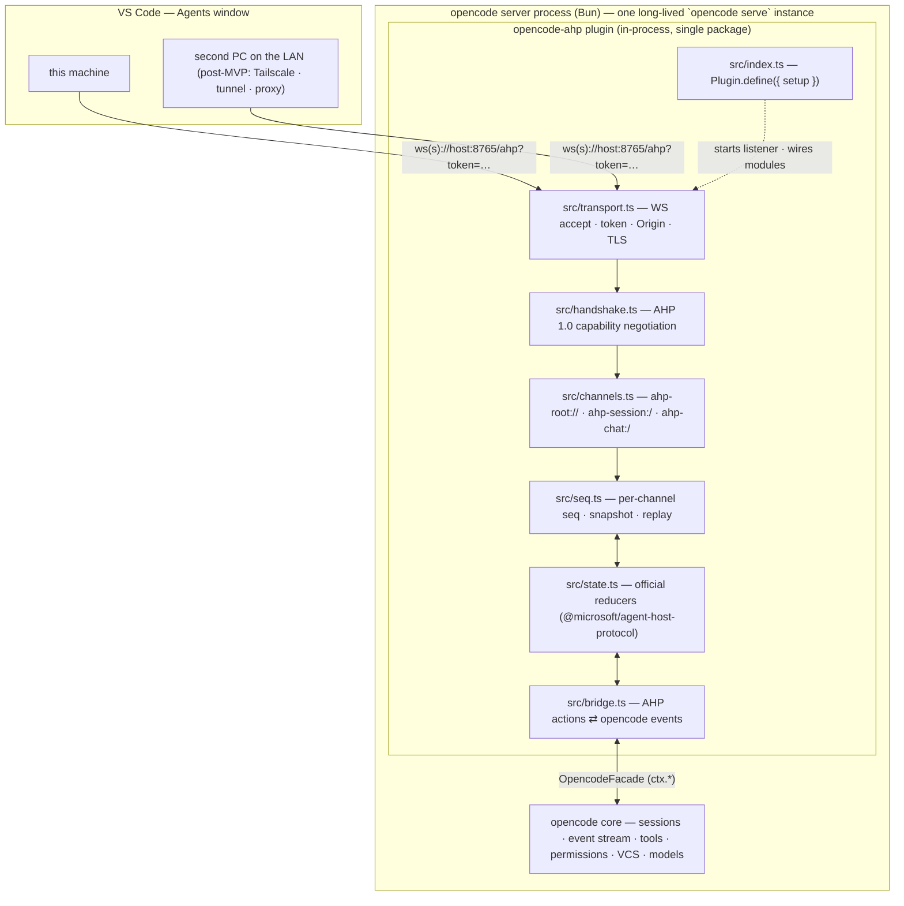
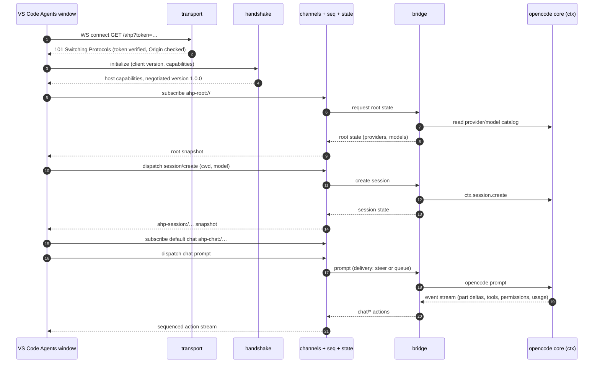
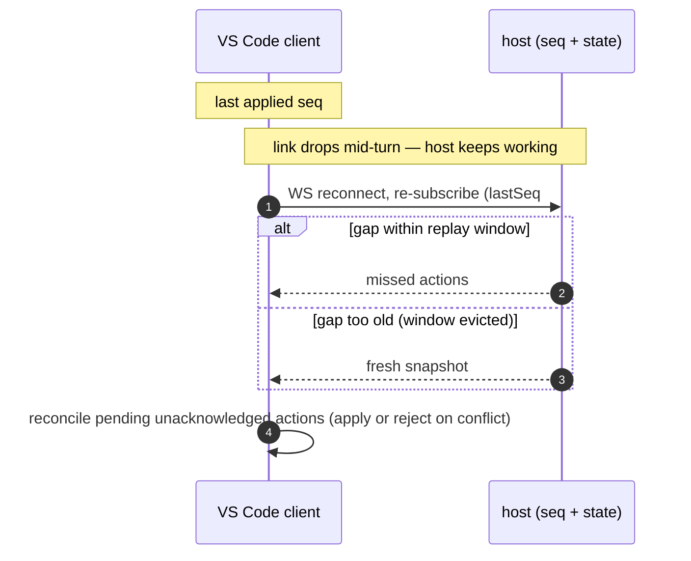

# Plan: `opencode-ahp`

An OpenCode V2 plugin (global, publishable) that hosts the **Agent Host
Protocol (AHP) 1.0.0 in-process** — opencode becomes a native agent in the
VS Code Agents window, on this machine and on remote ones.

**Repo pattern:** follows `llama-sync` (`/home/mattzink/llama-sync`) —
mise-managed toolchain, pnpm, single npm package shipping TypeScript source
(no build step), GitHub CI + npm trusted publishing, local-directory plugin
support, pure modules + vitest, `plan.md` kept current with a
deviations/findings section.

**Verification targets:** VS Code **1.145.2** Agents window (this machine +
one other PC on the local LAN — MVP scope per D3); AHP **1.0.0**
(published 2026-10-03 — 1.1 is a draft, unpublished, out of scope);
opencode **v2** (v2.2.6 at writing; npm `@opencode/cli`, repo
`anomalyco/opencode`).

**Registry facts verified 2026-11-07:** npm `opencode-ahp` is available
(registry 404); `@opencode/plugin` latest is **2.2.6**;
`@microsoft/agent-host-protocol` latest *published* is **1.0.0** (1.1.x
exists only as a doc draft).

---

## 1. Verdict

**Feasible.** Recommended path: an **opencode v2 plugin that hosts AHP
in-process** inside the opencode server. The plugin's `setup(ctx)` starts a
WebSocket listener; a bridge translates between AHP's channel/action model
and opencode's plugin `ctx` APIs (sessions, events, permissions, VCS,
tools, models).

A plugin beats a standalone service for our case:

- no second process to deploy, keep alive, or version-drift;
- direct in-process access to events, permissions, and VCS — no REST/SSE
  indirection;
- ships and updates with the opencode install (`opencode plugin update`).

**Key enabler:** the official `@microsoft/agent-host-protocol` TypeScript
package exports not just wire types but **all state reducers**
(`rootReducer`, `sessionReducer`, `chatReducer`, `changesetReducer`,
`terminalReducer`, …) plus `isClientDispatchable`, and client helpers
(`AhpClient`, `MultiHostClient`, `WebSocketTransport`; subpaths `/client`,
`/ws`, `/hosts`). A host therefore **reuses Microsoft's official state
machine** and only needs to build:

1. transport (WS accept, auth, origins, TLS),
2. channel registry (`ahp-root://`, `ahp-session:/`, `ahp-chat:/`, …),
3. sequencer/replay (per-channel sequences, snapshots, reconnect catch-up),
4. the opencode ↔ AHP bridge.

All four live as **pure modules inside one npm package** (the
`llama-sync` pattern). A standalone bin is out of scope (D4, 2026-11-07);
the pure-module layout would keep a future extraction cheap if it is ever
needed.

AHP is a coordination layer over ACP ("a mutex over ACP"), and opencode
already speaks ACP natively (`opencode acp`) — which is why ACP-bridge
stopgaps work at all. Our plugin goes one level deeper and skips the ACP
subprocess hop entirely.

---

## 2. Goals / Non-goals

### Goals

- **G1 — Native agent in the Agents window.** opencode appears as a
  provider in VS Code's Agents window: provider picker → model picker →
  session, with streaming, tool-call confirmations, and session list.
- **G2 — Remote access.** The host is reachable from other machines: one
  long-lived `opencode serve` instance, token auth, and a documented
  transport story (§5). MVP scope: **local LAN only** (D3, 2026-11-07);
  broader transports (Tailscale, dev tunnels, TLS proxies) are post-MVP.
- **G3 — AHP 1.0.0 conformance.** Passes the official conformance test
  suite for every capability we advertise.
- **G4 — Publishable.** GitHub `mattzink/opencode-ahp` + npm
  `opencode-ahp`, installable via `opencode plugin add`, CI-gated
  publishing per the house pattern (§10).

### Non-goals (v1)

- Replacing the opencode TUI or its own UI.
- Standalone (non-plugin) host binary (D4, 2026-11-07).
- AHP 1.1-draft features (automations, and other in-flux items).
- Multi-user / multi-tenant policy, sandboxing.
- Windows-first deployment polish (build for Linux first, verify
  cross-platform later).

---

## 3. Feasibility

### 3.1 AHP 1.0.0 mechanics (what a host must implement)

- **JSON-RPC 2.0 over WebSocket.**
- **Connection handshake / capability negotiation** with semver versioning
  (1.0 changed this from the draft's integer `1`).
- **Channels**: `ahp-root://` (provider/model catalog),
  `ahp-session:/<id>`, `ahp-chat:/<id>`, plus optional changeset and
  terminal channels. (Draft-era URIs `agenthost:/root`,
  `opencode:/<uuid>` are gone.)
- **Snapshot + sequenced actions**: each channel has a snapshot and a
  monotonic action sequence; any client can join at any sequence number and
  replay.
- **Write-ahead reconciliation**: clients dispatch actions optimistically;
  the host is the state arbiter (can reject/reconcile conflicts); on
  reconnect the host sends missed actions or a fresh snapshot, and the
  client reconciles its pending actions.
- **Optional, negotiated capabilities**: terminals, automations,
  elicitation, client-provided tools, etc. — a host may start with "just
  chat" and add more (VS Code handles absence gracefully).
- **Conformance**: language-independent test fixtures in
  [`microsoft/agent-host-protocol` → `types/test-cases`](https://github.com/microsoft/agent-host-protocol/tree/main/types/test-cases).
  This is our parity exit criterion.

### 3.2 opencode v2 capability mapping

opencode v2: Bun-based server (default port 4096, `opencode serve`),
plugins run **in the server process** with a `ctx` surface covering
session / event / permission / vcs / model / provider / tool / storage plus
hooks.

| AHP 1.0 feature | opencode v2 surface | Status |
| --- | --- | --- |
| Provider & model catalog | `ctx.model` / provider + model listings | ✅ direct |
| Session create / list / load | `ctx.session` (v2 session API) | ✅ direct |
| Chat prompts | v2 prompt API with `delivery: "steer" \| "queue"` | ✅ direct → maps to AHP steering + queued pending messages |
| Streaming parts (text / reasoning) | event stream (`V2EventEncoded` part deltas) | ⚠️ event catalog audit needed (Phase 0) |
| Tool lifecycle events | tool events / `ctx.tool` | ⚠️ audit needed (Phase 0) |
| Tool-call confirmation / permissions | `ctx.permission` (list / reply + `evaluate` hook) | ✅ direct |
| Changesets (uncommitted / session / per-turn diffs) | `ctx.vcs.status()` / `ctx.vcs.diff()` | ✅ direct |
| Model picker / session options | model + mode configuration | ✅ direct |
| Custom-agent picker (Build/Plan/…) | `ctx.agent` (`list` / `get`) + `agent.updated` event | ✅ direct → `AgentCustomization` children + `Message.agent` (§14.7); catalog side **implemented** (Phase 0 increment, 2026-11-07) — `AgentInfo.customizations` carries the workspace agent container; `Message.agent` → prompt agent lands with Phase 1 sessions |
| Client-provided tools | `ctx.tool.transform` | ✅ direct (Phase 4) |
| Terminals | — | ❌ no PTY/terminal API (AHP-optional; peers use pipe-backed or omit) |
| Automations | — | ❌ gap (1.1-draft territory) |
| Multiple chats per session | one chat per session | ❌ gap (matches pi-ahp / ahp-acp-gateway) |
| Elicitation | partial | ⚠️ partial |

### 3.3 Risks

| # | Risk | Mitigation |
| --- | --- | --- |
| R1 | **Young plugin API** — opencode v2 is ~2 months old (2.0 → 2.2.6 in that span); surfaces may move | Pin `@opencode/plugin` to a tested version (llama-sync precedent); keep the bridge thin so it's cheap to adapt; test across patch releases |
| R2 | **A plugin crash takes down the server process** (plugins run in-process) | Defensive bridge code — never throw across the transport boundary; keep the listener failure-isolated; consider a Bun Worker if instability appears |
| R3 | **Plugin is per-server-instance** (TUI vs `opencode serve`) | Document + README runbook: run **one long-lived `opencode serve` instance** as the AHP host |
| R4 | **Token in `?token=` query param is cleartext on plain `ws://`** | Non-loopback bind *requires* a token (refuse to start otherwise); LAN/Tailscale for plain ws; `wss://` off-LAN (Bun.serve terminates TLS natively) |
| R5 | **Origin handling** — VS Code desktop sends `Origin` headers; naive hosts reject or over-allow | `allowedOrigins` policy **while always enforcing the token** (token is the only credential); matrix-tested (Phase 0/1) |
| R6 | **`Bun.serve` is a Bun-only API** — availability inside the plugin context is unverified (the opencode v2 server is Bun, but the plugin sandbox could differ) | Phase 0 verifies it; fallback is the `ws` package (works on Node and Bun) behind the same `transport.ts` interface |

---

## 4. Existing implementations

### 4.1 Comparison

| Implementation | What it is | Verdict for us |
| --- | --- | --- |
| **[maxious/opencode-plugin-agent-host-protocol](https://github.com/maxious/opencode-plugin-agent-host-protocol)** | opencode plugin hosting an AHP WS server | **Closest prior art, but stale** — detailed below |
| **[formulahendry/ahp-acp-gateway](https://github.com/formulahendry/ahp-acp-gateway)** | Standalone AHP ⇄ ACP gateway (Node 24+), stateful, protocol-compliant | **Behavioral reference** (stopgap declined, D3); opencode is its default built-in ACP provider |
| **[Qusic/pi-ahp](https://github.com/Qusic/pi-ahp)** | AHP host for the pi coding agent (WS) — official AHP registry | **Best pattern reference** for "embed agent → AHP host" + VS Code integration steps |
| **[softov/ahpd](https://github.com/softov/ahpd)** | AHP host over WS that runs plugins (agent, ports, server tools installed, not built-in); `@ahpd/sdk` for building hosts; opencode preset via `@ahpd/agent-acp` — official registry | Alternative stopgap; confirms the plugin/daemon shape |
| **VS Code's bundled Agent Host** (`src/vs/platform/agentHost/node/`) | Microsoft's **reference AHP server** (Copilot/Claude/Codex adapters) | Reference for protocol behavior and edge cases |
| hydra-ahp, AgentConnect (found in GitHub search) | Other community AHP projects; not in the official registry | Found during investigation, not evaluated in depth — revisit only if they resurface |

Notable AHP *clients* (useful for testing our host beyond VS Code):
**AHPX** (CLI/Node client), **ahpc** (terminal client + tool server). VS
Code itself is the primary client for us.

### 4.2 maxious plugin — detailed notes

- **3,844 LOC, 9 commits, last commit 2026-04-02** — effectively
  unmaintained.
- Targets the **opencode v1 plugin API** and the **pre-1.0 protocol
  draft**: integer protocol version `1`, `agenthost:/root` /
  `opencode:/<uuid>` channel URIs, 25 `session/*` actions. AHP 1.0 changed
  all three axes (semver negotiation; `ahp-root://` / `ahp-session:/` /
  `ahp-chat:/`; `chat/*` action namespace).
- Layout worth salvaging: `src/ws-server.ts`, `src/session-manager.ts`,
  `src/permission-bridge.ts`, `src/protocol/*`, plus its test and
  client-state code.
- **Verdict (D1, 2026-11-07): no code reuse** — a fresh build against AHP
  1.0; nothing is copied from this repo. Its only value is as a source of
  good test cases and scenarios (permission round trips, reconnect edge
  cases, client-state bookkeeping questions) to inform §9. (Clone at
  `/tmp/opencode/ahp-investigation/opencode-plugin-agent-host-protocol`.)

### 4.3 ahp-acp-gateway — notes

- `npx --yes ahp-acp-gateway` → AHP WS at `ws://127.0.0.1:8765/ahp`, health
  at `/healthz`, SQLite persistence at `~/.ahp-acp-gateway/`.
- **opencode is the default built-in ACP provider**
  (`npx --yes @opencode/cli acp`); E2E-tested against the VS Code Agents
  window.
- Features: replay with snapshot fallback, restart repair, changeset
  channels (uncommitted/session/per-turn, incl. `discard-changes`), token
  auth, strict Origin allowlist option, Docker image + one-click Azure
  Container Apps deploy (yields `wss://<fqdn>/ahp?token=...`).
- Limitations: ACP v1 only, one chat per session, read-only resources,
  pipe-backed terminals, no MCP forwarding, bundled provider catalog.
- **Use:** no stopgap — D3 declines it (we build our own host, and the MVP
  only needs LAN reachability). Remaining value: behavioral reference —
  its deployment config is exactly the surface a host should expose
  (`/ahp` path, `/healthz`, token, Origin policy).
- Its README documents the `chat.remoteAgentHosts` JSON setting against the
  current Agents window — evidence that path still works in 1.145.

---

## 5. Remote access (VS Code 1.145.2 — MVP scope: local LAN per D3)

### 5.1 Registering a third-party AHP host in VS Code

- **Agents window** (`Chat: Open Agents Window`, or `code --agents`):
  **`Agents: Add Remote Agent Host...`** (added in 1.144) → paste the
  `ws(s)://` URL. No sign-in needed; the token is the only credential.
- **`settings.json` — JSON-only in 1.145, *not* surfaced in the settings
  UI:**

  ```jsonc
  "chat.remoteAgentHosts": [
    { "name": "opencode", "address": "wss://host.example:8765/ahp?token=..." }
  ]
  ```

  `address` accepts a bare `host:port/path` (ws://) or a full `wss://`
  URL. Reopen the Agents window after saving. **With Settings Sync on,
  this one line propagates to all of the user's PCs automatically** — the
  simplest multi-PC story.
- Related UI-visible settings: `chat.remoteAgentHostsEnabled` (on by
  default), `chat.remoteAgentHostsAutoConnect`.

### 5.2 Important: the built-in remote flows are NOT a path for third-party hosts

The Agents window's **SSH** and **Dev tunnels** connection methods
auto-install the VS Code CLI on the remote machine and run **VS Code's own
bundled Agent Host**. GitHub Environments (Preview) registers a machine for
the bundled host + supported Copilot clients. **None of these run our
opencode plugin.** For a third-party host, what matters is purely network
reachability of the raw `ws(s)://` URL — everything else is client-side
registration (trivial: one line per PC or the command above).

### 5.3 Transport options

**MVP (D3): local LAN only** — plain `ws://` + token on the LAN. No
Tailscale, tunnels, or TLS needed for the MVP; the rest are post-MVP
options:

| Transport | When | Notes |
| --- | --- | --- |
| LAN `ws://` (**MVP**) | same network | the MVP transport (D3); token in query string is cleartext — LAN only, by design |
| **Tailscale** (post-MVP) | user's own PCs across networks | `ws://100.x.y.z:8765/ahp?token=` — or `wss://` via Tailscale Serve. Encrypted, zero firewall changes |
| **Dev tunnels as a port forward** | any internet-reachable PC | `code tunnel --forward 8765:8765` exposes the port as a `wss://` endpoint through the Azure relay (outbound-only on the host, auth by account). This is a generic TLS port forward — *not* the auto-discovery flow |
| Cloudflare Tunnel / any TLS proxy | same idea | any `wss://` endpoint under our control |

### 5.4 Host-side requirements (inform Phase 0/1)

- Accept the token via `?token=` query param (and `Authorization: Bearer`
  too).
- Handle VS Code desktop `Origin` headers — allow them while still
  enforcing the token.
- Accept whatever path the URL carries (e.g. `/ahp`).
- Support `wss://` via native TLS in `Bun.serve` — **post-MVP**; only
  needed for off-LAN transports, which are out of MVP scope (D3).

---

## 6. Proposed architecture

Single npm package, in-process plugin. The protocol machinery is a set of
**pure modules** (no `ctx` imports, unit-testable without an OpenCode
runtime — the llama-sync principle); only `src/index.ts` touches `ctx`, and
it does so through a narrow `OpencodeFacade` interface that `bridge.ts`
defines and `index.ts` implements (dependency inversion: bridge tests
inject a fake facade).

### 6.1 Components



Component responsibilities:

- **`transport.ts`** — WS accept (`Bun.serve`, fallback `ws` package —
  R6), token auth (query + Bearer), Origin policy, optional TLS,
  `/healthz`, non-loopback guard (R4).
- **`handshake.ts`** — AHP 1.0.0 `initialize`: semver capability
  negotiation; accept 1.0.x, reject anything else with the supported list;
  advertise only the capabilities we implement.
- **`channels.ts` + `seq.ts` + `state.ts`** — channel registry; per-channel
  monotonic sequences, snapshots, replay window; state computed by the
  **official reducers** (we never hand-roll state transitions).
- **`bridge.ts`** — the only opencode-aware module: maps AHP actions to
  `OpencodeFacade` calls (session create, prompt with `delivery:
  steer|queue`, permission reply, VCS status/diff) and opencode events to
  AHP chat actions (part deltas, tool lifecycle, permission events, usage).

### 6.2 Connection + session (happy path)



### 6.3 Reconnect + replay (write-ahead reconciliation)



---

## 7. Repository layout & dev toolchain

House pattern per `llama-sync` (verified against that repo 2026-11-07):

```
opencode-ahp/
├── plan.md                     # this file
├── mise.toml                   # node 26; pnpm adopted from package.json
│                               #   packageManager; node_modules/.bin on PATH;
│                               #   `setup` task (pnpm install, source/output tracking)
├── package.json                # name opencode-ahp, type: module,
│                               #   exports { ".": "./src/index.ts" },
│                               #   packageManager pnpm@12.x, engines node >=20,
│                               #   scripts: typecheck / test / prepublishOnly
├── pnpm-workspace.yaml         # pnpm 10+ knobs (allowBuilds / minimumReleaseAgeExclude as needed)
├── pnpm-lock.yaml
├── tsconfig.json               # strict, NodeNext, ES2022, noEmit — no build step;
│                               #   ships TS source, opencode (Bun) runs it directly
├── vitest.config.ts            # include src/test/**/*.test.ts
├── .gitignore                  # node_modules/, dist/, *.tsbuildinfo
├── README.md                   # what/why, install, options, remote access, dev, publishing
├── LICENSE                     # MIT
├── options.example.jsonc       # documented option set (copied to options.jsonc when
│                               #   running from a checkout; npm installs ship none)
├── index.ts                    # one-line re-export of ./src/index.js — see below
├── .github/workflows/ci.yml    # jdx/mise-action@v5 → install, typecheck, test
├── .github/workflows/publish.yml # trusted publishing (OIDC) → npm publish on push to main
└── src/
    ├── index.ts                # Plugin.define entry: options, listener lifecycle,
    │                           #   OpencodeFacade impl (the only ctx call sites), cleanup
    ├── options.ts              # resolution: ctx.options ▸ options.jsonc sibling ▸ built-ins (pure)
    ├── transport.ts            # WS accept, token auth, Origin policy, TLS, /healthz (R6 interface)
    ├── handshake.ts            # AHP 1.0 initialize / semver capability negotiation (pure)
    ├── channels.ts             # channel registry: ahp-root://, ahp-session:/, ahp-chat:/ (pure)
    ├── seq.ts                  # per-channel sequencer: sequences, snapshots, replay window (pure)
    ├── state.ts                # official reducer wiring (@microsoft/agent-host-protocol) (pure)
    ├── bridge.ts               # AHP action ⇄ opencode event mappers + OpencodeFacade interface (pure w/ injected facade)
    └── test/
        ├── options.test.ts
        ├── transport.test.ts   # token/Origin matrix, path routing, non-loopback guard
        ├── handshake.test.ts   # version negotiation matrix (1.0.x accept, 1.1-draft/older reject)
        ├── channels.test.ts
        ├── seq.test.ts         # seq, snapshot, replay window, multi-client ordering
        ├── bridge.test.ts      # event→action + action→facade-call mapping (fake facade)
        └── fixtures/
            ├── ahp-*.json      # captured AHP 1.0.0 frames (official conformance suite + live)
            └── opencode-*.json # captured V2EventEncoded fixtures (Phase 0 audit)
```

**Dependencies:** `@opencode/plugin` pinned to a tested v2 line (latest at
writing: 2.2.6 — llama-sync precedent: pin the version actually
implemented, not `latest`); `@microsoft/agent-host-protocol` **strict-pinned
to `1.0.0`** (1.1.x is draft/unpublished). Dev: `typescript` ^7.x,
`vitest` ^5.x, `@types/node` ^26 (llama-sync toolchain versions).

**Dev tooling via mise** (identical pattern to llama-sync): `mise.toml`
pins `node = "26"`, adopts the pnpm version from `package.json`
`packageManager` (`idiomatic_version_file_enable_tools = ["pnpm"]`), puts
`node_modules/.bin` on PATH, and defines a `setup` task (`pnpm install`
with source/output tracking). Locally, `mise install` provisions
everything; all scripts run via pnpm. CI installs the toolchain with
`jdx/mise-action@v5` before `pnpm install --frozen-lockfile` (§10).

**Root `index.ts` (local-directory plugin support):** OpenCode resolves
*local-directory* plugin entries to `<dir>/index.*` (`Host.resolve`) and
does **not** read `package.json` `exports` for that case (llama-sync
implementation finding §10.1.3). The one-line re-export
`export { default } from "./src/index.js"` exists solely for that path; npm
and git installs resolve through `exports["."]` and are unaffected.

**Pure-module principle:** `options`, `handshake`, `channels`, `seq`,
`state`, and the `bridge` mappers take plain data in and return plain data
out — fully unit-testable without an OpenCode runtime. Only `src/index.ts`
touches `ctx` (as the `OpencodeFacade` implementation). All green before
wiring the live `ctx`.

---

## 8. Plugin design

### 8.1 Lifecycle (`src/index.ts`)

```ts
export default Plugin.define({
  id: "opencode-ahp",
  async setup(ctx) {
    const opts = resolveOptions(ctx.options, readOptionsFile())
    //   options.ts; malformed sibling file → one error log + ctx.options + built-ins
    if (!opts.enabled) return
    const facade = implementFacade(ctx)          // bridge.ts interface; the only ctx call sites
    const host = createHost({
      state: createState(),                      // state.ts — official reducers
      channels: createChannels(),                // channels.ts
      seq: createSeq({ replayWindow: opts.replayWindow }),
      bridge: createBridge(facade),              // bridge.ts — pure w/ injected facade
    })
    const token = opts.token ?? (await ensureToken(ctx.storage))
    //   generate + persist via ctx.storage + print once to the server log
    const server = await startServer(opts, token, host)
    //   transport.ts: Bun.serve (websocket + optional TLS) — fallback: ws package (R6)
    log(`${TAG} AHP 1.0.0 host listening on ws${opts.tls ? "s" : ""}://${opts.host}:${opts.port}${opts.path}`)
    return () => { server.stop() }               // cleanup: close all client connections
  },
})
```

Ordering notes:

- Options resolve **before** anything else; the plugin is fully inert
  (`enabled: false` or missing options) rather than partially up.
- The token is persisted in `ctx.storage` so restarts reuse it — a printed
  token must not go stale on `opencode service restart`.
- The listener is the *only* thing `setup` starts; all protocol behavior
  hangs off it. `console` output uses the `[opencode-ahp]` TAG prefix
  (house pattern: untimestamped stdout lines in the service log — grep
  `\[opencode-ahp\]`).
- Every failure path logs and stays up: a bad client connection or a
  bridge error must never take down the opencode server (R2).

### 8.2 Options (draft — finalize in Phase 1)

Resolution order per key (house pattern): `ctx.options` (object-form
config entry) ▸ `options.jsonc` sibling of `src/index.ts` (npm installs
ship none — copy `options.example.jsonc` if using a checkout) ▸ built-in
defaults.

| Key | Type | Default | Description |
| --- | --- | --- | --- |
| `enabled` | boolean | `true` | Master switch; `false` → no listener, plugin inert |
| `port` | number | `8765` | WS listen port |
| `host` | string | `"127.0.0.1"` | Bind address; **non-loopback requires a token** (refuse to start otherwise, R4) |
| `path` | string | `"/ahp"` | WS path — VS Code's URL carries it verbatim (§5.4) |
| `token` | string \| null | auto | Generated on first start, persisted in `ctx.storage`, printed once; explicit value supported. Accepted via `?token=` query param and `Authorization: Bearer` |
| `allowedOrigins` | string[] \| `"*"` | `"*"` | Origin allowlist; the token is always required regardless (R5) |
| `tls` | `{ keyPath, certPath }` \| null | `null` | Native TLS via `Bun.serve` → `wss://` for off-LAN transports (§5.3) |
| `healthPath` | string | `"/healthz"` | Plain-HTTP health endpoint (no auth) |
| `replayWindow` | number | `1000` | Per-channel actions kept for reconnect replay; older gaps → fresh snapshot (§6.3) |
| `capabilities` | object | `{ changesets: false, terminals: false, automations: false }` | What is advertised in `initialize` — never advertise what we don't implement. `changesets` flips to `true` in Phase 2 (D2) |

### 8.3 Installation mechanics (avoids double-load)

The repo lives at `~/opencode-ahp` — **not** inside any
`.opencode/plugins/` or `~/.config/opencode/plugins/` discovery path — and
is loaded exclusively through an explicit `plugins` entry (house pattern,
llama-sync R5).

- **Dev (this machine):** global `~/.config/opencode/opencode.jsonc`

  ```jsonc
  "plugins": [{
    "package": "/home/mattzink/opencode-ahp",
    "options": { /* per §8.2 */ }
  }]
  ```

  (This is the local-directory path served by the root `index.ts`, §7.)
- **Published:** `opencode plugin add opencode-ahp` (npm) or
  `opencode plugin add github:mattzink/opencode-ahp` (git); remove the dev
  entry.
- **Updating:** `latest` tracks the newest `main` build but installed
  copies don't auto-update — `opencode plugin update opencode-ahp` +
  `opencode service restart`. Pinned entries
  (e.g. `opencode-ahp@0.1.42`) are skipped by updates by design.

---

## 9. Testing plan

### 9.1 Unit tests (vitest)

Pure modules, no OpenCode runtime — all green before wiring the live
`ctx` (house pattern):

- `options.test.ts` — resolution precedence matrix (ctx.options ▸
  sibling file ▸ defaults), JSONC stripping (comments, trailing commas),
  missing/malformed file.
- `handshake.test.ts` — negotiation matrix: client 1.0.x → accept; older /
  unknown → reject with supported list; 1.1-draft → reject (we pin 1.0.0);
  capability intersection (changesets on/off, terminals always off).
- `transport.test.ts` — token matrix (missing / wrong / correct, via query
  and via Bearer); Origin matrix (allow-all-with-token, allowlist, VS Code
  desktop Origin values); path routing (`/ahp` vs `/healthz` vs 404);
  non-loopback without token → refuse to start.
- `channels.test.ts` + `seq.test.ts` — snapshot on subscribe; monotonic
  seq; multi-client broadcast ordering; replay window (within → replay,
  evicted → snapshot); client-dispatchable gating via
  `isClientDispatchable`.
- `bridge.test.ts` — with a fake `OpencodeFacade`: opencode event → AHP
  chat action mapping (part deltas, tool lifecycle, permission events,
  usage) per the Phase 0 audit; AHP action → facade call mapping (session
  create, prompt with `delivery: steer|queue`, permission reply, VCS
  status/diff for changesets).
- **Fixtures:** captured AHP 1.0.0 frames from the official conformance
  suite (`types/test-cases`) plus live captures; `V2EventEncoded` fixtures
  captured during the Phase 0 audit.

### 9.2 Static checks

`pnpm typecheck` = `tsc --noEmit` (strict, NodeNext) over `src/` incl.
tests; `pnpm test` = `vitest run`. Toolchain (node 26 + pnpm) from
`mise.toml` (§7); CI runs `jdx/mise-action@v5`,
`pnpm install --frozen-lockfile`, then typecheck + vitest on push/PR
(§10).

### 9.3 Conformance (Phase 3)

The official AHP conformance fixtures
(`microsoft/agent-host-protocol` → `types/test-cases`) run against our
host over WebSocket. Exit criterion: green for every capability in
`options.capabilities`.

### 9.4 Manual E2E checklist (this machine + one LAN PC)

1. Dev local-directory entry added; `opencode service restart` (or config
   hot-reload); plugin active; `curl 127.0.0.1:8765/healthz` → 200;
   listener line in the service log.
2. Same-machine VS Code: `Agents: Add Remote Agent Host...` →
   `ws://127.0.0.1:8765/ahp?token=…` → host appears in the Agents window
   picker.
3. New session: opencode appears in the agent picker; the model picker
   shows the **real** opencode catalog (spot-check 2–3 models).
4. Prompt round trip: text streams in as `chat/*` actions; reasoning parts
   when the model produces them.
5. Permission round trip: prompt that triggers a tool needing approval →
   approval prompt in the Agents window; approve → tool runs; deny → tool
   blocked.
6. Token enforcement: no token → rejected; wrong token → rejected;
   correct token from a VS Code desktop Origin → accepted (Origin policy,
   R5).
7. Reconnect: drop the link mid-turn (airplane mode / `ss -K`), reconnect
   → replay or snapshot (§6.3); no duplicate turns; pending actions
   reconcile.
8. Multi-client: two Agents windows (or the AHPX CLI) observe the same
   session; action streams match.
9. Restart stability: `opencode service restart` → listener returns,
   clients reconnect, sessions persist (opencode owns session state).
10. **Second PC on the LAN**: `ws://<lan-ip>:8765/ahp?token=…` → full
    round trip (Phase 1 exit criterion — MVP is LAN-only per D3).
11. (Phase 1) **Steering** (D2): a mid-turn steer reaches the active
    turn; a queued message waits until the turn completes
    (`delivery: steer|queue`).
12. (Phase 2) Changesets: prompt that edits files → uncommitted/session
    diffs appear; `discard-changes` works.

**Exit criteria:** MVP = items 1–11 (Phase 1); parity = item 12
(Phase 2); §9.3 conformance green = Phase 3.

---

## 10. CI & publishing (house pattern)

### 10.1 CI — `.github/workflows/ci.yml`

Push to `main` + pull requests: checkout → **`jdx/mise-action@v5`** (Node
26 + pnpm per `mise.toml`/`packageManager`; no `version` input — the
action defaults to the newest stable mise ≥24 h old; `"latest"` is *not* a
magic value) → `pnpm install --frozen-lockfile` → `pnpm typecheck` →
`pnpm test`.

### 10.2 Publish — `.github/workflows/publish.yml`

Push to `main`; publishes must land in commit order, so
`concurrency: { group: publish, cancel-in-progress: false }` (never cancel
a running publish — a stale build finishing after a newer one must not win
the `latest` tag).

- `permissions: { id-token: write, contents: write }` — **npm trusted
  publishing (OIDC)**: the npm CLI exchanges the OIDC token GitHub mints
  for this specific run of this specific workflow file for a short-lived
  publish credential — no npm token or repo secret stored anywhere.
  `contents: write` backs the per-build GitHub release.
- Steps: **full-clone** checkout (`fetch-depth: 0` — the release-notes step
  resolves the push's `event.before` commit) → `jdx/mise-action@v5` →
  install → typecheck → test → **compute version** (base `major.minor`
  from `package.json` + `GITHUB_RUN_NUMBER`, e.g. base `0.1.0` + run 7 →
  `0.1.7`; failed runs consume a number, so the sequence may have gaps —
  each published version is unique either way) →
  `pnpm version <v> --no-git-tag-version` → **`npm publish`** (the *npm*
  CLI — not pnpm — detects the OIDC environment and performs the token
  exchange; unscoped name is public by default; `prepublishOnly` re-runs
  typecheck + tests as a final gate) → **write release notes** (short
  pointer to the README install instructions + `opencode plugin add
  opencode-ahp@<v>` pin + the commits in `event.before..GITHUB_SHA` —
  GitHub's `generate_release_notes` only lists merged PRs, which is useless
  for a project that commits directly to main) → **create release**
  (`softprops/action-gh-release@v3`, tag `v<v>`; creates the tag when
  missing, updates the release when the tag exists).

**One-time trusted-publisher setup** (house pattern):

1. Publish the base once from a checkout (`npm login`, `npm publish`) —
   creates the package, required before a trusted publisher can be
   configured.
2. npmjs.com → `opencode-ahp` → **Package settings → Trusted publishers
   → Add**: GitHub Actions, user `mattzink`, repository `opencode-ahp`,
   workflow filename `publish.yml` — and tick **Allow `npm publish`**
   (configurations created after 2026-09-03 default to *staged* publishing
   only, which would leave every build awaiting manual approval).
3. Push to `main`; the first automated release lands as `0.1.<n>`. Because
   the repo is public, npm attaches a provenance attestation to each build.

Note: `repository.url` in `package.json` must keep matching the GitHub
repository exactly — npm validates it against the publisher configuration.

**Versioning:** base starts at `0.1.0` (→ publishes `0.1.<n>`); bump the
base in `package.json` to move builds to a new era (e.g. `1.0.0` once the
MVP is stable → `1.0.<n>`).

### 10.3 Install / update (end user)

- `opencode plugin add opencode-ahp` (npm) or
  `opencode plugin add github:mattzink/opencode-ahp` (git).
- Update: `opencode plugin update opencode-ahp` + `opencode service
  restart`. Pin a build: `opencode plugin add opencode-ahp@0.1.42`.
- Manual publish from a checkout: `npm publish` (gates run via
  `prepublishOnly`).

---

## 11. Phased plan

### Phase 0 — Spike (de-risk the load-bearing assumptions)

- [x] Scaffold the repo per §7 (mise.toml, package.json + lock, tsconfig,
      vitest config, .gitignore, root `index.ts`, options.example.jsonc,
      CI skeleton) — `mise install` green. (Deltas vs the §7 tree:
      `src/host.ts`, `scripts/`, `docs/` — see §14.)
- [x] `Bun.serve` websocket started from a v2 plugin `setup(ctx)` accepts a
      connection (hello-world AHP client); if the plugin context forbids
      raw listeners → `ws`-package fallback behind `transport.ts` (R6).
      **R6 resolved: no fallback needed** (verified live, §14).
- [x] **Audit the `V2EventEncoded` event catalog**: part deltas, tool
      lifecycle, permission events, usage — lock the §3.2 mapping; capture
      fixtures for `src/test/fixtures/`. (Fixture: `events.jsonl`, full
      tool-using turn; mapping table + gaps in §14.)
- [x] Minimal AHP `initialize` (semver negotiation, 1.0.0 only) +
      `ahp-root://` channel serving the **real** opencode provider/model
      catalog. (Live: 2 agents / 16 models; error matrix -32005/-32602
      verified, §14.)
- [x] Two-machine VS Code test: Agents window on PC A → host on PC B;
      token + Origin handling verified end-to-end.
      **Verified live 2026-11-07** (PC B `10.0.1.52`, VS Code 1.145.2,
      Agents window): host registration, handshake, token + Origin, root
      catalog all confirmed in the real UI; findings in §14.7.

**Exit criteria:** all boxes checked; §3.2 gaps confirmed or resolved;
go/no-go on Phase 1 scope. **MET** — Phase 1 is underway (the agent-
catalog increment of §14.7 shipped as a Phase 0 add-on, 2026-11-07).

### Phase 1 — MVP (daily-drivable)

**Status (2026-11-08):** core host complete — `createSession` (with the
`SessionState.customizations` agent picker that fixes the empty
dropdown), session/chat stores on the official reducers, full event pump
(turns, streaming, tool lifecycle, permissions, steering/queue, usage,
summary sync), client-dispatchable actions with echo/rejection
semantics. 156/156 tests green, typecheck clean; live end-to-end
verification passed on the LAN host (`scripts/ahp-phase1.mjs` —
§14.9). **PC B confirmation received** (user screenshot): the Agents
window dropdown lists Agent/Build/Plan + "Configure Custom Agents…" —
General/Explore correctly absent (subagents), gpuz pill + Qwen 3.8 DFlash2
model intact. **First publish done (2026-11-08):** npm
`opencode-ahp` registered (0.0.0-stage placeholder) + trusted publisher
(GitHub Actions, `publish.yml`, allow `npm publish`); the workflow
publishes `0.1.<run>` (gaps in the run numbers are expected) —
`latest` was `0.1.1` when the keep-alive work started. The LAN host
config is flipped to the npm spec (`"package": "opencode-ahp"`),
location reloaded via `POST /api/location/reload`, and the live probe
confirms it runs the published artifact (`serverInfo.version` 0.1.1) —
the full Phase 1 lifecycle (`scripts/ahp-phase1.mjs`) passes against
it. **Keep-alive shipped (2026-11-08, §15):** the idle-timeout
workaround (`location_idle_timeout: false`) is gone — the plugin keeps
its own location loaded; both friction steps are reduced to the
one-time cold boot (an opencode limit, README step 3). Live-verified on
the LAN host without the flag (keep-alive active, anchor hidden from
`listSessions`, `keepAliveAt` advancing, full lifecycle green).
Remaining: publish the keep-alive version and re-flip the LAN host to
it; E2E checklist §9.4 items 5/6/7/11 from PC B; optional AHP entry in
the daily `:80` global config (that service currently has no AHP
plugin entry — same-machine VS Code use would need one); upstream
feature request (auto-boot / server-scoped plugin hook + the
`session.update` `archived` gap, §15).

Working order (house pattern: pure modules + tests first, wiring last):

- Pure modules + unit tests: `options`, `handshake`, `transport` (policy),
  `channels`, `seq`, `bridge` mappers — green before live `ctx`.
- `src/index.ts` lifecycle wiring (§8.1): listener, facade, cleanup.
- Bridge MVP: session create/list; prompt; streaming text/reasoning;
  tool-call events; **permission prompts (approve/deny via
  `ctx.permission`)**; **steering + queued pending messages (prompt
  `delivery: steer|queue` — D2)**; model picker from the opencode
  catalog; **opencode agents as AHP custom agents** (the
  `AgentInfo.customizations` catalog side **already shipped** as a
  Phase 0 increment, 2026-11-07 — `mapAgentCustomizations` +
  `agentDirectoryCustomization` in `bridge.ts`, verified by the
  two-machine test; the session side — `AgentCustomization` children of
  the workspace directory in `SessionState.customizations` and
  `Message.agent` on `chat/turnStarted` → prompt agent — lands with
  sessions — §14.7).
- Options per §8.2 (finalize defaults); generated token; listener log line.
- README (what/why, install, options, remote access §5, development,
  publishing) + LICENSE.
- E2E checklist items 1–10 (§9.4).
- **First publish:** push to GitHub (`mattzink/opencode-ahp`); manual base
  publish + trusted-publisher setup (§10.2); flip this machine's dev entry
  to the npm spec; `publish.yml` live.

**Exit criteria:** daily-drivable from a second PC on the LAN (D3); no
lost messages on normal disconnect/reconnect.

### Phase 2 — Parity (changesets + reconciliation)

- **Changesets** (deferred from Phase 1 per D2): uncommitted / session /
  per-turn diff channels from `ctx.vcs` (mirror ahp-acp-gateway's channel
  set incl. `discard-changes`), the `invokeChangesetOperation` command,
  and `resourceRead` for the `ContentRef` file contents behind the diffs.
- Full **write-ahead reconciliation**: reconnect replay window + snapshot
  fallback; optimistic client actions reconciled against host state
  (replay vs snapshot fallback verified live — §14.10).

**Exit criteria:** E2E item 12 (changesets: prompt that edits files →
uncommitted/session diffs appear; `discard-changes` works) plus
reconnect under dropped-link scenarios (E2E item 7) verified live.

**Status (2026-11-08): exit criteria MET, live-verified** (LAN host
10.0.1.107:8767, `scripts/ahp-phase2.mjs`). Uncommitted/session/turn
changesets with catalogue entries + review capabilities, `resourceRead`
for all content-ref kinds, `discard-changes` (file restored from HEAD,
changeset refreshed), and a mid-turn link drop → **replay** (the turn
completed during the gap; `turnComplete` arrived via the replay, exactly
once). 208/208 tests green, typecheck clean. Findings in §14.10.
Remaining: user commit/push → CI publish; flip the LAN host config back
to the npm spec and re-verify.

### Phase 3 — Conformance & transport (carved out of Phase 2, 2026-11-08)

- **Run the official conformance suite** (§9.3) and fix gaps.
- Native `wss://` termination (only needed for off-LAN transports — D3).

**Exit criteria:** conformance green for all advertised capabilities; a
`wss://` endpoint usable for an off-LAN transport.

### Phase 4 — Extensions

- Client-provided tools via `ctx.tool.transform`.
- Multi-chat per session (if/when opencode's API allows).
- Elicitation completion; terminal channel (if opencode ever exposes a PTY
  surface).
- Automations / AHP 1.1 features once they stabilize.

### Overall definition of done

VS Code Agents window on 2+ machines: pick **opencode** as the agent, pick
a real model, chat with streaming, approve/deny tool calls, review
changeset diffs, survive reconnects — all over AHP 1.0.0, passing the
conformance suite, with no extra service to run beyond one
`opencode serve` instance.

---

## 12. Decisions (resolved 2026-11-07/08)

| # | Question | Decision |
| --- | --- | --- |
| D1 | maxious plugin: reuse its code? | **No code reuse** — fresh build against AHP 1.0; the repo is used only as a source of good test cases (§4.2) |
| D2 | MVP scope: steering / changesets? | **Steering in Phase 1**; changesets deferred to Phase 2 |
| D3 | Stopgap via `ahp-acp-gateway` while we build? | **No stopgap** — MVP only needs to work over the **local LAN** |
| D4 | Standalone bin (non-plugin host)? | **No standalone bin for now** (2026-11-08: an `opencode acp` sidecar proposal was re-rejected on the same grounds — plugin interface only) |
| D5 | Idle-timeout workaround: how to remove? | **In-plugin keep-alive** (2026-11-08, §15): periodic durable `session.metadata.updated` on a deterministic anchor session — no separate process, no user config; cold boot is an architectural limit (plugins load per location) |
| D6 | Cold-boot residual | **"Investigate upstream later"** (user, 2026-11-08): ship keep-alive now; README keeps the one-time boot step; file an opencode feature request (auto-boot config / server-scoped plugin hook) later |
| D7 | Anchor session visibility | **Unarchived by design** (discovered live, 2026-11-08, §15): the plugin surface cannot archive (`session.update` drops `archived` — upstream gap, v2.2.6 ≡ dev); the anchor is a real session visible in the TUI session list as "opencode-ahp (keep-alive)" and filtered from all AHP surfaces by its ID |

---

## 13. References

**Protocol**

- AHP docs (guide, spec 1.0.0, implementations, "AHP and ACP"):
  <https://microsoft.github.io/agent-host-protocol/>
- Spec v1.0.0:
  <https://microsoft.github.io/agent-host-protocol/specification/overview>
- Official repo (types, clients in 6 languages, conformance fixtures):
  <https://github.com/microsoft/agent-host-protocol> · test cases:
  [`types/test-cases`](https://github.com/microsoft/agent-host-protocol/tree/main/types/test-cases)
- `@microsoft/agent-host-protocol@1.0.0` unpacked locally:
  `/tmp/opencode/ahp-investigation/ahp-pkg/package` (verified exports incl.
  all reducers + `isClientDispatchable`; subpaths `/client`, `/ws`,
  `/hosts`)

**opencode**

- v2 plugin API (ctx surface: session/event/permission/vcs/model/provider/
  tool/storage + hooks): <https://opencode.ai/docs/build/plugins/server>
- Repo: <https://github.com/anomalyco/opencode> (v2 since 2026-09-11;
  v2.2.6 at writing) · SDK: `@opencode-ai/sdk`

**VS Code 1.145**

- Remote agent sessions (SSH / Dev Tunnels / GitHub Environments;
  `chat.remoteAgentHostsEnabled`):
  <https://code.visualstudio.com/docs/agents/run/remote-agent-sessions>
- 1.144 release notes (Agent Host Protocol v1.0;
  `Agents: Add Remote Agent Host...`):
  <https://code.visualstudio.com/updates/v1_144>
- 1.145 release notes: <https://code.visualstudio.com/updates/v1_145>

**Prior art**

- <https://github.com/maxious/opencode-plugin-agent-host-protocol> (clone:
  `/tmp/opencode/ahp-investigation/opencode-plugin-agent-host-protocol`)
- <https://github.com/formulahendry/ahp-acp-gateway>
- <https://github.com/Qusic/pi-ahp>
- <https://github.com/softov/ahpd> (+ `@ahpd/agent-acp` opencode preset)
- AHP registry of clients/servers:
  <https://microsoft.github.io/agent-host-protocol/guide/implementations.html>

**House pattern (repo conventions source)**

- `/home/mattzink/llama-sync` — published opencode v2 plugin: `mise.toml`
  (node 26, pnpm via `packageManager`, PATH, `setup` task),
  `.github/workflows/ci.yml` + `publish.yml` (`jdx/mise-action@v5`, npm
  trusted publishing OIDC, `major.minor` + `GITHUB_RUN_NUMBER` versioning),
  single package shipping TS source (no build step), root `index.ts` for
  local-directory plugin resolution, options resolution
  (`ctx.options ▸ options.jsonc ▸ defaults`), pure modules + vitest,
  deviations/findings plan section.

---

## 14. Deviations from plan & implementation findings

Filling in during Phase 0/1 (house pattern per llama-sync §10: tooling/
packaging deltas, config notes, E2E environment notes, runtime findings).

### 14.1 Repo layout deltas vs §7

- **`src/host.ts` added** (9 modules, not 8). A pure JSON-RPC router sitting
  between `transport.ts` (sockets) and `bridge`/`state` (semantics):
  `initialize` / `reconnect` / `subscribe` / `unsubscribe` / `dispatchAction`
  / `ping`, the per-clientId registry, replay-window serving via `seq.ts`,
  and snapshot assembly. Keeps protocol logic unit-testable from both sides.
- **`scripts/` added** (not in the §7 tree): dependency-free Node ≥ 22
  helpers for the spike/E2E — `ahp-client.mjs` (AHP session + transport
  probe matrix) and `capture-events.mjs` (event fixture capture).
- **`docs/lan-test-runbook.md`** — the two-machine test procedure.
- **Fixture format**: `src/test/fixtures/events.jsonl` (one JSON header
  block + one event per line) instead of the `opencode-*.json` files in §7
  — a whole-turn capture is one coherent file, and the header records
  server/project/session/model/prompt for test provenance.

### 14.2 AHP 1.0.0 protocol findings (verified empirically + live)

- **`serverSeq` is GLOBAL host-wide**, not per-channel (the spec's
  lifecycle example numbers a chat action 43 while a root snapshot is taken
  at 42). Consequences built into `seq.ts`/`host.ts`:
  - snapshot `fromSeq` = current global seq;
  - reconnect replay is a *global* range `(lastSeenServerSeq, current]`
    filtered by the client's subscriptions;
  - the replay window bounds the global buffer.
- **`Sequencer.since(s)` returns `null` iff `s + 1 < oldest`** — a client
  at `lastSeen = oldest - 1` has seen nothing evicted, so the range is
  still fully replayable. (First implementation had the off-by-one wrong:
  `s < oldest` rejected a fully-replayable range.)
- **Per-socket protocol**: the first request is `initialize` (new client)
  or `reconnect` (known `clientId`; the host keeps a per-clientId registry
  of `{version, socketId}`). `ping` is answered before init. `unsubscribe`
  and `dispatchAction` are **notifications** (no id) — a dispatch's result
  comes back as an `action` notification; rejected actions DO consume a seq
  and carry `rejectionReason`.
- **Reconnect result**: `{type: "replay", actions, missing}` (known client +
  gap inside the window) else `{type: "snapshot", snapshots}`. A new
  connection presenting an existing *live* clientId supersedes the old
  socket (closed, code 4000 "superseded").
- **Const enums at runtime**: `ActionType` / `ReconnectResultType` are
  `declare const enum` in the .d.ts but *real runtime objects* in the
  published dist — value imports work under `tsc` (inlined) and Bun.
  Untrusted JSON-RPC params are cast `as unknown as StateAction` at the
  boundary; enums are only produced, never parsed, from the client side.
- **Negotiation matrix (live)**: `["1.0.1","1.0.0"]` → `"1.0.1"`;
  `["0.9.5"]` → `"0.9.5"`; `["2.0.0"]` / `["0.8.0"]` → `-32005` with
  `data.supportedVersions: ["1.0.0","0.9.0"]`; `["banana"]` → `-32602`;
  `[]` → `-32602` (param validation).

### 14.3 opencode v2 runtime findings

- **R6 resolved**: a `Bun.serve` websocket listener started from a v2
  plugin `setup(ctx)` accepts connections end-to-end (probe matrix + full
  AHP session + Origin 403/101 checks). No `ws`-package fallback needed;
  `transport.ts` keeps the `Listener` interface so one could be added.
- **Location lifecycle**: a location — and therefore its plugins — only
  boots when a client opens it. `GET /api/location?location[directory]=<dir>`
  (form-encoded *object* param; `?directory=` is the wrong shape) triggers
  "location services booted" and the plugin `setup(ctx)`. **Creating a
  session does not boot the location.** (curl needs `-g`/`--globoff` for
  the bracketed param.)
- **HTTP API auth**: all `/api/*` + `/openapi.json` routes require HTTP
  Basic — username `opencode`, password = env `OPENCODE_SERVER_PASSWORD`
  when set, else a freshly generated one **printed to `opencode serve`
  stdout** (`server password <pw>`). The `:80` service uses the password in
  `~/.config/opencode/service.json`; `~/.local/state/opencode/service.json`
  registers the background service for the default state dir.
- **Plugin console output goes to the opencode server's stdout**, not to
  `opencode.log`. `opencode.log` carries structured spans (plugin loading,
  watchers, location boot). No `ctx.log` exists — house pattern is tagged
  `console.log/warn/error` (`[opencode-ahp]`).
- **Registry reads are setup-safe**: v2 plugin docs guarantee
  `ctx.provider.list()` / `ctx.model.list()` reflect every registration
  even during plugin setup — the facade's `listCatalog()` is async but
  race-free. (The earlier setup-time-race concern was pre-v2.)
- **`Context`** is a type-only import from subpath
  `@opencode/plugin/promise/plugin`.
- **Plugin storage is shared across locations** of one server: the second
  scratch location reused the persisted `ahp.token` without re-printing.
- **Local-directory plugin entries** resolve to `<dir>/index.*` without
  reading `package.json` `exports` (llama-sync precedent) — the root
  `index.ts` re-export exists for exactly this path.
- **`POST /api/session/{id}/model`** takes `Model.Ref = {id, providerID,
  variant?}` — `id` is the *bare* model ID; there is no `modelID` field.

### 14.4 Live catalog mapping (root snapshot: 2 agents / 16 models)

- One `AgentInfo` per opencode provider; providers with activation
  `disabled` and models with `enabled: false` are excluded.
- `SessionModelInfo.id` = `providerID/modelID`; `maxContextWindow` ←
  `limit.context`, `maxOutputTokens` ← `limit.output`,
  `maxPromptTokens` ← `limit.input`; `supportsVision` ←
  `capabilities.input` includes `"image"`.
- `Provider.Info` has **no `description`** — the bridge falls back to
  `description ?? name` (both live agents exercised the fallback).

### 14.5 Event mapping (fixture: `src/test/fixtures/events.jsonl`)

Capture: one full tool-using turn (`echo hello-ahp` via the shell tool) on
`gpuz/qwen3.8-27b-q5xl`, 38 events, terminal
`session.execution.succeeded`. Envelope:
`{id, created?, metadata?, type, location?: {directory}, data,
durable?: {aggregateID, seq, version}}`. All `session.*` events carry
`data.sessionID`; deltas (`text/reasoning.delta`, `tool.progress`,
`usage.updated`, `shell.*`) are **non-durable**; `execution.*` and
`usage.updated` carry **no** `location` field.

| opencode event | AHP 1.0.0 | notes |
| --- | --- | --- |
| `session.execution.started` | `turnStarted` | `data: {sessionID}` only |
| `session.execution.succeeded` | `turnComplete` | ditto |
| `session.execution.failed` / `.interrupted` | `turnError` / `turnCancelled` | `failed` detail fields not observed live |
| `session.text.delta` | `chat/delta` | `data.delta`, `ordinal`, `assistantMessageID` |
| `session.reasoning.delta` | `chat/reasoning` | same shape |
| `session.text.ended` / `reasoning.ended` | `chat/responsePart` | full `text` + `ordinal` |
| `session.tool.input.started` | `chat/toolCallStart` | join key `data.id`; `name` (e.g. `shell`) |
| `session.tool.input.ended` | (raw input) | `text` is a **JSON string** — `JSON.parse` needed |
| `session.tool.called` | `chat/toolCall` | `input` already parsed |
| `session.tool.progress` | (progress) | non-durable; `metadata.shellID` |
| `session.tool.success` | `chat/toolCallResult` | `content: Part[]`, `metadata: {status, truncated, exit}` |
| `session.tool.failed` | `chat/toolCallResult` (error) | shape from OpenAPI audit, not observed live |
| `session.usage.updated` | `chat/usage` (cumulative) | non-durable, session-cumulative, after each step |
| `session.step.ended` | (per-step tokens) | per-step `tokens`/`cost`/`finish` |
| `session.inbox.enqueued` / `.delivered` | pending-message channel (D2 steering) | `item: {type: "user", payload: {text}, delivery: "steer"}` |
| `permission.asked` / `.replied` | tool-call confirmation | **not observed live** (scratch shell auto-approves); mapping from OpenAPI audit |

Phase 1 mapping shifts discovered:

- **`assistantMessageID` is per-step, not per-turn.** A two-step turn
  (tool step `finish: "tool-calls"`, final text step `finish: "stop"`) uses
  two different message IDs, and reasoning can interleave with text within
  a step. AHP part grouping must key on (sessionID, turn), not on the
  message ID.
- Tool lifecycle joins on `data.id`; input arrives both as a JSON string
  (`tool.input.ended.text`) and parsed (`tool.called.input`); output is a
  typed `content: Part[]` array.

### 14.6 E2E environment notes

- Scratch env A: `/tmp/opencode/ahp-scratch/` — server on 127.0.0.1:4097
  (isolated XDG), AHP on :8765 (token auto-generated + persisted), second
  strict-Origin location on :8766 (403 for foreign Origins, 101 for
  `vscode://vscode`).
- LAN dry run (host side of the two-machine test, verified): isolated XDG
  under `/tmp/opencode/ahp-lan/`, `opencode serve --hostname 0.0.0.0
  --port 4098` from `project-lan/` (options: `host 0.0.0.0`, port 8767,
  fixed token, `allowedOrigins "*"`), location booted via API, listener up,
  401s on the LAN IP without/with bad token. R4 + R2 both confirmed
  (non-loopback without token → listener refuses, server stays up; port
  conflict → same graceful behavior). PC B side: `docs/lan-test-runbook.md`.
- Node 26 global `WebSocket` accepts `{headers: {origin}}` (undici 8.10) —
  the ahp-client uses it for the Origin matrix.
- Repo is an empty git repo by user instruction; **no commits** through
  Phase 0. The running `:80` service was never touched (all spikes used
  isolated scratch instances).

### 14.7 VS Code 1.145.2 live-client findings (2026-11-07, real Agents window on PC B)

First real VS Code connection to the LAN host (PC B `10.0.1.52` →
`ws://10.0.1.107:8767/ahp`), Agents window, new-session input:

- **Host registration + handshake + root catalog work end-to-end.** The
  added host appears; the **top pill picker** (screenshot: "OpenCode" /
  "gpuz") is the AHP **agent-backend picker** — it renders our
  `RootState.agents` (`AgentInfo.displayName`). Selecting one feeds the
  **model picker** ("Qwen 3.8 | Max 160K") from `AgentInfo.models`.
- **The bottom-left "Agent" dropdown is the AHP *custom-agent* picker**,
  not a provider/role list. With no customizations exposed it shows a
  single generic **"Agent"** entry (= "no custom agent; provider default",
  per `Message.agent` docs). VS Code docs confirm custom agents appear
  "from the same picker".
- **Picker source correction (2026-11-08, from the VS Code source —
  root cause RESOLVED):** the Agents-window dropdown is fed by
  `getEffectiveAgents(SessionState.customizations)` — it reads the
  **session-state** customizations only, *not* `AgentInfo.customizations`
  (which the spec routes to the new-session flow). So the catalog
  container alone can never populate the in-session dropdown. The fix is
  Phase 1: `createSession` must seed `SessionState.customizations` with
  the workspace directory container (implemented in `host.ts`, live
  verified 2026-11-08 — see §14.9).
- **AHP 1.0.0 (strict-pinned) carries the concept** — verified in the
  unpacked `@microsoft/agent-host-protocol@1.0.0` types:
  - `AgentCustomization` (child of a `PluginCustomization` /
    `DirectoryCustomization` container; fields `description`, `model?`,
    `tools?`, `disableModelInvocation?`, `disableUserInvocation?`,
    `enabled?` on `ChildCustomizationBase`, `uri`/`name` on
    `CustomizationBase`).
  - `Message.agent?: AgentSelection { uri }` — on drafts carries "the
    agent the user picked"; absent = provider default. `AgentSelection.uri`
    must match an `AgentCustomization.uri` in the session's effective
    customizations.
  - `AgentInfo.customizations` — "when a session is created with this
    agent, these entries are augmented … and propagated into the
    session's `customizations` list" → this is what feeds the
    **new-session** agent picker before any session exists.
  - `SessionState.customizations` — the live per-session view (agent
    children of the workspace directory container).
- **opencode v2 exposes exactly the corresponding data** —
  `ctx.agent` (`AgentDomain`): `list(): Agent.Info[]`, `get(id)`,
  `reload()`, plus the ephemeral `agent.updated` event. `Agent.Info`:
  `id`, `name`, `model?` (pinned `Model.Ref`), `description?`,
  `mode: "primary" | "subagent" | "all"`, `hidden`, `permissions[]`,
  `system?`, `color?`, `steps?`.

  Mapping (Phase 1):

  | opencode `Agent.Info` | AHP `AgentCustomization` |
  | --- | --- |
  | `id` | `uri` (stable per-agent; synthetic scheme, e.g. `opencode:agent/<id>`; file URI when file-defined) |
  | `name` | `name` |
  | `description` | `description` |
  | `model` (pinned) | `model` (bare model id; absent → inherit session model) |
  | `mode: "subagent"` | `disableUserInvocation: true` |
  | `hidden: true` | omit (internal agents: summary/title/…) |
  | `permissions[]` | no AHP field — enforced by opencode itself |

- **Expected end state:** top pill = provider (OpenCode/gpuz), bottom-left
  = opencode agents (Build, Plan, user-defined), model picker = models —
  three independent axes, matching opencode's own model.
- VS Code sends a **VS Code-specific notification
  `setClientManagedSettingsPermissions`** post-init (host currently logs +
  ignores; connection stays up). Phase 1: handle gracefully (apply or
  ack per AHP `authenticate`/config semantics) rather than ignore.
- `createSession` is not yet implemented (Phase 0 scope) — starting a
  session currently fails with `unknown method` (-32601). Expected, not a
  bug.

**Implemented as a Phase 0 increment (2026-11-07)** — catalog side only
(no session dependency; the root snapshot already re-derives on every
call):

- `bridge.ts`: `FacadeAgent` (narrow `Agent.Info`),
  `OpencodeFacade.listAgents()`; `mapAgentCustomizations()` (plan table
  above) and `agentDirectoryCustomization(directory, agents)` — a
  `DirectoryCustomization` (`enabled: true`, `contents: "agent"`,
  `writable: false`, `load: {kind: "loaded"}`, `uri: file://<dir>`) whose
  `children` are the agent customizations. `mapCatalog()` now takes
  `(providers, agents, workspaceDirectory?)` and attaches the container
  to every non-disabled provider's `AgentInfo.customizations` — omitted
  entirely when no visible (non-hidden) agent exists.
- `host.ts`: `snapshotFor` awaits `listCatalog()` + `listAgents()` in
  parallel and maps with `defaultDirectory` (`ctx.location.directory`).
- `index.ts`: `listAgents()` reads `ctx.agent.list()` (returns
  `AgentListOutput { data: Agent.Info[] }` — note the `data` wrapper,
  same as provider/model lists).
- Deviations from the mapping table above, deliberately: pinned
  `model` is emitted as the **`<providerID>/<modelID>` ref** (the
  `SessionModelInfo.id` format) rather than a bare model id, so the pin
  resolves against the model picker; the synthetic URI
  `opencode:agent/<id>` doubles as the customization `id` (the host is
  the minting publisher).
- Tests: 9 new cases in `bridge.test.ts` (78/78 green, typecheck clean).
  Live re-verified after the LAN host restart (2026-11-07): the root
  snapshot shows both providers carrying the container — `opencode`:
  Build, General [subagent-only], Explore [subagent-only], Plan;
  `gpuz`: same set. PC B re-check pending the user's next look.

### 14.8 Location idle eviction kills the AHP listener (found 2026-11-08)

The LAN host stopped serving AHP overnight (PC B could not reconnect);
the `opencode serve` process was alive and healthy on :4098. Diagnosis:

- **opencode v2 unloads idle locations after 60 minutes by default**
  (location-activity sweep; v2.1.0+ keeps locations with *running
  sessions or background jobs* — #57416 — and adds
  `experimental.location_idle_timeout`, a duration string or `false`,
  — #57476). **AHP WebSocket connections do not count as location
  activity** (they are raw sockets to our in-process listener, invisible
  to opencode), so an idle AHP-only host gets evicted.
- Eviction runs the plugin **cleanup** → our `listener.stop()` → the
  8767 socket disappears from the process fd table with **no log line**
  (the cleanup was silent) and no error anywhere. Timeline evidence:
  location booted 23:59, last log write 00:59 (≈ +60 min), process PID
  unchanged.
- Upstream references: `anomalyco/opencode` issue #58049 (same silent
  teardown, "purely location lifecycle"), #57476 (the config knob),
  #57416 (sessions/background jobs count as activity), #55305.

**Fixes applied / decided:**

- **Host project config** (required for every AHP deployment; goes in
  the README's runbook):

  ```jsonc
  { "experimental": { "location_idle_timeout": false } }
  ```

  Applied to `/tmp/opencode/ahp-scratch/project-lan/.opencode/opencode.jsonc`;
  accepted cleanly by 2.2.6 (location reload 204, no validation errors).
  The daily `:80` service config was **not** touched.
- **Diagnosability**: the plugin cleanup in `src/index.ts` now logs
  "location teardown — stopping the AHP host" so a future eviction is
  visible in the server log.
- **Recovery without restart**: `GET /api/location?location[directory]=…`
  re-boots the location (plugin setup re-runs: token fixed in options,
  catalog re-derived, clientId registry reset → clients re-initialize);
  `POST /api/location/reload` re-reads config.
- Phase 1 note: once AHP sessions create real opencode sessions, active
  turns keep the location alive on their own (#57416); the config
  opt-out still covers idle gaps (e.g. overnight).

### 14.9 Phase 1 implementation findings (2026-11-08)

All wire shapes below verified against the installed
`@microsoft/agent-host-protocol@1.0.0` package (the docs site defaults
to the 1.1.0 draft — the installed 1.0.0 dist is the only ground truth).

**Channel-suffix ↔ opencode session ID**

- opencode `SessionID`s must start with `ses`. `createSession` passes the
  client-chosen channel suffix through as the id **only** when it already
  starts with `ses`; otherwise opencode mints an id and the host records
  the suffix→sesID mapping. The channel registry therefore holds **both**
  keys (the client suffix for the session URI; the opencode id for the
  chat URI and the event-pump join). `removeRecord` removes both.
- `session.created` fires **synchronously** inside `ctx.session.create` —
  the event pump would register the in-flight session as an external
  one. Fix: external registration is **deferred 250 ms** and re-checked
  via `facade.getSession` (null → skip; already registered → skip); the
  `createSession` path additionally remaps a racing interim record
  (`removeRecord` first, then register under the client channel).

**Root channel semantics**

- `root/sessionAdded`, `root/sessionRemoved`,
  `root/sessionSummaryChanged` are **notifications** (JSON-RPC frames to
  root subscribers, ephemeral, never replayed).
- `root/activeSessionsChanged {activeSessions: n}` is the one root
  **action** (replayed, seq-stamped).

**Dispatch / echo contract (spec-confirmed + reducer-verified)**

- `dispatchAction` is **fire-and-forget**: the reply arrives as a
  server→client `action` notification (`ActionEnvelope`), and **only
  subscribers of that channel receive it** — the client must subscribe to
  receive its own echoes (write-ahead: it already applied the action
  optimistically).
- **Rejections are additionally delivered to the dispatching socket**
  even when it is not subscribed to the channel (write-ahead rollback —
  the client needs the `rejectionReason` to undo its optimistic apply).
  Host resolves `origin.clientId` → socket for that.
- `publish()` is the single apply+deliver point: seq-stamp → apply to the
  store (accepted only) → deliver the `action` notification to channel
  subscribers (accepted **and** rejected).

**Reducer crash traps (AHP 1.0.0 `chatReducer`)**

- `chat/turnStarted.startedAt` and `chat/turnCancelled.duration` are
  **required** on the wire. The reducer derives `modifiedAt` via
  `addMillisecondsToTimestamp(startedAt, duration)` — a missing
  `duration` throws `RangeError: Invalid time value` inside `endTurn`
  (observed live in the host). The host normalizes both with its own
  clock when the client omits/unparseable values.
- `chat/toolCallComplete` **inlines** the result fields (`success`,
  `pastTenseMessage`, `content`, `error`) directly onto the completed
  `ToolCallState` — there is **no `result` property** in state.
- `chat/toolCallComplete` is a no-op unless the tool call is
  Running/PendingConfirmation/AuthRequired; success from auth-required
  is ignored (the client must resolve the challenge first).
- `chat/toolCallConfirmed`: approved → `running` (with
  `confirmed: action.confirmed`); denied → `cancelled`.

**Event-name corrections vs §14.5's OpenAPI audit**

- The live permission events are named **`permission.asked`** /
  **`permission.replied`** (no `session.` prefix — unlike the `session.*`
  family). `permission.asked` carries
  `source?: {type: "tool", messageID, id}` where `id` is the **tool call
  id** — that's the join key to the in-flight tool call. Non-tool
  sources (no `source`, or `source.type ≠ "tool"`) are logged + ignored
  (the Phase 1 surface has no general elicitation).
- `PermissionReply = "once" | "always" | "reject"` — a plain string
  union (host maps approve→`"once"`, deny→`"reject"`; `"always"` is
  out of MVP scope).
- `IS_CLIENT_DISPATCHABLE` in the dist is a **runtime object** (safe to
  consult at runtime for the "not client-dispatchable" rejection).

**Turn model**

- The client dispatches `chat/turnStarted` (it owns `turnId`,
  `startedAt`, the user `Message`). The host applies the message's model
  (`model.id` split on the first `/` → `switchModel`) and agent
  (`Message.agent.uri` → `opencode:agent/<id>` → `switchAgent`)
  **before** `session.prompt`; `SessionPromptInput` carries no
  model/agent fields.
- A `turnStarted` while a turn is active is **rejected** (`rejectionReason`
  "a turn is already active…") — follow-ups must use
  `chat/pendingMessageSet` (steering/queue).
- Write-ahead `currentTurnId` is set before `prompt` and reverted on
  failure (the echo carries the rejection).
- **Steering/queue:** `chat/pendingMessageSet {kind: "steering" |
  "queued"}` → with an active turn: `prompt({delivery: "steer" |
  "queue"})` + echo; without: default prompt + echo + a **host-minted**
  `chat/turnStarted` carrying the `queuedMessageId`.
  `chat/pendingMessageRemoved` → **rejected** (honest gap: the plugin
  surface has no inbox cancel).
- **Turn handoff** (terminal events): steering message present →
  `chat/pendingMessageRemoved {kind: "steering"}`; else queued message →
  host-minted `chat/turnStarted {queuedMessageId}` (no new prompt —
  opencode already queued it); else `lastInbox.delivery === "queue"`
  (external TUI) → host-minted `chat/turnStarted` from the inbox text.
  Orphan `execution.started` (no active turn — TUI prompt) → host-minted
  turn too. `execution.interrupted` without an active turn → skipped
  (the dispatch-cancel path already finalized the turn).
- **Lazy part/tool emission:** `chat/responsePart` fires on the **first
  delta** (key `<assistantMessageID>:<kind>:<ordinal>`, partId
  `part-<key>`); later deltas → `chat/delta` / `chat/reasoning`.
  `text.ended`/`reasoning.ended` emit the full-text part **only if the
  key was unseen** (non-streaming fallback). `chat/toolCallReady` fires
  on the first of {`permission.asked` (→ pending-confirmation +
  `session/inputNeededSet`), `tool.progress`/`tool.success`/
  `tool.failed` (→ running, `confirmed: "not-needed"`)};
  `tool.success/failed` → `chat/toolCallComplete`, skipped if the call
  was already cancelled/completed.
- **Usage:** `session.usage.updated` is **session-cumulative** and fires
  after each step; the host forwards it as `chat/usage` only while a turn
  is active, with `model: <providerID>/<modelID>` from `step.started`.

**Summary sync (the client's session list)**

- After any accepted chat action: diff the denormalized `ChatSummary`
  fields → `session/chatUpdated {chat, changes}` (reducer merges).
- After any session/chat action: diff `SessionSummary` (title/status/
  activity/modifiedAt/chats/defaultChat) → `root/sessionSummaryChanged`
  **notification** (changes = `Partial<SessionSummary>`).
- `SessionSummary.provider` = the session model's providerID at creation
  (else `"opencode"`); initial status = `Idle | IsRead` (33).
- opencode auto-titles sessions (`session.renamed` → the title can
  arrive *mid-turn*) → `session/titleChanged` + summary notification
  (observed live: "Greeting").

**Live verification (2026-11-08, LAN host 10.0.1.107:8767)**

- `scripts/ahp-phase1.mjs` (new spike script) passes end-to-end:
  initialize → `createSession` → session snapshot **carries the agent
  picker** (directory `project-lan` → Build, General, Explore, Plan —
  the §14.7 dropdown fix) → chat snapshot "Chat 1" →
  `chat/turnStarted` dispatch → full lifecycle `turnStarted → usage →
  responsePart → turnComplete` (~1.7 s) + `root/sessionAdded` /
  `root/sessionSummaryChanged` notifications observed.
- **gpuz single-slot contention:** the llama.cpp server runs with
  parallel = 1, so a prompt routed to gpuz *while the agent's own
  conversation holds the slot* sits in the queue and the turn errors
  after ~248 s (`Failed to drain Session`, `AI.Error`). The test uses
  the free `opencode` provider for the round-trip; gpuz turns are
  expected to work when the slot is idle. Not a host bug — noted for the
  runbook.
- llama-sync provider registration is **dynamic**: `gpuz` drops out of
  the catalog while its SSE stream is down and re-appears on reconnect —
  `createSession` with an explicit `provider` fails -32002 in that
  window (correct behavior per the error-code contract).

**Test status:** `pnpm typecheck` clean; `pnpm test` 156/156 green
(8 files — the 38-event fixture replay in `host.test.ts` covers the
reasoning/tool/markdown/usage/terminal path end-to-end through the real
reducers; `keep-alive.test.ts` covers the §15 keep-alive module).

---

### 14.10 Phase 2 implementation findings (2026-11-08)

Changesets + write-ahead reconciliation, live-verified on the LAN host
(10.0.1.107:8767) with `scripts/ahp-phase2.mjs` (E2E items 12 + 7).

**Changeset channel grammar & catalogues**

- URI shape: `<ownerUri>/changeset/{uncommitted|session|turn/<turnId>}`,
  where the owner is `ahp-chat:/<sessionID>` (uncommitted/turn) or
  `ahp-session:/<sessionID>` (session). `parseChangesetChannel` splits on
  the **last** `/changeset/` occurrence.
- `channelKind` gives the marker **priority**: any URI containing
  `/changeset/` is kind `changeset`, even if it looks session/chat-shaped.
  Therefore `createSession` rejects channel suffixes containing
  `/changeset/` (otherwise the session channel would be un-subscribable),
  and owners that themselves contain the marker are rejected by the
  parser.
- Catalogues ride the session/chat snapshots: the session state carries
  one entry (`session`), the chat state carries three
  (`uncommitted`, `session`, `turn` with the `{turnId}` template). Every
  entry carries `changeKind` + `capabilities: { review: {} }`.
  **Catalog-at-creation is unobservable through the action stream**:
  `publish()` only broadcasts to existing subscribers, so a client learns
  the catalogues from the initial snapshot responses (subscribe after
  createSession). External registration (the event-pump path) applies
  catalogues directly to the fresh store instead.

**Changeset URIs are keyed by the opencode session ID, not the
client-chosen channel suffix (live finding)**

- `snapshotFor`'s changeset branch resolves
  `this.sessions.get(parsed.sessionID)` — the map is keyed by the
  opencode-minted `ses_…` id. A client-created session
  (`ahp-session:/lan-phase2-1794…`) has its chat URI at
  `ahp-chat:/ses_…` (opencode id), and its changeset catalogues point at
  `ahp-chat:/ses_…/changeset/uncommitted` /
  `ahp-session:/ses_…/changeset/session`.
- The channel registry holds **both** keys (`addSession(suffix)` and
  `addSession(created.sessionID)`), and `byChannel` holds the client
  channel + the chat URI (opencode id) only. So with a non-`ses` client
  suffix, the session changeset URI
  (`ahp-session:/ses_…/changeset/session`) is a *separate* session-owned
  channel, parallel to the chat channel — consistent with `publish()`'s
  resolution, which finds the record through `byChannel`.
- Clients must follow the catalogue `uriTemplate`s (the probe does);
  hand-rolling changeset URIs from the client-chosen suffix 404s.

**Diff source: the vcs.working approximation**

- `ctx.vcs.diff({ mode: "working", untracked: "files" })` returns
  `{ location, data: FileDiff.Info[] }` — a **wrapper** (not a bare
  array), with `data[].file` **repo-root-relative** (not
  location-relative). The facade joins `location` (repo root) with each
  `file`; a `null` location (not a repo) yields `[]`.
- **Repo-wide scope caveat:** when the location is a *subdirectory* of a
  larger repo, the diff includes files **outside** the location. The host
  guards against this with `isPathInside` checks on resourceRead targets
  and on discard targets.
- The installed dist types prove the seam: the facade's VCS domain is
  `VcsDomain extends Omit<VcsApi, "init">` — `init` is the only
  VcsApi member the plugin surface does not provide.

**Turn changesets: the pre-edit before-capture**

- Captured **awaited in the sequential pump** at `tool.input.ended` for
  the file-writing tools `{write, edit, "apply", "patch"}`. The pump is a
  single sequential async loop, so the capture completes before the
  tool's `execution.succeeded` is processed — the snapshot is the true
  pre-edit content.
- The path is extracted from the tool input (`path` / `file_path` /
  `filePath` / `file` keys), resolved against the location's
  `defaultDirectory`, and must stay inside it (outside → skip).
  **First capture per file wins** (later edits in the same turn do not
  overwrite the before-snapshot).
- Snapshots are retained on the session record until session removal
  (memory caveat for long sessions with many file edits — accepted for
  MVP; turn changesets are the durable record of what each turn did).

**Content refs**

- Live side (uncommitted/session diffs): `file://` — uri and content are
  the same live path.
- Before side (uncommitted/session diffs):
  `ahp-content://head/<b64url(absPath)>` — served via
  `git show HEAD:<repoRootRelativePath>` (untracked file → -32008
  resource-not-found).
- Turn sides:
  `ahp-content://snap/<b64url(session)>/<b64url(turn)>/<b64url(absPath)>/<before|after>`
  — served from the in-memory capture (the after side is the disk content
  at capture+execution time).
- `b64urlDecode` validates `/^[A-Za-z0-9_-]+={0,2}$/`; anything else (and
  path traversal, e.g. `ahp-content://head/../../etc/passwd`) → -32008.
  `file://` targets outside the location → -32009.

**Refresh model**

- `subscribe` recomputes a changeset store **only** when its status is
  `Computing` or `Error`; a `ready` store never recomputes on
  re-subscribe (the last completed state is returned).
- Every turn terminal refreshes **only** the URIs in `rec.changesets`
  (the ones that store has computed — no eager computation of changesets
  nobody subscribed).
- `refreshChangeset` publishes on failure a
  `changeset/statusChanged` error (`errorType: "changeset-computation"`);
  on success it publishes `changeset/contentChanged` **only when the
  files JSON changed** (the discard operation is attached in the same
  action while files exist), an explicit
  `changeset/operationsChanged { operations: undefined }` when they
  vanish, and `changeset/statusChanged` ready when not already ready.
  A subsequent refresh also re-publishes operations when only the file
  set shrank back to non-empty (the action carries the full file list
  with the operation list attached).

**Operations: discard-changes**

- `invokeChangesetOperation` is resource-scoped
  (`target: { kind: "resource", resource: <fileRef> }`) with the
  operation idle in the operation list.
- Validation chain (in order): params shape → URI parse → **live
  session** (-32001) → **live store** (-32001) → **known operation**
  (-32601) → target scope (resource) → target kind + file-in-store
  (-32602) → **path inside location** (-32009) → perform discard.
- Discard semantics: uncommitted/session → tracked file `git checkout
  HEAD -- <file>` (facade `discardFile`, fallback `rm` for
  delete/renamed cases); untracked → `rm`. Turn changesets → restore the
  captured before-snapshot (or delete the file when before is null).
- Success: `changeset/operationStatusChanged` running → idle + a store
  refresh (the file drops out of the changeset) + result
  `{ message: "Discarded changes to <path>" }`. Failure: the operation
  transitions to `error` with a message, and the command responds
  -32603.
- **Discard on a turn changeset diverges from the reference
  gateway** (`/tmp/opencode/ahp-investigation/ahp-acp-gateway`): there,
  the turn changeset is a read-only record. Here it restores the
  pre-turn snapshot (the file may have been edited by later turns —
  accepted: the operation is scoped to one file and the state is
  computed, not a replay).

**Reconnect/replay (live-verified, E2E item 7)**

- `ReconnectResultType` values are **lowercase** on the wire: `"replay"`
  / `"snapshot"` (the const enum's string values, not the member names).
- `seq.since(lastSeen)` returns only `serverSeq > lastSeen` (strictly
  greater — the boundary action itself is not re-sent).
- A client **survives socket close**: `onClose` nulls the record's
  `socketId` but does not evict (MVP gap vs the spec's eviction
  expectation). `reconnect` with the same `clientId` therefore finds the
  record and can replay — verified after a full close, not just a
  transient drop.
- Replayed envelopes ride the **`reconnect` response**
  (`result.actions`), not as `action` frames. A client must merge them
  into state, **de-duped by serverSeq**: the probe uses the
  turnStarted-echo seq as the boundary, so actions already observed
  live between the boundary and the drop are *re-sent* by the replay
  (their seqs are `> boundary`) and would otherwise apply twice.
- Live run: the turn **completed during the gap**; `chat/turnComplete`
  was delivered entirely through the replay, exactly once (no duplicate
  turn), and the re-subscribed chat snapshot showed both turns.

**Test status:** `pnpm typecheck` clean; `pnpm test` 208/208 green
(8 files — 156 baseline + 52 new Phase 2 tests: changeset parsing
(`channels.test.ts`), the state store (`state.test.ts`), bridge diff
builders/content-refs/catalogues, and the host route/refresh/discard
suites incl. a `driveTurn` before-capture race fixed with a
`usage.updated` barrier — the synchronous test body runs to completion
before any pump microtask, so the disk mutation to the AFTER content
must be ordered *after* the awaited before-capture via the captured
event's `chat/usage` action).

---

## 15. Keep-alive: surviving the idle-location eviction (implemented 2026-11-08)

**Problem.** Two deployment frictions (D5, 2026-11-08): opencode v2
unloads idle locations after `experimental.location_idle_timeout`
(default 60 minutes) and AHP WebSocket connections do **not** count as
location activity — so the AHP listener silently stops overnight. The
workaround forced users to set `experimental.location_idle_timeout:
false` **and** to boot the location manually after every server start.
Goal: remove both frictions using only the existing plugin interface
(no separate process, no upstream changes — D4 stands).

**Findings (v2.2.6 ≡ dev `1284450a03`; 88 commits since v2.2.6):**
- Eviction (`packages/core/src/location-activity.ts`): a one-minute
  sweep touches a location on every **durable** session event (only
  while the location is active in the RcMap) and evicts only when it
  is past TTL **and** unoccupied (no active executions / background
  jobs) **and** unretained. `retain` is called only from
  `packages/server/src/handlers/pty-socket.ts` — unreachable from a
  plugin.
- `Session.setMetadata` (`packages/core/src/session/session.ts`)
  publishes the durable `session.metadata.updated` event
  **unconditionally** (after a `get` guard) → a periodic metadata
  update of any session in the location keeps it loaded.
- **No auto-boot (cold boot is an architectural limit):** locations
  boot only on an HTTP request to the opencode API
  (`packages/server/src/location.ts` `requestRef`) or a TUI/IDE
  opening the project. Plugins load per location
  (`Node.makeLocationNode`) and cannot run before the location boots;
  the AHP client never hits the opencode API (it dials the AHP WS),
  so it cannot trigger a boot. No autoboot/initialLocation/
  defaultLocation config exists — re-verified on **dev**:
  `location-activity.ts`, `location-lifecycle.ts`,
  `location-services.ts`, `plugin.ts`, `effect/plugin.ts`,
  `promise/plugin.ts`, `server-process.ts`, `server/location.ts` are
  unchanged since v2.2.6; `session.metadata.updated` is still
  durable; the only plugin-surface delta is plumbing for the new
  provider-watch feature (`App.Metadata`→`App.Service`,
  `Flag.Service`, `opencode-watches.ts`).

**Design (D6, user-approved).** In-plugin keep-alive:
- **Anchor session** — deterministic ID `ses_ahp_keepalive`
  (`Session.ID` is any `ses`-prefixed string, per
  `packages/schema/src/session-id.ts`). Get-or-create; deterministic
  so reloads reuse the same session (no DB accumulation) and the AHP
  facade filters it by a constant (no metadata reads, no list scans).
- **Touch** — every `keepAliveIntervalMinutes` (default 10):
  `ctx.session.update({sessionID, metadata: {"opencode-ahp":
  "keep-alive", keepAliveAt}})` → durable `session.metadata.updated`
  → location touch → TTL reset. 10 minutes leaves sixfold headroom
  under the 60-minute default TTL.
- **Filtering** — the facade hides the anchor from all three AHP
  surfaces: `listSessions` (ID filter), `getSession` (→ null), and
  the event stream (raw v2 envelope `data.sessionID` filter — covers
  `session.created`, the only session event the bridge maps;
  `session.metadata.updated`/`session.archived` are not mapped
  (null → skipped)).
- **Options** — `keepAlive` (default `true`),
  `keepAliveIntervalMinutes` (default `10`, positive integer).
- **Failure semantics (R2)** — `KeepAlive` is a pure module
  (`src/keep-alive.ts`; injected session access + timers, 9 unit
  tests). `start()` never throws: anchor-setup failure → keep-alive
  stays off (one log line; opencode's idle timeout applies as
  before); touch failure → logged, retried on the next tick; ticks
  are overlap-guarded (no concurrent touches); `stop()` idempotent
  (location teardown and the listener-failure path both call it).
  Started **before** the host is constructed, so the anchor's
  `session.created` fires before the event pump subscribes and never
  reaches AHP clients.

**Upstream gap found while implementing (D7):** `SessionUpdateInput`
advertises `archived`, but the plugin host's `session.update`
(`packages/core/src/plugin/host.ts:594-601`) forwards only
title/metadata/permissions and **silently drops `input.archived`** —
in v2.2.6 *and* current dev. HTTP `PATCH /api/session/{id}` accepts
`{archived}` (verified live against the LAN server); no other
archive path exists in the plugin surface. **Resolution:** the anchor
is unarchived by design — visible in the opencode TUI session list as
"opencode-ahp (keep-alive)" (self-explanatory), hidden from every
AHP client by the ID filter. README + `options.example.jsonc` say so.

**Status (2026-11-08):** implemented — 156/156 tests (8 files),
typecheck clean. **Live-verified on the LAN host** with a
dev-checkout config, 1-minute touch interval, and **no**
`location_idle_timeout` flag: "keep-alive active" log; anchor created
and touched (`keepAliveAt` advancing in the metadata); the
`listSessions` probe (ws handshake → initialize → listSessions)
returns the 7 real sessions and **not** the anchor; the full
`scripts/ahp-phase1.mjs` lifecycle passes with keep-alive running.

**Residual (D6: "Investigate upstream later"):** the **cold boot**
remains a one-time-per-server-process step (README step 3: open the
project once, or the headless `GET /api/location` curl, after a fresh
server start). A zero-touch boot needs upstream support — an
auto-boot config or a server-scoped plugin hook. Two follow-ups are
queued for an opencode feature request: (a) auto-boot / server-scoped
plugin hook; (b) the plugin-host `session.update` dropping
`archived`.
